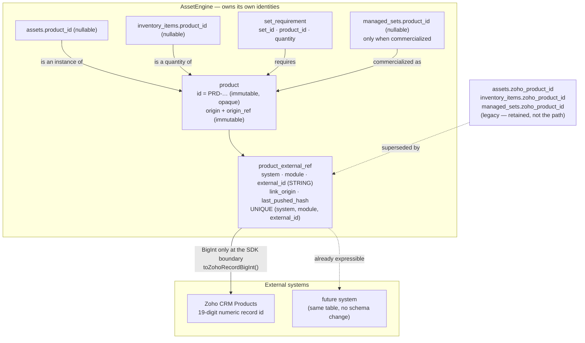
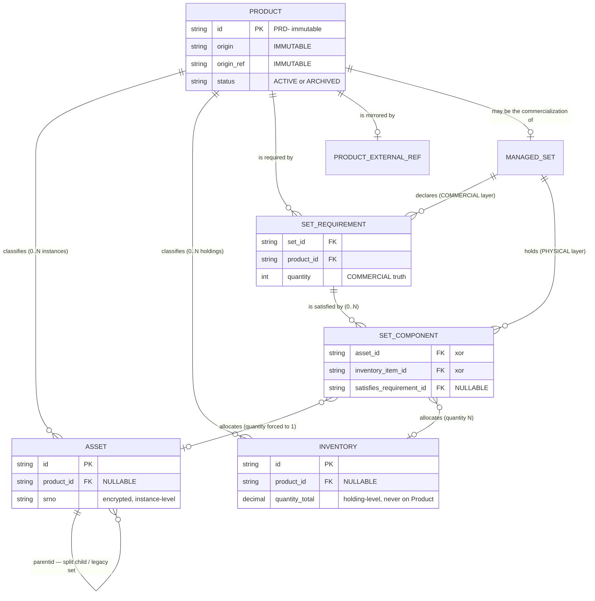
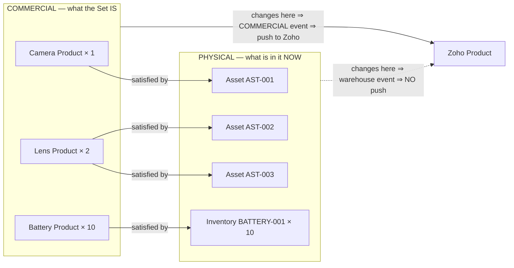
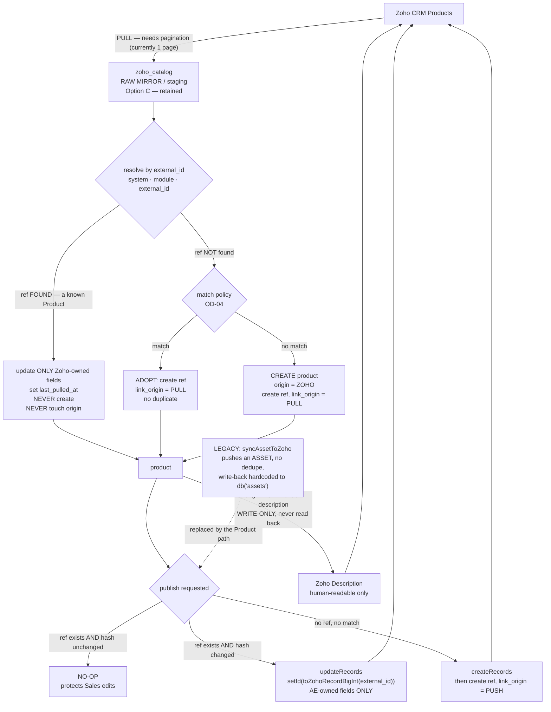
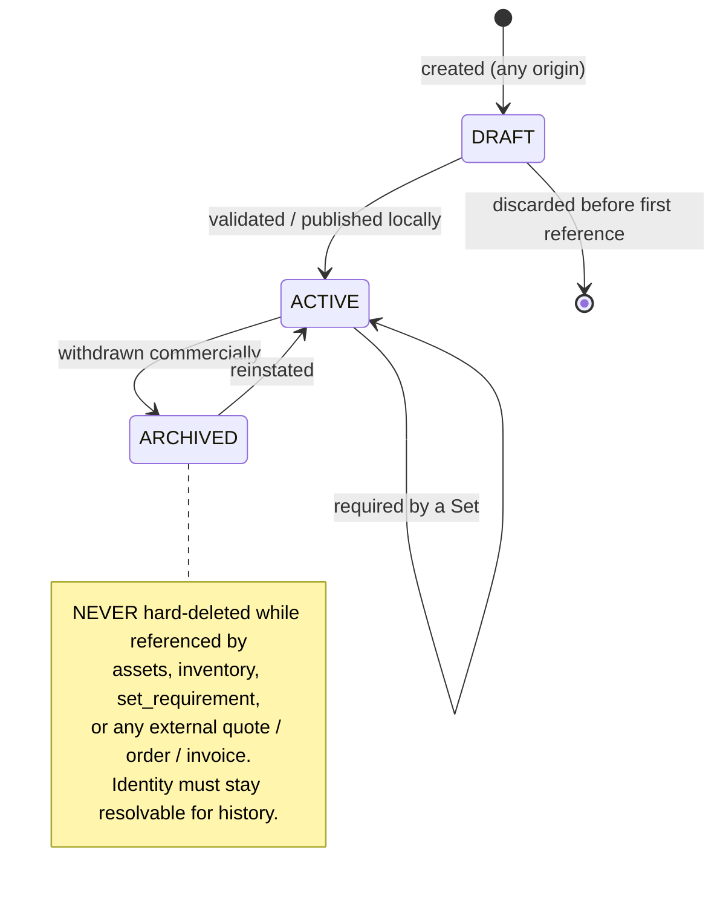
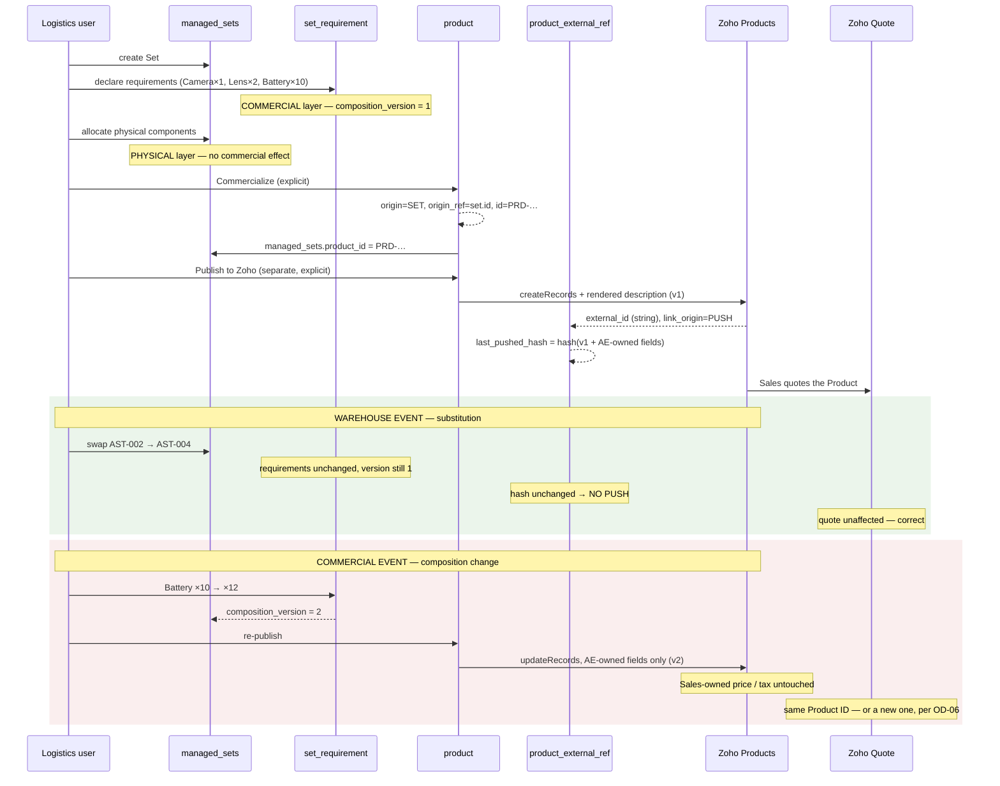
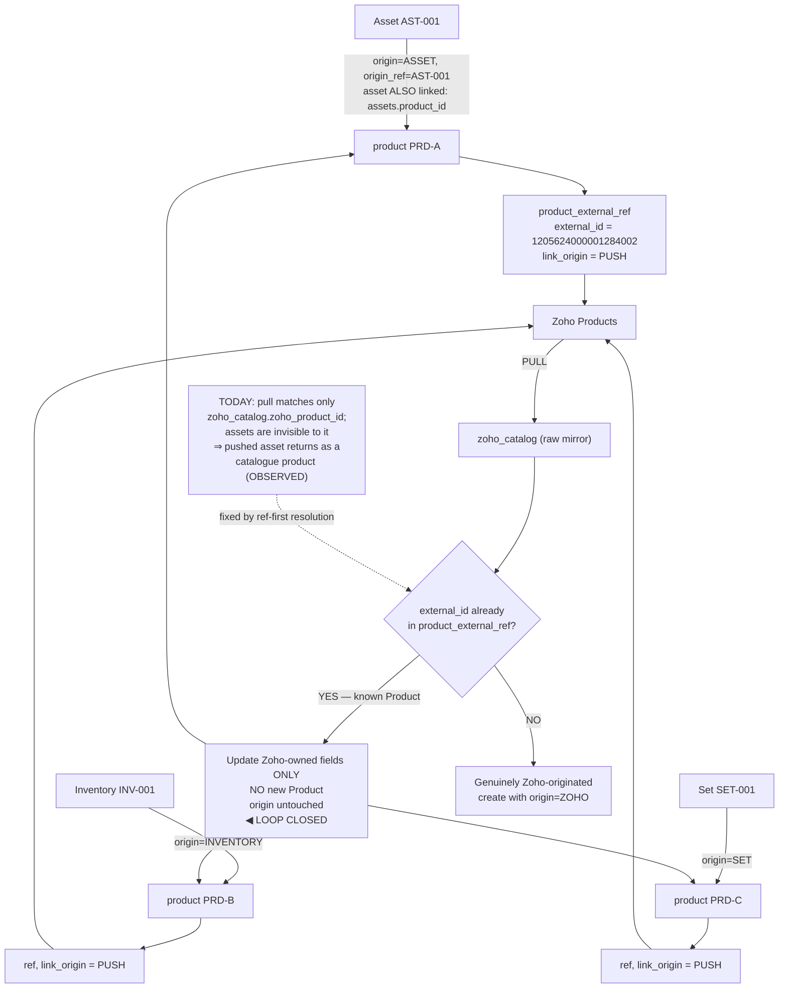

# AssetEngine Product Entity — Architecture Decision Document

**Status:** PROPOSED — awaiting business sign-off
**Date:** 26 August 2026
**Scope:** Conceptual, data and integration architecture for the missing AssetEngine Product entity
**Not in scope:** Implementation, schema changes, migrations, synchronisation code

**Evidence base:**
- [`docs/ASSETENGINE_COMPLETE_ARCHITECTURE_AUDIT.md`](./ASSETENGINE_COMPLETE_ARCHITECTURE_AUDIT.md)
- [`docs/PRODUCT_INTEGRATION_AUDIT.md`](./PRODUCT_INTEGRATION_AUDIT.md)
- Live production schema, `192.168.6.237` / `asset_manager` (read-only inspection)
- Source: `web-app/asset-manager-backend`, `web-app/asset-manager-frontend`

**Constraints honoured.** No code, schema, migration, production data, Zoho record, OAuth configuration or UI was modified. No table renamed, no column dropped. No Zoho API call made. Nothing implemented.

> **Reading rule.** Every architectural claim about the *current* system carries file, line, table, column or route evidence. Every claim about the *proposed* system is a recommendation for review. Where the evidence does not settle a business rule, it is marked **OPEN DECISION** and listed in §10 rather than assumed.

---

## Table of contents

**Part I — Definition**
1. Why this document exists
2. What an AssetEngine Product is
3. Why requirement and allocation must not be collapsed
4. Product versus the classification axes that already exist

**Part II — Structure**
5. Product origins
6. Identity architecture
7. Provenance and loop prevention
8. Asset ↔ Product
9. Inventory ↔ Product
10. Set ↔ Product
11. Set → Product → Zoho
12. Zoho → AssetEngine Product
13. AssetEngine → Zoho Product
14. Zoho co-management and field ownership
15. Future role of `zoho_catalog`
16. Product and quotations
17. Dependencies on other entities

**Part III — Mandated outputs**
1. Final proposed Product model
2. Product identity diagram
3. Product ↔ Asset ↔ Inventory ↔ Set relationship diagram
4. Zoho ↔ AssetEngine Product sync diagram
5. Product origin matrix
6. Field ownership matrix
7. Product lifecycle
8. Set → Product commercialization flow
9. Provenance / loop-prevention model
10. Open business decisions
11. ADR-PRODUCT-001 onward
12. Implementation prerequisites

---

# PART I — DEFINITION

## 1. Why this document exists

The audits established four facts that make a Product entity unavoidable rather than desirable.

**There is no Product entity.** A live schema search for `%product%`, `%catalog%`, `%sku%`, `%item_master%` returns exactly one table, `zoho_catalog`, which is a read-only mirror of one page of the Zoho Products module.

**The one identifier that exists means opposite things on different tables.** `assets.zoho_product_id` has exactly one writer in the codebase — the push write-back at `zohoService.js:901-903` — so it records *"this asset was published into Zoho."* `inventory_items.zoho_product_id` has exactly one writer path, a client-supplied value from the catalogue picker at `server.js:5029`, so it records *"this item was instantiated from that product."* Same column name, reversed causation, no provenance marker to tell them apart.

**The consequence is already in production.** Asset `HAR-MUM-0726-55QOFA-R` was pushed on 20 August, became Zoho Product `1205624000001284002`, and the 21 August pull returned it as `zoho_catalog` row "Trimble Bullet 720". One physical asset is now offered in the catalogue picker as if it were a purchasable product type. This is not a hypothetical loop; it is a row in the database.

**Five of seven identity chains the business needs route through an identifier that does not exist.** Every chain in the brief that passes through "AssetEngine Product ID" is currently unrepresentable.

This document defines the entity, its relationships, and the decisions that must be made before any of it is built.

---

## 2. What an AssetEngine Product is

### 2.1 Definition

> **An AssetEngine Product is a commercial catalogue identity: a stable, named, sellable-or-procurable *type* of thing, owned jointly by Sales and Logistics, which physical Assets and Inventory holdings may be instances of, and which may be projected into external systems such as Zoho CRM.**

Four properties follow from that definition and are load-bearing for everything below.

**A Product is a type, never an instance.** It has no serial number, no location, no condition, no quantity on hand, no assignment and no status in the physical sense. The moment a Product acquires any of those, it has stopped being a Product and become an Asset or an Inventory holding.

**A Product has commercial identity, not physical identity.** Its name, code, price, tax treatment and description exist so that something can be quoted, ordered, invoiced and procured. This is why the identity must remain stable across warehouse events — see §16.

**A Product is externally projectable but not externally owned.** It may exist in AssetEngine before it exists in Zoho, or the reverse. Neither system is unilaterally authoritative, which is the whole substance of §14.

**A Product is a long-lived reference record.** It is referenced by transactions (quotes, orders, receipts) that must remain interpretable years later. This is why deletion must be soft and identity immutable — see ADR-PRODUCT-014.

### 2.2 What a Product is explicitly not

| Product is **not** | Because | Current confusion in the code |
|--------------------|---------|-------------------------------|
| An Asset | An Asset is one physical holding with a serial, location and status | An asset pushed to Zoho *becomes* a Zoho Product (`zohoService.js:520`), and comes back as a catalogue product (§1) |
| An Inventory holding | Inventory carries quantity; a Product carries none | Catalogue selection copies price and attributes into the item as a frozen snapshot (`inventory.js:1577-1582`) |
| A Set | A Set is a composition with a mutable membership and its own lifecycle | `managed_sets.zoho_product_id` implies a set *is* a product; nothing writes it (`kitSetService.js:246`) |
| A Kind / Category | Kinds are a navigation taxonomy (`asset_kinds`, 11 rows, primary key on **`name`**) | Product, Kind, Type, Category, Make and Model are six overlapping axes — see §4 |
| A Zoho record | The Zoho record is a *projection* of the Product into one external system | `zoho_catalog` primary key is the Zoho ID, so today the Zoho record *is* the local identity |
| A quantity or price | Both are attributes *of* something else at a point in time | `zoho_catalog.unit_price` is 0.00 on 201 of 202 rows, so price is not usefully carried today either |

### 2.3 The minimum attribute set

Proposed. Each entry notes whether the concept already exists somewhere.

| Attribute | Purpose | Exists today? |
|-----------|---------|---------------|
| `id` | AssetEngine-owned immutable identity | **No** |
| `name` | Human-readable commercial name | As `zoho_catalog.product_name`, `assets.itemname` |
| `code` (SKU) | Stable commercial key | As `zoho_catalog.sku` — populated on **3 of 202 rows** |
| `description` | Commercial description | As `zoho_catalog.description` |
| `make`, `model` | Manufacturer identity | Free text on items and catalogue (202/202 populated) |
| `hsn_code` | Tax classification | Columns on `assets`, `inventory_items`, `zoho_catalog`; local `hsn_codes` table is **empty** |
| `unit` | Unit of measure for the type | Only as `quantity_unit` on holdings — free text, no registry |
| `origin`, `origin_ref` | Provenance (§7) | **No** |
| `status` | ACTIVE / ARCHIVED | Only `zoho_catalog.is_active`, which **no code ever writes** |
| `is_serialised` | Whether instances carry serials | **No** — OPEN DECISION OD-11 |
| Audit columns | `created_at/by`, `updated_at/by` | Partially, inconsistently |

Deliberately **excluded**: quantity, price-as-truth, location, serial, condition, assignment, project. Unit price is discussed under field ownership (§14) because it is co-managed and contested.

---

## 3. Why requirement and allocation must not be collapsed

This is the single most consequential distinction in the document.

### 3.1 The two layers

Using the brief's example:

```
SET "Camera Kit"

  COMMERCIAL / REQUIREMENT LAYER          what the Set IS
    Camera  Product × 1
    Lens    Product × 2
    Battery Product × 10

  PHYSICAL / ALLOCATION LAYER             what is in it RIGHT NOW
    Camera  → Asset AST-001
    Lens    → Asset AST-002
    Lens    → Asset AST-003
    Battery → Inventory BATTERY-001, quantity 10
```

### 3.2 What exists today

Only the lower layer, and in a constrained form. `managed_set_components` has foreign keys to `assets.id` and `inventory_items.id`, and its `component_type` check constraint permits exactly `'ASSET'` and `'INVENTORY'`. There is no product-level component and no place to record a requirement.

Two constraints observed in the live schema shape everything that follows:

```
managed_set_components_asset_quantity_check
    CHECK (component_type <> 'ASSET' OR quantity = 1)

managed_set_components_asset_id_active_unique
    UNIQUE (asset_id) WHERE asset_id IS NOT NULL AND is_active = true
```

The first means "Lens × 2" cannot be one row — it must be two. The second is a **global** unique, not per-set: one asset can belong to at most one active Set anywhere in the system.

### 3.3 Why collapsing them breaks the business

**Warehouse substitution would look like a commercial change.** If `AST-002` goes for repair and `AST-004` takes its place, the Set is commercially identical — same products, same quantities, same thing delivered to the customer. With only one layer, that swap is indistinguishable from replacing a Canon lens with a Sony one. The system must then either push to Zoho on every substitution, rewriting the commercial record for a warehouse event, or push on none and miss real changes. There is no third option, because the data cannot tell the two apart. The Product Integration Audit §14.3 records this as the decisive gap.

**A Set could not be defined before it is stocked.** Sales needs to quote "Camera Kit" before Logistics has allocated serial numbers. A requirement layer can be complete while allocation is empty; a single layer cannot express intent at all.

**Shortfall becomes invisible.** "Requires 10 batteries, 6 allocated" is a computable, actionable statement only if the requirement is recorded independently. Today there is nothing to compare against.

**Quotation traceability collapses.** A quote raised in March referenced a commercial composition. If the only record of composition is the current allocation, the March composition is unrecoverable — the more so because `kitSetService` writes **no history of any kind** (the v2 migration states this explicitly at line 15).

**The asset-quantity-1 constraint forces conflation.** "Lens × 2" as two allocation rows means the requirement quantity is implicit in the row count. Deallocating one lens silently changes the apparent requirement from 2 to 1.

### 3.4 Proposed separation

| Layer | Where it lives | Cardinality | Changes when |
|-------|----------------|-------------|--------------|
| **Requirement** | New `set_requirement` — `set_id`, `product_id`, `quantity`, `unit` | One row per required Product | The commercial definition changes |
| **Allocation** | Existing `managed_set_components`, plus a nullable `satisfies_requirement_id` | One row per physical holding | The warehouse changes |

The link column is what makes shortfall computable and substitution detectable. It must be nullable, because allocations that satisfy no declared requirement already exist in production and must not be invalidated.

**This same separation is what Projects will need** (§17). It should not be designed as a Set-only concept.

---

## 4. Product versus the classification axes that already exist

Introducing Product adds a sixth way to say what something is. Ignoring the five that exist would create the same overlap the audits already criticise, so the relationship must be stated.

### 4.1 What exists

| Axis | Storage | Live shape | Keyed by |
|------|---------|------------|----------|
| **Kind** (assets) | `asset_kinds` | 11 rows, hierarchical via `parentname` | **`name`** — the primary key is the display string |
| **Kind** (inventory) | `inventory_kinds` | 2 rows, FK to folder, self-FK parent | `id` |
| **Type** | `assets.type` | Free text | — |
| **Category** | `assets.category` | Free text | — |
| **Make** | `assets.make`, `inventory_items.make`, `zoho_catalog.make` | Free text, 202/202 populated in catalogue | — |
| **Model** | same three tables | Free text, 202/202 populated | — |

`inventory_items.kindid` is a genuine foreign key with `ON DELETE RESTRICT` — the audits identified it as the only strongly-typed taxonomy link in the system. `asset_kinds` being keyed on `name` is a cautionary example: renaming a kind breaks every reference to it, which is precisely the failure mode a Product ID must avoid.

### 4.2 Proposed relationship

**Product does not replace Kind.** They answer different questions at different granularities:

- *Kind* answers "where does this live in the navigation tree?" — Camera, Lens, Battery. Coarse, hierarchical, internal.
- *Product* answers "what commercial item is this?" — Sony FX6 Body, Canon RF 24-70mm f/2.8. Fine, flat, externally shared.

A Product may optionally reference a Kind so navigation still works, and Kind remains the taxonomy for items that have no Product.

**Make and Model should migrate to being Product attributes.** They are properties of a type, not of an instance: two Sony FX6 bodies necessarily share make and model. Today they are duplicated on every row and free-text on all of them.

**However, the existing columns must be retained.** Four production assets have make and model but no product; the columns are read by DC descriptions, search (`server.js:3267`, `3279`), the Zoho push (`zohoService.js:550-551`) and reporting. The proposal is that once an item has a `product_id`, the Product becomes authoritative for make and model and the item columns become a denormalised snapshot — not that anything is dropped.

**`type` and `category` are out of scope.** They are legacy free-text and should be dealt with separately.

The precise Kind/Product coupling is **OPEN DECISION OD-12**.

---

# PART II — STRUCTURE

## 5. Product origins

The brief asks whether all five origins are necessary rather than assuming so. They are, but not symmetrically: three are distinct creation mechanisms, and two are provenance markers on a shared mechanism.

### 5.1 Assessment

| Origin | Necessary? | Reasoning |
|--------|-----------|-----------|
| **ZOHO** | **Yes — required** | Already live. `syncProductsFromZoho` populates 202 rows. The business explicitly requires Sales to create Products in Zoho while quoting. |
| **MANUAL** | **Yes — required** | Logistics must catalogue a Product before any physical item exists — the Receipt Note flow (PO line → Product → Inventory) has no other entry point. Also the only viable path for backfilling the existing catalogue. |
| **SET** | **Yes — required** | Stated business requirement: a Set may be commercialized. Needs its own origin because the resulting Product's composition is *derived*, which changes update semantics (§11). |
| **ASSET** | **Yes — as provenance, not as a distinct mechanism** | See §5.2. |
| **INVENTORY** | **Yes — as provenance, not as a distinct mechanism** | See §5.2. |

### 5.2 Why ASSET and INVENTORY are provenance, not separate mechanisms

Creating a Product "from an asset" is, mechanically, creating a Product whose attributes are seeded from that asset's `itemname`, `make` and `model`. That is identical to MANUAL creation with a pre-filled form. The origin still needs to be recorded separately, for two reasons that the audits demonstrate.

**Loop prevention requires it.** Without a marker, the next catalogue pull cannot tell that Zoho Product `1205624000001284002` is the projection of one physical asset rather than a purchasable product type. That is exactly how "Trimble Bullet 720" came to sit in the catalogue picker.

**It records an inference, and inferences can be wrong.** An asset-originated Product asserts "this instance implies a type exists." That inference may later prove incorrect — two assets thought to be the same model may differ. Knowing which Products were inferred from single instances, and from which instance, is what makes that correctable.

There is a discipline that follows and matters more than the origin label: **the originating item must be linked to the new Product** (`assets.product_id` set to it). If a second identical asset appears, it should be linked to the *existing* Product, not trigger another creation. This single rule is what prevents the duplicate proliferation the audit documents at `zohoService.js:554-562`, where every unlinked asset creates a fresh Zoho Product.

### 5.3 Per-origin contract

Full matrix in Part III §5. In prose:

**ZOHO-originated.** Created by the catalogue pull when a Zoho record ID has no existing `product_external_ref`. Zoho is authoritative for commercial fields. An AE Product ID is generated; the external ref is created with `link_origin = PULL`. Nothing is pushed back — the Product already exists in Zoho. Assets and Inventory may be linked to it; it may be required by a Set; it may not itself become a Set-derived Product.

**MANUAL-origin.** Created by a Logistics user. AssetEngine is authoritative until first push. On push, a Zoho Product is created and the external ref is written with `link_origin = PUSH`. Fully linkable and Set-usable.

**ASSET / INVENTORY origin.** Created by a Logistics user from a specific holding, recording `origin_ref` = that holding's ID. AssetEngine authoritative until first push. **The originating holding is linked to the Product as part of the same operation.** These Products should be marked as instance-derived so the catalogue picker can treat them differently from Zoho-sourced product types — the visibility rule is **OPEN DECISION OD-08**.

**SET-origin.** Created by explicitly commercializing a Set (§11), recording `origin_ref` = `managed_sets.id`. The Product's description is *rendered* from the Set's requirement layer; the structured composition stays in AssetEngine and is never read back from Zoho's free text. A Set-derived Product should not itself be required by another Set until Super Sets are designed — **OPEN DECISION OD-13**.

`origin` and `origin_ref` are immutable once set. They describe how the record came into being, which cannot change retrospectively.

---

## 6. Identity architecture

### 6.1 Requirements

1. AssetEngine generates its own Product ID, independent of Zoho.
2. That ID is immutable and opaque — no embedded semantics that can go stale.
3. Zoho IDs are stored as strings and converted to BigInt only at the SDK boundary.
4. One Product must be able to carry references into more than one external system.
5. `zoho_product_id` must not be reused as the general-purpose product reference.

Requirement 3 is not theoretical. Production Zoho IDs such as `1205624000001284002` are 19 digits; `Number.MAX_SAFE_INTEGER` is 16. `zoho_sync_logs` records three `PUSH_ASSET` failures reading `KEY: id EXPECTED TYPE: BigInt` before the fix landed on 24 August. The existing `toZohoRecordBigInt` (`zohoService.js:105-123`), called at the single `setId` boundary at line 557, is the correct pattern and should be the model for every future boundary.

### 6.2 Product ID format

Recommendation: a dedicated generator, distinct prefix, no embedded business meaning — for example `PRD-` plus a monotonic or random component.

Two existing mistakes to avoid, both evidenced:

- **Do not key on name.** `asset_kinds` has its primary key on `name`; renaming a kind breaks every reference. Product names change routinely (Sales renames for quotes), so a name-derived key is disqualified.
- **Do not reuse `generateModernAssetId`.** It embeds location and type codes from hardcoded dictionaries in `utils.js:171`, and the architecture audit records that assets and inventory already share its ID space with no cross-table uniqueness guard — the only such trigger, `trg_check_assets_dup`, protects `assets` ↔ `components`. Products must not join that ID space.

Whether the code (SKU) is mandatory and unique is **OPEN DECISION OD-03**, and it is consequential: SKU is populated on 3 of 202 catalogue rows, so it cannot currently serve as a match key.

### 6.3 Evaluation of the audit's `product_external_ref`

The Product Integration Audit proposed:

```
product_external_ref
    product_id, system, module, external_id,
    sync_direction, content_hash, last_pulled_at, last_pushed_at
```

**Verdict: adopt the shape, with four modifications.** The core idea is right — separating "what this Product is" from "where it is mirrored" is what allows a Product to precede its Zoho record, to survive Zoho deletion, and to reach a second external system later without schema change.

**Modification 1 — remove `sync_direction`.** Direction is not a property of an identity mapping. Under co-management (§14) direction is decided **per field**, not per record: `Unit_Price` may flow Zoho → AE while `Make` flows AE → Zoho for the very same Product. A single `sync_direction` on the mapping row would either contradict the field policy or be ignored. Field-level policy belongs in configuration, not in the mapping table.

**Modification 2 — rename `content_hash` to `last_pushed_hash`, and define its input precisely.** As named it is ambiguous — a hash of what? It must be *the hash of the payload AssetEngine last pushed*, computed over **only the fields AssetEngine owns**. If Zoho-owned fields were included, every Sales price edit would change the hash and trigger a pointless push that would then overwrite the very edit that caused it. That is a self-inflicted overwrite loop, and the field list is the guard against it.

**Modification 3 — add `link_origin`.** The mapping needs to record whether the link was created by a pull or by a push. This is *provenance of the link*, distinct from `product.origin`, which is provenance of the Product. Both matter: a MANUAL Product later matched to a pre-existing Zoho record has `origin = MANUAL` but `link_origin = PULL`, and the two facts drive different conflict rules.

**Modification 4 — state both uniqueness constraints explicitly.** `UNIQUE (system, module, external_id)` is required, and non-negotiable: it is the constraint that makes the loop-prevention rule in §7 enforceable at the database level rather than in application logic. Whether `UNIQUE (product_id, system, module)` also holds is the 1:1-versus-1:N question and is **OPEN DECISION OD-05**.

`last_pulled_at` and `last_pushed_at` are retained as-is.

**Rejected alternative — a plain `zoho_product_id` column on `product`.** Simpler, and wrong for three reasons: it hard-codes one external system into the core entity; it cannot express two references; and it repeats the exact mistake being corrected, where one column silently carries several meanings.

---

## 7. Provenance and loop prevention

### 7.1 The question the system must answer

> Given a Zoho Product arriving on a pull: is this an AssetEngine Product coming home, or a genuinely new Zoho-originated Product?

Today the answer is unobtainable. The pull matches only on `zoho_catalog.zoho_product_id` (`zohoService.js:781`) and has no visibility of assets at all, which is why a pushed asset returns as a catalogue product.

### 7.2 Two independent facts, deliberately separated

| Fact | Where it lives | Mutable? | Answers |
|------|----------------|----------|---------|
| **Product provenance** | `product.origin` + `product.origin_ref` | **No** | "How did this Product come to exist?" |
| **Link provenance** | `product_external_ref.link_origin` | No | "How did this Product come to be connected to that Zoho record?" |

Keeping them separate matters because they legitimately disagree. A Logistics user may create a MANUAL Product and later discover Sales already has a matching Zoho record; linking them yields `origin = MANUAL`, `link_origin = PULL`. Collapsing the two would lose the fact that AssetEngine defined the Product first, which is what determines who wins on a field conflict.

### 7.3 The loop-prevention rule

**On pull, resolve by external ID before anything else.**

```
for each Zoho Product record:
    ref = find product_external_ref
              where system='ZOHO_CRM' and module='Products'
                and external_id = <zoho record id>

    if ref exists:
        → this is a KNOWN Product, whatever its origin
        → update ONLY Zoho-owned fields on the existing Product
        → set last_pulled_at
        → NEVER create a Product
        → NEVER alter origin or origin_ref

    if ref does not exist:
        → candidate NEW Zoho-originated Product
        → apply matching policy (OPEN DECISION OD-04)
        → on no match: create Product with origin='ZOHO', link_origin='PULL'
```

This single rule closes loops A, B, C and D from the Product Integration Audit §13, because in every one of them the returning record already carries an external ref created by the push. The `UNIQUE (system, module, external_id)` constraint makes it enforceable rather than merely intended.

Applied to the live example: asset `HAR-MUM-0726-55QOFA-R` is pushed, creating a Product with `origin = ASSET`, `origin_ref = HAR-MUM-0726-55QOFA-R`, and an external ref for `1205624000001284002` with `link_origin = PUSH`. The 21 August pull finds that ref, recognises a known Product, updates only Zoho-owned fields, and creates nothing. The catalogue is not polluted.

### 7.4 Sync logs are not the source of truth

The brief requires this and the evidence supports it. `zoho_sync_logs` holds 14 rows with no retention policy, no index on `zoho_id`, no uniqueness, and gaps by construction — `syncDealsFromZoho` never calls `logSync` at all, and `logSync` failures are swallowed at `zohoService.js:607-609`. It is a diagnostic trail. Provenance must be a column on the entity, durable and queryable, and the log remains useful only for reconstructing what happened.

### 7.5 A second-order risk: description round-tripping

The audit records that the push writes composition into Zoho's `Description` (`zohoService.js:493-501`) and the pull reads `Description` back into `zoho_catalog.description` (`zohoService.js:764`). For a Set-derived Product this creates a path where a rendered, human-readable composition could be pulled back and treated as data.

**Rule: the rendered description is write-only.** For Products with `origin = 'SET'`, the pull must never overwrite the structured composition, and must not treat `Description` as anything but display text. This is the concrete form of the brief's instruction that Zoho free text is not the source of truth for Set composition.

---

## 8. Asset ↔ Product

### 8.1 Answers

| Question | Proposed answer | Basis |
|----------|-----------------|-------|
| Can one Product have many Assets? | **Yes.** Ten Sony FX6 bodies are ten Assets of one Product. | Core to the type/instance split |
| Can one Asset have more than one Product? | **No.** At most one. | An item that is commercially several things is a Set |
| Can an Asset exist without a Product? | **Yes — must.** Nullable. | All 4 production assets would otherwise be invalid; backfill impossible |
| Can an Asset change Product? | **Yes, with history.** | Misclassification correction is legitimate; silent change is not |
| What happens on split? | **Children inherit the parent's `product_id`.** | Splitting changes how many, never what |
| What happens on break-set? | Children keep their own `product_id`; the container's Product, if any, is separate. | Legacy sets are containers, not types |
| Does the relationship represent type, commercial identity, or both? | **Both, deliberately.** | See §8.2 |
| What happens on Asset → Inventory conversion? | **`product_id` is the invariant that must survive.** | See §8.3 |

### 8.2 On "type or commercial identity"

The brief asks whether the Product relationship denotes the physical item's type or its commercial identity. The proposed answer is *both, and that is intentional* — the Product is the single place where the two coincide. Splitting them into "technical type" and "commercial identity" would create two catalogues to reconcile, and nothing in the audited system or the stated business need requires that separation. If a genuine case appears later (one physical model sold under two commercial identities), it is expressible by two Products sharing make and model, without a schema change.

### 8.3 Why conversion is the strongest argument for Product

The architecture audit states plainly that true Asset ↔ Inventory conversion does not exist. The Product Integration Audit explains why it cannot yet be designed: there is no invariant to preserve across the boundary. Asset IDs and Inventory IDs are generated by the same function into the same space; serials are encrypted on one side and plaintext on the other; quantity semantics differ.

`product_id` supplies the missing invariant. Converting a holding from Asset to Inventory changes *how it is tracked* while `product_id` proves *what it still is*. Without that, conversion is indistinguishable from delete-and-recreate.

**Split contract, stated precisely.** Children inherit `product_id`; they do **not** inherit any external reference, and inheritance must not trigger a push. Under current behaviour, splitting an asset into five children yields five assets with no `zoho_product_id`, each of which creates its own Zoho Product on push (`zohoService.js:554-562`). Under the proposal all five share one Product and one Zoho record — which is correct, because they are five instances of one type.

`unsplit` remains a data-loss path — it hard-deletes the child row at `server.js:11686` — and Product does not fix that. Noted as a prerequisite, not solved here.

---

## 9. Inventory ↔ Product

### 9.1 Answers

| Question | Proposed answer | Basis |
|----------|-----------------|-------|
| Can one Product have many Inventory records? | **Yes.** Different locations, batches, purposes. | Required by multi-location stock |
| Can one Inventory record hold many units of one Product? | **Yes — that is its purpose.** | `quantity_total` / `quantity_available` |
| Can one Inventory record hold several Products? | **No.** One row, one Product. | Otherwise quantity is meaningless |
| How does quantity relate to Product? | **It does not.** Quantity belongs to the holding. Stock on hand is derived by aggregation, never stored on the Product. | A Product with a quantity would be a stock record |
| How does serialisation relate? | **Serials belong to the physical layer.** A Product may declare *whether* instances are serialised; it never holds a serial. | Serials live on `assets.srno`, `inventory_items.srno` |
| Inventory broken into individual rows? | Each resulting row keeps the same `product_id`. | Same reasoning as split |
| Inventory → Asset conversion? | `product_id` survives; tracking mode changes. | §8.3 |
| Can Inventory exist without a Product? | **Yes — must.** Nullable. | The single production item has no product ID |

### 9.2 Serialisation is a Product-level policy, an instance-level value

Whether a type is serialised is a property of the type: cameras are, cable ties are not. Which serial a given unit carries is a property of the unit.

This distinction is worth flagging because the audits show the current model cannot express either cleanly. Asset serials are encrypted (`encryptionService.encryptDeterministic`), inventory serials are plaintext, batch assets concatenate many serials into one `srno` string parsed with `split(/[\n,]+/)`, there is no uniqueness constraint on any serial column anywhere, and quantity is force-synced to serial count only at serial split (`server.js:11532`).

An `is_serialised` flag on Product would give the first structural basis for validating any of this — which is also why adding it now, before serial architecture is decided, risks encoding an assumption. **OPEN DECISION OD-11.**

### 9.3 Stock quantities and Zoho

Zoho Products carry `Qty_in_Stock`. AssetEngine has never written it, and this proposal does not change that: publishing stock levels to CRM is a business decision with real consequences (Sales quoting against stale availability). **OPEN DECISION OD-14.**

---

## 10. Set ↔ Product

### 10.1 The ten questions

| # | Question | Proposed answer |
|---|----------|-----------------|
| 1 | Where do Product requirements belong? | New `set_requirement`: `set_id`, `product_id`, `quantity`, `unit` |
| 2 | Where do physical allocations belong? | Existing `managed_set_components`, unchanged, plus nullable `satisfies_requirement_id` |
| 3 | How is Product-level composition maintained? | Edited directly by Logistics/Sales as the commercial definition. Changing it is a commercial event |
| 4 | How is physical allocation maintained? | Existing add/remove component APIs. Changing it is a warehouse event |
| 5 | How do substitutions work? | Replace the allocation row, leave the requirement untouched. Requirement unchanged ⇒ no commercial change ⇒ **no Zoho push** |
| 6 | Effect of changing a physical Asset on the Product composition? | **None.** This is the whole point of §3 |
| 7 | Effect of changing the required Product? | Commercial change: composition version increments, Set-derived Product needs a Zoho update |
| 8 | How is Set history preserved? | **It is not, today** — hard prerequisite, see §10.3 |
| 9 | How does a Set become a Product? | Explicit commercialization (§11) |
| 10 | How does the resulting Product stay linked? | `product.origin = 'SET'`, `origin_ref = managed_sets.id`, plus `managed_sets.product_id` |

### 10.2 Composition versioning

A quote references a commercial composition at a point in time. To answer "what did we quote in March?", the requirement layer needs a version.

Proposed: a monotonic `composition_version` on the Set, incremented **only** on requirement changes — never on allocation changes — with an append-only history of requirement rows. The pushed Zoho description records the version it was rendered from, so a quote can be traced back.

This is also what makes `last_pushed_hash` (§6.3) meaningful for Set-derived Products: hash the rendered composition, and a push happens only when the commercial content actually changed.

### 10.3 The blocking gap: Sets have no history

`kitSetService.js` writes to no history, audit or event table. The v2 migration states this as an explicit design choice at line 15. Consequences already recorded in the architecture audit:

- Component removal is a soft flag (`is_active = false`) with no actor, no reason and no removal timestamp.
- Archiving deactivates components; restoring does **not** reactivate them (`archiveSet` at 431-451, `restoreSet` at 454-467), so archive/restore silently loses membership. Production shows 11 of 12 component rows inactive.
- The global unique on active `asset_id` means one asset is in at most one active Set, so Super Sets and shared allocations are refused outright.

**Commercializing a Set whose membership history cannot be reconstructed produces a commercial record that cannot be audited.** Set history is therefore a prerequisite for §11, not a follow-up.

### 10.4 Why Set Product ≠ Set ID

The brief asks this explicitly. Four independent reasons:

**Different lifecycles.** A Set moves through DRAFT → ACTIVE → ARCHIVED (enforced by `managed_sets_status_check`). A Product referenced by a paid invoice must remain interpretable after the Set is archived. If the identities were one, archiving the Set would archive the commercial record.

**Different cardinality.** One Set may reasonably yield several commercial Products — a sale variant and a rental variant of the same kit, at different prices. One identity cannot carry two.

**Different mutability.** Set membership changes constantly. A Product referenced by quotes, orders and invoices must be stable (§16).

**Different existence conditions.** Sets exist that will never be commercialized — internal configurations, staging groups. Production has seven Sets and zero commercial Products. Forcing every Set to be a Product would create commercial records for warehouse bookkeeping.

The relationship is therefore a nullable reference (`managed_sets.product_id`), not an identity.

---

## 11. Set → Product → Zoho

### 11.1 Lifecycle

```
SET (managed_sets) with a populated requirement layer
   │
   │  explicit user action: "Commercialize"      ← never automatic
   ▼
ASSETENGINE PRODUCT
   origin = 'SET'
   origin_ref = <managed_sets.id>
   name / code / description authored or rendered
   managed_sets.product_id = <product.id>
   │
   │  explicit user action: "Publish to Zoho"    ← separate step
   ▼
ZOHO PRODUCT
   product_external_ref (system='ZOHO_CRM', module='Products',
                         external_id=<zoho id>, link_origin='PUSH')
   Description = human-readable rendering of the requirement layer
   last_pushed_hash = hash(rendered composition + AE-owned fields)
   │
   ▼
available to Zoho Quotes, Sales Orders, Invoices
```

Commercialization and publication are deliberately two steps. A Product may legitimately exist in AssetEngine without being in Zoho, and forcing a network call into the commercialization act makes an irreversible business event fail on a transport error.

### 11.2 Decisions within the flow

| Question | Proposed answer |
|----------|-----------------|
| When is the Product created? | On explicit commercialization. Never as a side effect of creating a Set |
| Is the Product ID permanent? | **Yes.** Immutable for the life of the record |
| Do Set changes create a new Product or update the existing one? | **Allocation changes: neither.** Requirement changes: update in place by default. Whether a sufficiently large change should mint a *new* Product is **OPEN DECISION OD-06** |
| How does a Product know which Set created it? | `origin = 'SET'`, `origin_ref = managed_sets.id`, immutable |
| How are historical Set versions preserved? | `composition_version` plus append-only requirement history (§10.2) — **does not exist today** |
| How are Sales edits protected? | Field ownership (§14): the push writes only AE-owned fields, and only when `last_pushed_hash` changes |
| How are Logistics changes represented? | Requirement changes bump the version and re-render the description; allocation changes do neither |
| How does Zoho receive the readable form? | Rendered into `Description` from the requirement layer — write-only (§7.5) |
| How does AssetEngine know which Zoho Product corresponds? | `product_external_ref`, not `managed_sets.zoho_product_id` |

### 11.3 The existing `managed_sets.zoho_product_id`

The column exists with a partial unique index (`managed_sets_zoho_product_id_unique WHERE zoho_product_id IS NOT NULL AND btrim(...) <> ''`), and nothing writes it — `createSet` hardcodes `null` at `kitSetService.js:246`, and `updateSet` accepts only `name`, `description`, `set_code` at 270-276. All seven production Sets have it null.

Proposal: the new architecture uses `managed_sets.product_id` → `product_external_ref` and treats `managed_sets.zoho_product_id` as superseded. Per the constraints, **it is not dropped**. The existing partial unique index does encode a useful assumption — one Zoho Product per Set — which should be carried forward as a deliberate rule rather than an accident (see OD-05).

---

## 12. Zoho → AssetEngine Product

The Sales-first path. Worked through the brief's example.

```
Sales creates "SONY FX6 CAMERA KIT" in Zoho to raise a Quote
   │
   ▼
POST /api/zoho/sync-products  (existing route, authenticateJWT, server.js:2749)
   │  getRecords → currently ONE page only, no pagination
   ▼
zoho_catalog                      raw mirror retained (§15)
   │
   ▼
resolve by external_id  (§7.3)
   │
   ├── ref exists   → update Zoho-owned fields on the existing Product
   └── no ref       → create Product
                        origin      = 'ZOHO'
                        origin_ref  = null
                        id          = PRD-…            (AE-generated)
                      create product_external_ref
                        external_id = <zoho id>   (stored as STRING)
                        link_origin = 'PULL'
```

| Question | Proposed answer |
|----------|-----------------|
| When does AssetEngine create the Product? | On pull, when no external ref resolves. Whether creation is automatic for all 202 rows or requires review is **OPEN DECISION OD-07** |
| Which ID is generated? | An AssetEngine `PRD-` ID. The Zoho ID never becomes the local primary key — unlike `zoho_catalog` today, where it is |
| How is the Zoho ID attached? | Via `product_external_ref`, as a string. BigInt only at the SDK boundary |
| Can Assets/Inventory be linked afterwards? | **Yes.** This is the main gap being closed: today a Zoho Product can only ever become Inventory, never an Asset, and the shared modal actively forces inventory mode at `dashboard.js:7827-7835` |
| Can it later be required by a Set? | **Yes** — this is precisely what the requirement layer needs |
| Are Sales-created fields protected? | **Yes**, by field ownership (§14). A Zoho-originated Product's commercial fields are Zoho-owned by default |

Two pre-existing defects on this path are recorded because they affect trust in the resulting Products: the pull fetches a single page (empirically 200 rows refreshed on 21 August, two left stale) and `server.js:5029` accepts a client-supplied `ZohoProductId` with no validation whatsoever.

---

## 13. AssetEngine → Zoho Product

The Logistics-first path. The brief instructs that current `syncAssetToZoho` behaviour be treated as legacy, and the audit substantiates why: it can create duplicates and it overwrites Sales edits.

### 13.1 Current versus target

| Aspect | Current (legacy) | Target |
|--------|------------------|--------|
| What is pushed | An **Asset** row (`zohoService.js:520`) | A **Product** |
| CREATE / UPDATE decision | Presence of `assets.zoho_product_id` (554) | Presence of a `product_external_ref` |
| Duplicate prevention | **None** — no name or SKU search before create | Match policy before create (OD-04) |
| Write-back target | Hardcoded `db('assets')` (901) | `product_external_ref` — entity-agnostic |
| Field handling | All five mapped fields overwritten every push | Only AE-owned fields, only when the hash changes |
| Zoho record deleted | UPDATE fails, no fallback; asset permanently unpushable | Detect, then re-create or unlink per OD-10 |
| Split children | Each creates its own Zoho Product | Share one Product and one Zoho record |
| Serials | Kit descriptions embed `srno`, which is **ciphertext** on assets (497) | Excluded from the rendered description |

The hardcoded write-back at line 901 is the most important structural constraint. Any inventory or set push that reused `handleSyncResponse` would write into `assets` under a foreign ID — a silent no-op leaving the item unlinked, so **every subsequent push would create another duplicate Zoho Product.** That is why the write-back must move to `product_external_ref` before any second entity is pushed.

### 13.2 Target push sequence

```
1. Resolve the Product's external ref (system='ZOHO_CRM', module='Products')

2. If a ref exists:
     a. compare current AE-owned payload hash with last_pushed_hash
     b. equal      → NO-OP        (protects Sales edits; avoids pointless writes)
     c. different  → updateRecords with setId(toZohoRecordBigInt(external_id))
                     writing ONLY AE-owned fields
     d. record last_pushed_at, last_pushed_hash

3. If no ref exists:
     a. apply the match policy (OD-04) against zoho_catalog and/or a live search
     b. match found  → create the ref, then follow step 2 (adopt, do not duplicate)
     c. no match     → createRecords, then create the ref with link_origin='PUSH'
```

Steps 2b and 3b are the two guards absent from the current implementation, and between them they address both failure modes the audit documents.

| Question | Proposed answer |
|----------|-----------------|
| When is the Zoho Product created? | On explicit publish, when no ref exists and no match is found |
| How are duplicates prevented? | Ref-first resolution, then a match policy, then `UNIQUE (system, module, external_id)` |
| If a matching Zoho Product exists? | **Adopt it** — create the ref and update. Never create a second |
| If the Zoho Product was deleted? | Detect the API error and surface it. Auto-recreate or unlink is **OPEN DECISION OD-10** |
| If the Asset/Inventory is split? | Nothing. Children share the Product; splitting is not a commercial event |
| If the Product is renamed? | Push if `name` is AE-owned; if Zoho-owned, the rename is a conflict for OD-09 |
| If Sales changes the Product in Zoho? | Zoho-owned fields are pulled in. AE-owned fields are restored on the next push — an intended, documented asymmetry |
| If Logistics changes the physical item? | **No Zoho effect.** Physical attributes are not Product attributes |

---

## 14. Zoho co-management and field ownership

### 14.1 Why neither simple model works

**"AssetEngine owns Product, overwrite Zoho"** is the current behaviour and is already destructive: `syncAssetToZoho` unconditionally rewrites `Product_Name`, `Description`, `Unit_Price`, `Make` and `Model` on every push, with no timestamp comparison and no `Modified_Time` check. A Sales price correction survives exactly until the next Logistics push.

**"Zoho owns Product, AssetEngine mirrors"** is `zoho_catalog` today, and it cannot support the business. Logistics could never create a Product for an unpurchased item, so the Receipt Note flow has no entry point; and the catalogue is demonstrably poor for logistics purposes — SKU on 3 of 202 rows, HSN on 2, a non-zero price on 1.

Co-management therefore requires **field-level ownership**, which is why `sync_direction` was removed from the mapping row in §6.3.

### 14.2 Ownership model

Three ownership classes, plus one hybrid:

| Class | Meaning | Conflict rule |
|-------|---------|---------------|
| **AE-owned** | AssetEngine authoritative; pushed; pull does not overwrite | AE wins |
| **Zoho-owned** | Zoho authoritative; pulled; never pushed | Zoho wins |
| **Origin-dependent** | Owner determined by `product.origin` | ZOHO-origin ⇒ Zoho wins; otherwise AE wins |
| **Local-only** | Never crosses the boundary | n/a |

"Origin-dependent" is what makes genuine co-management workable: a Product Sales invented in Zoho keeps Sales' name, while a Product Logistics catalogued keeps Logistics' name — without needing two entity types.

The full matrix is Part III §6. The contested rows are `name`, `description`, `unit_price` and `code`, and they are contested for a reason: they are exactly the fields both departments legitimately edit. Each is marked OPEN DECISION rather than guessed.

### 14.3 Mechanism, not just policy

Three components make ownership real rather than documentary:

1. **A field-ownership table** the push and pull both consult — configuration, not code.
2. **`last_pushed_hash` over AE-owned fields only** (§6.3), so a Zoho-side edit to a Zoho-owned field never triggers a push that would clobber it.
3. **Conflict logging** when a pull finds a Zoho-side change to an AE-owned field. Silent discard is what the audits criticise elsewhere; the change should be recorded even when policy says AE wins.

Whether a conflict blocks the sync or merely logs is **OPEN DECISION OD-09**.

---

## 15. Future role of `zoho_catalog`

### 15.1 Options

| Option | Assessment |
|--------|------------|
| **A. Keep as the cache, no Product entity** | **Rejected.** This is the status quo; it preserves the ambiguity the brief instructs be removed |
| **B. Replace it with `product`** | **Rejected.** Forces the pull to resolve every row into a Product during a network operation, mixing transport with classification. Also destroys the raw payload needed for field-level conflict detection, and offers nowhere to park the two anomalous rows (§15.3) |
| **C. Retain as a transport/staging mirror; `product` becomes the local entity** | **Recommended** |
| **D. Other** | Considered and not preferred: a generic `external_record_staging` table. Cleaner in the abstract, but it means migrating a working, populated table for no near-term benefit. Revisit when a second external system appears |

### 15.2 Why C

**It separates transport from meaning.** The pull's job becomes "faithfully mirror what Zoho said". Resolving a mirrored row into a Product is a separate, re-runnable, reviewable step. Today those are one loop with per-row upserts and no transaction (`zohoService.js:756-791`), so a mid-loop failure leaves a partial catalogue and no clean retry.

**Field-level conflict detection needs the raw values.** To know whether Zoho changed `Unit_Price` since the last pull, the previous pulled value must be available. The mirror is where that lives.

**Diagnosis needs it.** Reconstructing incidents like the round-tripped asset was only possible because raw pulled rows were still there.

**It is reversible and additive.** Nothing is renamed or dropped, satisfying the constraints, and `GET /api/zoho/catalog` keeps working while the UI is repointed at Product later.

### 15.3 Two rows requiring reconciliation

The mirror currently contains two rows that are not Zoho catalogue products, and both must be dealt with explicitly during backfill:

**`ZP-SAMPLE-0001`** — a seeded fake ("Sample Catalog Product (Hardcoded)", ₹25,000, make CINEOM). Its migration `20260804090000` is gated to `asset_manager_test` at lines 8-14, yet the row exists in production `asset_manager` with `created_at` 6 August. **UNKNOWN how it was inserted** — the same out-of-migration pattern the architecture audit records for the inventory tables. Its non-numeric key means `toZohoRecordBigInt` would reject it (`zohoService.js:119-121`), so anything derived from it can never be pushed. It must not become a Product.

**`1205624000001284002`** — "Trimble Bullet 720", the Zoho projection of asset `HAR-MUM-0726-55QOFA-R`. Under the target model this becomes a Product with `origin = 'ASSET'` and that asset linked to it. Backfilling it as `origin = 'ZOHO'` would permanently mislabel it, so the backfill must cross-check `assets.zoho_product_id` before assigning origin.

A third case is instructive: asset `HAR-MUM-0826-IEIZP5-U` holds `zoho_product_id = 1205624000001313001`, created in Zoho on 25 August, **after** the last pull — so it is in `assets` but not in the mirror. Backfill must therefore read both tables, not just the mirror.

---

## 16. Product and quotations

### 16.1 What must stay stable

```
AssetEngine Set  ──(composition, versioned)──▶  AssetEngine Product
                                                      │
                                          product_external_ref
                                                      │
                                                      ▼
                                              Zoho Product
                                                      │
                                    Zoho Quote ──▶ Sales Order ──▶ Invoice
```

Zoho quote, order and invoice line items reference the **Zoho Product record**. Two identities must therefore never move:

1. **`product.id`** — the AssetEngine anchor. Immutable for life.
2. **`product_external_ref.external_id`** — the Zoho record ID. Once written, never re-pointed at a different Zoho record. Re-pointing would silently change what every historical quote line means.

### 16.2 The substitution rule

> A warehouse substitution must never alter the commercial Product.

Concretely: if a March quote references Camera Kit and in April `AST-002` is swapped for `AST-004`, nothing about the quote, order or invoice may change. The requirement layer is unchanged, `composition_version` does not move, `last_pushed_hash` does not move, and no push occurs.

This is only enforceable because requirement and allocation are separate (§3). With a single layer, the substitution changes the only composition record there is, and the system must either push — rewriting a commercial record referenced by a live quote — or stay silent and lose the ability to detect real changes.

### 16.3 When commercial composition genuinely changes

Here there is a real fork, and it is a Sales decision rather than an architectural one:

- **Update the same Product.** Zoho keeps one record; historical quotes keep their line reference but the current description no longer matches what was quoted.
- **Mint a new Product.** Historical quotes stay accurate; the catalogue accumulates variants and Sales must know which is current.

A defensible middle position is to update in place for changes that do not alter what the customer receives, and mint a new Product when they do — but that boundary is a business rule. **OPEN DECISION OD-06.**

### 16.4 AssetEngine has no quote module

For completeness: the `quotes` table exists but holds four columns (`id`, `zoho_id`, `name`, `created_at`) and **zero rows**. All quote, order and invoice handling is Zoho-side, and the architecture audit found none of those modules integrated. Quote linkage is therefore entirely a Zoho concern, reached only through `product_external_ref` — which is another reason that reference must be stable.

---

## 17. Dependencies on other entities

Product is scoped here, but it is a prerequisite for several things and must not be designed in ignorance of them.

| Entity | Current state | Dependency on Product |
|--------|---------------|-----------------------|
| **Project** | `project_assets` accepts **assets only**; no inventory, no sets. `available-inventory` queries `assets` and references a non-existent column | **Same requirement/allocation split applies.** "This project needs 3 cameras" is a product-level requirement; assignment is allocation. The §3 pattern should be designed for reuse, not as a Set-only concept |
| **Quote / Sales Order / Invoice** | Not integrated. `quotes` is a 0-row stub | Consume Products through Zoho only. Depend on identity stability (§16) |
| **Purchase Order** | Local `project_orders` / `project_order_items` exist. **No Zoho PO integration** | PO lines are commercially product-shaped but reference free-text `itemdescription`. Product would give them a real key |
| **Work Order** | **Does not exist anywhere** | None yet |
| **Receipt Note / GRN** | **Does not exist.** Repo-wide search returns zero matches | **Blocked on Product.** The flow PO line → Receipt → Product → Inventory/Asset has no middle term without it. Product is a hard prerequisite |
| **Set** | `managed_sets` + `managed_set_components`, physical only, no history | Requires the requirement layer (§10) |
| **Kind / taxonomy** | `asset_kinds` (PK on `name`), `inventory_kinds` (FK from items) | Coexists; coupling is OD-12 |
| **Serial architecture** | No uniqueness, mixed encryption, batch serials as delimited text | Product may declare `is_serialised` (OD-11) but cannot repair serial identity |
| **Conversion** | Does not exist | Product supplies the missing invariant (§8.3) |

The two strongest cross-cutting observations: **Receipt Notes cannot be designed before Product exists**, and **Projects will want the same two-layer pattern as Sets**, so building it as Set-specific would guarantee a second implementation later.

---

# PART III — MANDATED OUTPUTS

## 1. FINAL PROPOSED PRODUCT MODEL

Conceptual. Not a migration, not DDL.

```
NEW — product
  id                  AE-generated, immutable, opaque          e.g. PRD-…
  code                SKU / commercial key                     uniqueness → OD-03
  name
  description
  make, model
  hsn_code
  unit                unit of measure for the type             registry → OD-15
  origin              ZOHO | MANUAL | ASSET | INVENTORY | SET   IMMUTABLE
  origin_ref          source AE id when origin is ASSET/INVENTORY/SET   IMMUTABLE
  status              ACTIVE | ARCHIVED                        soft only
  is_serialised       policy flag                              → OD-11
  created_at/by, updated_at/by

NEW — product_external_ref
  product_id          → product.id
  system              'ZOHO_CRM'
  module              'Products'
  external_id         Zoho record id, stored as STRING
  link_origin         PULL | PUSH                              IMMUTABLE
  last_pushed_hash    hash over AE-OWNED fields only
  last_pulled_at, last_pushed_at
  UNIQUE (system, module, external_id)                         ← loop guard
  UNIQUE (product_id, system, module)?                         → OD-05

NEW — set_requirement
  id
  set_id              → managed_sets.id
  product_id          → product.id
  quantity, unit
  sort_order, is_active
  COMMERCIAL LAYER — this is what renders the Zoho description

NEW — product_field_ownership          (configuration, not per-product)
  field, owner (AE | ZOHO | ORIGIN_DEPENDENT | LOCAL), conflict_rule

ADDITIVE, NULLABLE — on existing tables
  assets.product_id            → product.id
  inventory_items.product_id   → product.id
  managed_sets.product_id      → product.id      (commercialized Set)
  managed_set_components.satisfies_requirement_id → set_requirement.id
  managed_sets.composition_version

RETAINED UNCHANGED — nothing renamed, nothing dropped
  zoho_catalog                 raw Zoho mirror / staging (Option C)
  assets.zoho_product_id       legacy; superseded by product_external_ref
  inventory_items.zoho_product_id, catalog_uuid    legacy
  managed_sets.zoho_product_id                     legacy, never written
  managed_set_components       physical allocation, unchanged
```

---

## 2. PRODUCT IDENTITY DIAGRAM



---

## 3. PRODUCT ↔ ASSET ↔ INVENTORY ↔ SET RELATIONSHIP DIAGRAM



**The two layers, side by side:**



---

## 4. ZOHO ↔ ASSETENGINE PRODUCT SYNC DIAGRAM



---

## 5. PRODUCT ORIGIN MATRIX

| | **ZOHO** | **MANUAL** | **ASSET** | **INVENTORY** | **SET** |
|---|---|---|---|---|---|
| **Required?** | Yes | Yes | Yes (provenance) | Yes (provenance) | Yes |
| **What creates it** | Catalogue pull, no ref resolves | Logistics user | Logistics user, from a specific asset | Logistics user, from a specific item | Explicit "Commercialize" on a Set |
| **Authoritative system** | Zoho for commercial fields | AE until first push | AE until first push | AE until first push | AE for composition, always |
| **Identity created** | `PRD-…` + ref (`link_origin = PULL`) | `PRD-…` | `PRD-…`, `origin_ref` = asset id | `PRD-…`, `origin_ref` = item id | `PRD-…`, `origin_ref` = set id |
| **Relationship stored** | ref only | none initially | **originating asset linked to the Product** | **originating item linked** | `managed_sets.product_id` |
| **On sync to Zoho** | Already there; nothing pushed | Create, then update-on-change | Create, then update-on-change | Create, then update-on-change | Create; description rendered from requirements |
| **Can link Assets later?** | Yes | Yes | Yes (more instances) | Yes | OD-13 |
| **Can link Inventory later?** | Yes | Yes | Yes | Yes | OD-13 |
| **Can be a Set requirement?** | Yes | Yes | Yes | Yes | OD-13 (Super Sets) |
| **Can become Set-derived?** | No | No | No | No | It already is |
| **Provenance** | `origin='ZOHO'`, `origin_ref=null` | `origin='MANUAL'` | `origin='ASSET'` + ref | `origin='INVENTORY'` + ref | `origin='SET'` + ref |
| **Catalogue visibility** | Normal | Normal | Flagged instance-derived — OD-08 | Flagged instance-derived — OD-08 | Flagged Set-derived — OD-08 |
| **Live example** | 200 of 202 mirror rows | none | `1205624000001284002` ← `HAR-MUM-0726-55QOFA-R` | none | none |

---

## 6. FIELD OWNERSHIP MATRIX

Direction: **→Z** push · **Z→** pull · **↔** both by policy · **—** never crosses.

| Product field | AE owner | Zoho owner | Sync direction | Conflict rule | Notes |
|---------------|----------|------------|----------------|---------------|-------|
| **AE Product ID** | **Yes, exclusively** | No | — | n/a | Never sent. Zoho holds no AE identifier today, so the link is single-sided and unrecoverable if lost |
| **Zoho Product ID** | No | **Yes, exclusively** | Z→ | Zoho wins absolutely | String in storage; BigInt only at the SDK boundary |
| **Provenance** (`origin`, `origin_ref`) | **Yes, exclusively** | No | — | Immutable | Never crosses. The loop guard |
| **Set-derived composition** | **Yes, exclusively** | No | →Z as rendered text | AE wins absolutely | Structured in AE; Zoho `Description` is **write-only** |
| **Name** | Contested | Contested | ↔ by origin | **OPEN — OD-01** | Sales renames for quotes; Logistics wants stable naming. Suggested default: ORIGIN_DEPENDENT |
| **Code / SKU** | Contested | Contested | ↔ by origin | **OPEN — OD-02** | Only 3 of 202 rows have it, so it cannot yet be a match key |
| **Description** | Contested | Contested | ↔ by origin | **OPEN — OD-01** | For `origin='SET'`, AE must win — it is rendered |
| **Make** | **Yes** | No | →Z | AE wins | Physical fact. 202/202 populated in the mirror |
| **Model** | **Yes** | No | →Z | AE wins | As above |
| **HSN** | **Yes** (suggested) | No | →Z | AE wins | Logistics/tax concern. **Currently never pushed** though the column exists |
| **Unit of measure** | **Yes** (suggested) | No | →Z if a Zoho field exists | AE wins | Zoho-side field unverified — OD-15 |
| **Unit Price** | No (suggested) | **Yes** (suggested) | Z→ | **OPEN — OD-16** | Commercial. Current push sends `parseFloat(asset_value \|\| 0)`, so it can **zero a Zoho price** |
| **Tax** | No | **Yes** | Z→ | Zoho wins | Never touched by AE today; survives pushes |
| **Category** | No | **Yes** | Z→ | Zoho wins | Zoho-side field; distinct from AE Kind |
| **Vendor information** | No | **Yes** | Z→ | Zoho wins | Procurement lives in Zoho. Revisit with Receipt Notes |
| **Status** (ACTIVE/ARCHIVED) | Contested | Contested | ↔ | **OPEN — OD-17** | `zoho_catalog.is_active` exists and **no code writes it**; deleted Zoho products stay selectable forever |
| **Quantity in stock** | **Yes** (derived) | No | **not synced** | n/a | **OD-14.** Never write a Product-level quantity |
| **Serial numbers** | **Yes** (instance-level) | No | **must not cross** | n/a | Kit descriptions currently push **ciphertext** serials — OD-18 |
| **Local Kind / folder** | **Yes** | No | — | n/a | Navigation only |
| **Audit columns** | **Yes** | No | — | n/a | |

Six OPEN DECISIONs sit in this table. They are the fields both departments genuinely edit, and guessing them is exactly what the brief forbids.

---

## 7. PRODUCT LIFECYCLE



**Invariants across the whole lifecycle:**

| Invariant | Reason |
|-----------|--------|
| `id` never changes | Referenced by items, requirements and — through the ref — external transactions |
| `origin` / `origin_ref` never change | They record history, which cannot be rewritten |
| `external_id` never re-points | Would silently change the meaning of every historical quote line (§16.1) |
| Archive is soft | The Recovery Center pattern exists; hard delete of assets is already disabled at `server.js:601-604` |
| Archiving does **not** cascade | Linked assets and inventory keep `product_id`; history stays readable |

Whether archiving a Product deactivates its Zoho record is **OD-17**. Whether it should be blocked while `set_requirement` rows reference it is **OD-19**.

---

## 8. SET → PRODUCT COMMERCIALIZATION FLOW



The two shaded blocks are the payoff of §3. In the first, nothing propagates. In the second, exactly one thing does, and Sales' own fields survive it.

---

## 9. PROVENANCE / LOOP-PREVENTION MODEL



**The mechanism, in five statements:**

1. `product.origin` + `origin_ref` — immutable, on the entity, answering "how did this come to exist?"
2. `product_external_ref.link_origin` — immutable, on the mapping, answering "how did this link come to exist?"
3. `UNIQUE (system, module, external_id)` — makes one-Product-per-external-record a database guarantee, not an application convention.
4. **Resolve by external ID before anything else** on every pull. This is what closes loops A–D.
5. Rendered descriptions are **write-only** for `origin='SET'`, so free text can never become structure.

**Not the mechanism:** `zoho_sync_logs`. Fourteen rows, no retention, no index, no uniqueness, gaps by construction (`syncDealsFromZoho` never logs; `logSync` failures are swallowed at `zohoService.js:607-609`). Diagnostics only.

---

## 10. OPEN BUSINESS DECISIONS

Nineteen decisions the evidence does not settle. Each names who must decide and what it blocks.

| # | Decision | Owner | Blocks |
|---|----------|-------|--------|
| **OD-01** | Who owns Product `name` and `description` — AE, Zoho, or origin-dependent? | Sales + Logistics | Field ownership; any push |
| **OD-02** | Who owns `code`/SKU, and is it mandatory and unique? | Sales + Logistics | Match policy; product creation |
| **OD-03** | Is `code` the commercial key, or is the AE ID sufficient? | Architecture | ID design |
| **OD-04** | What is the match policy when a pull finds no ref? Name? SKU? Make+model? Manual review only? | Logistics | Duplicate prevention on both directions |
| **OD-05** | Can one Product map to several Zoho Products (1:1 or 1:N)? | Sales | `UNIQUE (product_id, system, module)` |
| **OD-06** | Does a commercial composition change update the same Product or mint a new one? Where is the boundary? | Sales | Set commercialization; quote traceability |
| **OD-07** | On pull, are Products created automatically for all mirror rows, or only on review? | Logistics | Backfill of 202 rows |
| **OD-08** | Should instance-derived and Set-derived Products be hidden, flagged, or shown normally in the catalogue picker? | Logistics | The observed pollution (§15.3) |
| **OD-09** | When a pull finds a Zoho change to an AE-owned field: log only, or block the sync? | Logistics | Conflict handling |
| **OD-10** | If the Zoho record was deleted but a ref exists: auto-recreate, unlink, or fail loudly? | Sales + Logistics | Push error handling |
| **OD-11** | Is `is_serialised` a Product-level policy, and is it enforced? | Logistics | Serial architecture; premature if decided now |
| **OD-12** | How do Product and Kind relate — optional reference, mandatory, or independent? | Architecture | Taxonomy coherence |
| **OD-13** | Can a Set-derived Product be required by another Set (Super Sets)? Note the global unique on active `asset_id` currently forbids shared allocation | Logistics | Super Set design |
| **OD-14** | Should AssetEngine ever push stock quantity to Zoho `Qty_in_Stock`? | Sales | Stock visibility in CRM |
| **OD-15** | Is there a unit-of-measure registry, and is there a Zoho field to map it to? Zoho-side field **unverified** | Logistics | Unit handling |
| **OD-16** | Who owns `unit_price`? Current push can **zero a Zoho price** by sending `asset_value \|\| 0` | Sales | Price integrity |
| **OD-17** | Does archiving an AE Product deactivate the Zoho record? `is_active` exists and is never written | Sales | Lifecycle |
| **OD-18** | Are serials removed from pushed kit descriptions? They are currently sent as **ciphertext**, against documented policy | Security + Sales | Push payload |
| **OD-19** | Can a Product be archived while `set_requirement` rows reference it? | Logistics | Referential policy |

Two items remain **UNKNOWN** rather than open, because no available evidence settles them: how `ZP-SAMPLE-0001` entered production despite a test-gated migration; and the Zoho-side field metadata (API names, types, custom-vs-standard for `Make`, `Model`, `HSN_Code`, unit of measure). The latter needs a live metadata call — `inspectModuleFields` exists at `zohoService.js:918` but is not routed, and calling it was out of scope.

---

## 11. ARCHITECTURE DECISION RECORDS

Seventeen records. All **PROPOSED**. None is an implementation ADR.

---

### ADR-PRODUCT-001
**Title:** AssetEngine requires a first-class Product entity
**Problem:** There is no Product entity. A live schema search for `%product%`/`%catalog%`/`%sku%`/`%item_master%` returns only `zoho_catalog`, a read-only mirror of one page of Zoho Products. Five of seven identity chains the business needs route through an AssetEngine Product ID that does not exist.
**Options:** (a) Continue with `zoho_catalog` + `zoho_product_id`. (b) Treat Zoho as the sole product master and mirror it. (c) Introduce a first-class AssetEngine Product entity.
**Decision:** (c).
**Rationale:** (a) preserves the exact ambiguity the brief instructs be removed, and it has already produced a physical asset masquerading as a catalogue product. (b) makes Logistics-originated Products impossible, so the Receipt Note flow has no entry point, and the Zoho catalogue is demonstrably unfit for logistics use — SKU on 3 of 202 rows, HSN on 2, a non-zero price on 1. Only (c) supports co-management.
**Trade-offs:** A new entity, a backfill, and a period of dual representation while `zoho_product_id` is retained.
**Future impact:** Unblocks Receipt Notes, Asset↔Inventory conversion, product-level Sets and PO reconciliation — all currently blocked on the missing middle term.
**Status:** PROPOSED

---

### ADR-PRODUCT-002
**Title:** Definition and boundaries of Product
**Problem:** "Product" is used loosely for a Zoho record, an asset's type, a catalogue row and a commercialized Set.
**Options:** (a) Product as a technical type. (b) Product as a commercial catalogue identity. (c) Product as both, unified.
**Decision:** (c) — a commercial catalogue identity that is also the technical type. A Product has no serial, location, quantity, condition, assignment or physical status.
**Rationale:** Splitting technical from commercial would create two catalogues to reconcile, and nothing in the audited system or the stated business need requires it. If one physical model must be sold under two commercial identities, that is two Products sharing make and model — expressible without a schema change.
**Trade-offs:** A single record carries fields owned by different departments, which is precisely why field-level ownership (ADR-PRODUCT-011) is mandatory rather than optional.
**Future impact:** Product becomes the invariant across Asset↔Inventory conversion (ADR-PRODUCT-007).
**Status:** PROPOSED

---

### ADR-PRODUCT-003
**Title:** Product is co-owned, with ownership resolved per field
**Problem:** Products are intentionally co-managed. The current implementation overwrites `Product_Name`, `Description`, `Unit_Price`, `Make` and `Model` on every push with no comparison, destroying Sales edits.
**Options:** (a) AE owns, overwrite Zoho. (b) Zoho owns, AE mirrors. (c) Field-level ownership with an origin-dependent class.
**Decision:** (c).
**Rationale:** (a) is the current destructive behaviour. (b) blocks Logistics-originated Products. Only (c) reflects the stated business reality, and the origin-dependent class is what lets one entity type serve both departments.
**Trade-offs:** Requires an ownership configuration, hash-based change detection and conflict logging. Six ownership rows remain OPEN (OD-01, 02, 16, 17 and related).
**Future impact:** Every sync path must consult ownership. Retrofitting it later would mean rewriting both directions.
**Status:** PROPOSED

---

### ADR-PRODUCT-004
**Title:** AssetEngine generates opaque, immutable Product IDs
**Problem:** `zoho_catalog` uses the Zoho record ID as its primary key, so local identity depends on an external system. Products must exist before they reach Zoho.
**Options:** (a) Keep the Zoho ID as the key. (b) Use SKU. (c) AE-generated opaque ID. (d) Reuse `generateModernAssetId`.
**Decision:** (c) — a dedicated generator, distinct prefix (e.g. `PRD-`), no embedded semantics, immutable for life.
**Rationale:** (a) makes Zoho a hard dependency and cannot represent an unpublished Product. (b) fails on evidence: SKU is present on 3 of 202 rows, and `asset_kinds` already demonstrates the hazard of keying on a mutable string — its primary key is `name`. (d) embeds location and type codes from hardcoded dictionaries in `utils.js:171` and would place Products in the ID space that assets and inventory already share without a cross-table uniqueness guard.
**Trade-offs:** An extra identifier for users to encounter; mitigated by displaying `code`/`name` and keeping the ID technical.
**Future impact:** Products can precede Zoho, survive Zoho deletion, and be mirrored into a second system.
**Status:** PROPOSED

---

### ADR-PRODUCT-005
**Title:** External references are modelled in a separate table, not a column
**Problem:** Mapping AE Products to Zoho records must support Products with no Zoho record, Products created in Zoho, and future external systems.
**Options:** (a) `product.zoho_product_id` column. (b) `product_external_ref` as proposed in the audit. (c) `product_external_ref` with modifications.
**Decision:** (c) — adopt the shape, with four changes: drop `sync_direction`; rename `content_hash` to `last_pushed_hash` and define it over AE-owned fields only; add `link_origin` (PULL | PUSH); state `UNIQUE (system, module, external_id)` explicitly.
**Rationale:** (a) hard-codes one system into the core entity, cannot express two references, and repeats the overloading being corrected. On the modifications: direction is a per-field property under co-management, so a per-record `sync_direction` would either contradict the field policy or be ignored; a hash over all fields would make every Sales price edit trigger a push that overwrites that very edit; `link_origin` is provenance of the *link*, which legitimately differs from provenance of the *Product*; and the uniqueness constraint is what makes loop prevention a database guarantee rather than an application convention.
**Trade-offs:** A join to reach the Zoho ID. Acceptable — and it makes the dependency explicit.
**Future impact:** A second external system needs rows, not schema.
**Status:** PROPOSED

---

### ADR-PRODUCT-006
**Title:** Provenance is an immutable attribute of the entity, not an inference
**Problem:** The system cannot tell whether an arriving Zoho Product is an AE Product returning or a genuinely new Zoho Product. In production, a pushed asset returned as a catalogue product.
**Options:** (a) Infer from `zoho_sync_logs`. (b) Infer from name or attribute matching. (c) Immutable `origin` + `origin_ref` on the entity, plus `link_origin` on the mapping.
**Decision:** (c).
**Rationale:** (a) is explicitly excluded by the brief and unsound in evidence — 14 rows, no retention, no index, no uniqueness, and known gaps since `syncDealsFromZoho` never logs and `logSync` failures are swallowed. (b) is unreliable given free-text names, one of which contains an embedded newline and quotation marks. Only (c) is durable and queryable.
**Trade-offs:** Two immutable columns plus one on the mapping. Backfill must infer origin for the 202 existing rows, cross-checking `assets.zoho_product_id` (OD-07).
**Future impact:** Enables the catalogue-visibility rules in OD-08 and the loop guard in ADR-PRODUCT-013.
**Status:** PROPOSED

---

### ADR-PRODUCT-007
**Title:** Asset and Inventory reference Product optionally, many-to-one
**Problem:** No relationship exists. Assets and Inventory have no product reference, and conversion has no invariant to preserve.
**Options:** (a) Mandatory `product_id`. (b) Nullable `product_id`, many items to one Product. (c) Many-to-many.
**Decision:** (b). One Product ↔ many Assets and many Inventory holdings; one item references at most one Product; the reference is nullable; changing it is permitted but must be recorded.
**Rationale:** Mandatory is impossible — all four production assets and the single inventory item have no Product, and backfill could not proceed. Many-to-many has no stated use case: an item that is commercially several things is a Set. Split children inherit `product_id` because splitting changes how many, never what; today they inherit nothing, so each creates its own Zoho Product on push.
**Trade-offs:** Nullable means every consumer must handle unclassified items indefinitely.
**Future impact:** Supplies the invariant that makes Asset↔Inventory conversion definable. Does not fix `unsplit`, which still hard-deletes the child row.
**Status:** PROPOSED

---

### ADR-PRODUCT-008
**Title:** A Set is not a Product; commercialization is an explicit, optional act
**Problem:** `managed_sets.zoho_product_id` implies a Set is a Product. Nothing writes it.
**Options:** (a) Set is a Product; Set ID is the Product ID. (b) Set always auto-creates a Product. (c) A Set may optionally be commercialized into a separate Product.
**Decision:** (c). `managed_sets.product_id` is a nullable reference, not an identity.
**Rationale:** Four independent reasons. Lifecycles differ — a Set moves DRAFT→ACTIVE→ARCHIVED under `managed_sets_status_check`, while a Product on a paid invoice must stay interpretable. Cardinality differs — one Set may yield a sale variant and a rental variant. Mutability differs — Set membership changes constantly; Products referenced by quotes must not. Existence differs — production has seven Sets and zero commercial Products, so forcing (b) would create commercial records for warehouse bookkeeping.
**Trade-offs:** Two identifiers for one business object; mitigated by the explicit link.
**Future impact:** Sets can be renamed, re-allocated and archived without touching commercial records.
**Status:** PROPOSED

---

### ADR-PRODUCT-009
**Title:** Set requirements and physical allocation are separate layers
**Problem:** `managed_set_components` records only physical rows, with FKs to `assets.id` and `inventory_items.id` and a check constraint permitting only `'ASSET'` and `'INVENTORY'`. There is nowhere to record "Lens × 2" without naming which two, and `managed_set_components_asset_quantity_check` forces asset quantity to 1.
**Options:** (a) One layer, physical only (status quo). (b) One layer with product-level components mixed in. (c) Two layers — `set_requirement` (commercial) and `managed_set_components` (physical), linked by a nullable `satisfies_requirement_id`.
**Decision:** (c).
**Rationale:** With one layer, a warehouse substitution is indistinguishable from a commercial change, so the system must push on every swap — rewriting a commercial record for a warehouse event — or push on none and miss real changes. There is no third option, because the data cannot tell them apart. Two layers also make shortfall computable and let Sales quote a Set before it is stocked. Option (b) mixes intent and reality in one table and inherits the quantity-1 constraint.
**Trade-offs:** A new table, a new link column and more UI. The link must be nullable because unmatched allocations already exist.
**Future impact:** The same pattern is what Projects will need. It should be designed for reuse, not as a Set-only concept.
**Status:** PROPOSED

---

### ADR-PRODUCT-010
**Title:** Set-derived Products carry structured composition in AssetEngine; Zoho receives rendered text
**Problem:** Zoho's `Description` is free text. The current push writes composition into it (`zohoService.js:493-501`) and the pull reads `Description` back (`764`), creating a path where rendered text could be treated as data.
**Options:** (a) Zoho `Description` is the composition of record. (b) Structured in AE, not sent to Zoho. (c) Structured in AE; a rendered human-readable form pushed write-only.
**Decision:** (c). For `origin='SET'`, the pull must never overwrite structured composition or treat `Description` as anything but display text.
**Rationale:** (a) is explicitly excluded by the brief and unparseable in practice — production names already contain embedded newlines and quotes. (b) denies Sales the readable form they need on a quote.
**Trade-offs:** Rendering must be deterministic for the hash to be meaningful.
**Future impact:** Composition versioning becomes the basis for deciding when a push is required.
**Status:** PROPOSED

---

### ADR-PRODUCT-011
**Title:** Push writes only AssetEngine-owned fields, and only when they have changed
**Problem:** `syncAssetToZoho` unconditionally overwrites five fields on every push, with no `Modified_Time` check and no field policy.
**Options:** (a) Keep overwriting. (b) Last-writer-wins by timestamp. (c) Field ownership plus hash-gated pushes.
**Decision:** (c). No-op when `last_pushed_hash` is unchanged; otherwise update only AE-owned fields.
**Rationale:** (a) destroys Sales edits. (b) requires reliable clock comparison across two systems and still cannot express that AE owns `Make` while Zoho owns `Unit_Price` on the same record. The hash must cover AE-owned fields only, or a Sales price edit would itself trigger the push that overwrites it.
**Trade-offs:** Hash computation must be stable across serialisation changes.
**Future impact:** Makes co-management safe enough to enable inventory and set pushes.
**Status:** PROPOSED

---

### ADR-PRODUCT-012
**Title:** `zoho_catalog` is retained as a raw transport mirror
**Problem:** `zoho_catalog` currently serves as both transport and local product representation.
**Options:** (a) Keep as-is with no Product entity. (b) Replace with `product`. (c) Retain as a raw staging mirror while `product` becomes the local entity. (d) A generic external-staging table.
**Decision:** (c).
**Rationale:** (a) is the status quo. (b) forces classification during a network operation, discards the raw values needed for field-level conflict detection, and leaves nowhere to park the two anomalous rows — the test-seeded `ZP-SAMPLE-0001` and the round-tripped asset. (d) is cleaner in the abstract but means migrating a working, populated table for no near-term benefit; revisit when a second system appears. (c) is additive, reversible, renames nothing and keeps `GET /api/zoho/catalog` working.
**Trade-offs:** Two tables holding product-shaped data during transition, with a clear rule: the mirror is what Zoho said, `product` is what AssetEngine means.
**Future impact:** The pull can become transactional and re-runnable independently of classification.
**Status:** PROPOSED

---

### ADR-PRODUCT-013
**Title:** Loops are prevented by resolving the external ID before anything else
**Problem:** The pull matches only `zoho_catalog.zoho_product_id` and cannot see assets, so a pushed asset returns as a catalogue product — observed in production.
**Options:** (a) Marker fields in the Zoho record. (b) Exclude AE-originated Products from the pull. (c) Resolve by `external_id` first; a hit never creates a Product.
**Decision:** (c), enforced by `UNIQUE (system, module, external_id)`.
**Rationale:** (a) needs a Zoho custom field, is editable by Sales, and Zoho holds no AE identifier today. (b) requires knowing what to exclude, which is the original problem restated. (c) needs no Zoho-side change and closes all four audited loops, because in every one the returning record already carries a ref created by the push.
**Trade-offs:** Correctness depends entirely on the ref surviving. Ref rows must never be hard-deleted.
**Future impact:** Makes bidirectional sync safe by construction rather than by discipline.
**Status:** PROPOSED

---

### ADR-PRODUCT-014
**Title:** Products are archived, never hard-deleted
**Problem:** Products will be referenced by items, requirements and external transactions. `zoho_catalog` has no lifecycle at all — `is_active` exists and no code writes it, so deleted Zoho products stay selectable forever.
**Options:** (a) Hard delete. (b) Soft delete only. (c) ACTIVE/ARCHIVED status, no hard delete while referenced.
**Decision:** (c). Archiving does not cascade; linked items keep `product_id`.
**Rationale:** Hard deletion would break historical quotes, orders and invoices. The pattern already exists — asset hard delete is disabled at `server.js:601-604` and a Recovery Center exists. Non-cascading preserves the operational history the business has said it wants to keep.
**Trade-offs:** Archived Products accumulate and must be filtered from pickers.
**Future impact:** OD-17 (does archiving deactivate the Zoho record) and OD-19 (can an archived Product still be required) remain open.
**Status:** PROPOSED

---

### ADR-PRODUCT-015
**Title:** Physical change never alters commercial identity
**Problem:** Warehouse events must not disturb commercial records referenced by live quotes.
**Options:** (a) Any Set change updates the Product. (b) Only requirement changes do. (c) Manual publication each time.
**Decision:** (b). Allocation changes have no commercial effect; requirement changes bump `composition_version` and make the Product eligible for a push.
**Rationale:** This is the operational expression of ADR-PRODUCT-009. Under (a), swapping a lens for an identical lens would rewrite a Product a customer has already been quoted. Under (c), real commercial changes would be missed whenever someone forgets.
**Trade-offs:** Users must understand which layer they are editing; the UI must make the distinction obvious.
**Future impact:** Whether a large commercial change mints a new Product is OD-06.
**Status:** PROPOSED

---

### ADR-PRODUCT-016
**Title:** Product coexists with Kind; Make and Model become Product attributes
**Problem:** Six overlapping classification axes already exist — `asset_kinds` (PK on `name`, 11 rows), `inventory_kinds` (2 rows, FK from items), `assets.type`, `assets.category`, `make`, `model`. Product would be a seventh.
**Options:** (a) Product replaces Kind. (b) Product is independent of Kind. (c) Product coexists; Product becomes authoritative for make and model, with item columns retained as snapshots.
**Decision:** (c).
**Rationale:** Kind and Product answer different questions at different granularities — Kind is coarse internal navigation ("Camera"), Product is a fine externally-shared identity ("Sony FX6 Body"). Replacing Kind would break `inventory_items.kindid`, the only strongly-typed taxonomy FK in the system, plus folder navigation. Make and model are properties of a type by definition: two Sony FX6 bodies necessarily share them. The item columns must stay — they are read by DC descriptions, search at `server.js:3267`/`3279` and the Zoho push at `zohoService.js:550-551`, and four production assets have make/model with no Product.
**Trade-offs:** Temporary duplication between Product and item attributes, needing a clear precedence rule.
**Future impact:** The precise coupling is OD-12. `type` and `category` remain legacy free text, out of scope.
**Status:** PROPOSED

---

### ADR-PRODUCT-017
**Title:** External IDs are stored as strings; BigInt conversion happens only at the SDK boundary
**Problem:** Zoho record IDs are 19 digits; `Number.MAX_SAFE_INTEGER` is 16. `Record.setId()` requires BigInt. Three production pushes failed with `KEY: id EXPECTED TYPE: BigInt` before the fix landed on 24 August.
**Options:** (a) Store as numeric. (b) Store as string, convert at every use. (c) Store as string, convert at a single SDK boundary with validation.
**Decision:** (c) — the pattern already implemented by `toZohoRecordBigInt` (`zohoService.js:105-123`), called only at line 557.
**Rationale:** Numeric storage would silently corrupt 19-digit values. Converting at scattered call sites reintroduces the original bug. The existing helper also rejects non-numeric IDs before any API call, which is why the test-seeded `ZP-SAMPLE-0001` can never be pushed — correct behaviour, and a useful guard to inherit.
**Trade-offs:** Every new boundary must remember to convert. Mitigated by keeping boundaries few.
**Future impact:** The reverse direction is currently unguarded — `handleSyncResponse` writes the returned ID into a varchar with no coercion or format assertion (`901-903`). Any new entity reusing that path inherits an unvalidated write.
**Status:** PROPOSED

---

## 12. IMPLEMENTATION PREREQUISITES

Nothing below has been done. Each item states what it blocks.

### 12.1 Business prerequisites — hard blockers

| # | Prerequisite | Blocks |
|---|--------------|--------|
| 1 | Resolve **OD-01, OD-02, OD-16** (ownership of name, description, code, price) | Any sync in either direction |
| 2 | Resolve **OD-04** (match policy) | Product creation on both paths; duplicate prevention |
| 3 | Resolve **OD-05** (1:1 or 1:N to Zoho) | The `product_external_ref` uniqueness constraint |
| 4 | Resolve **OD-06** (update vs new Product on composition change) | Set commercialization |
| 5 | Resolve **OD-07** (auto-create vs review on pull) | Backfill of 202 mirror rows |
| 6 | Decide the fate of the two assets already published as Zoho Products | Backfill correctness |

### 12.2 Technical prerequisites — must precede or accompany

| # | Prerequisite | Why | Evidence |
|---|--------------|-----|----------|
| 1 | **Catalogue pull must paginate** | One page today; two rows already stale. A backfill from a truncated mirror creates a truncated Product set | Empirical: 200 of 202 refreshed 21 Aug |
| 2 | **Pull must be transactional** | Per-row upserts with no transaction leave a partial catalogue on failure | `zohoService.js:756-791` |
| 3 | **`handleSyncResponse` must stop hardcoding `db('assets')`** | Any inventory or set push reusing it writes into `assets` under a foreign ID — a silent no-op leaving the item unlinked, so every later push creates another duplicate | `zohoService.js:901` |
| 4 | **Set history must exist** | Commercializing a Set whose membership history cannot be reconstructed produces an unauditable commercial record. Archive/restore already loses membership silently | `kitSetService.js`, v2 migration line 15 |
| 5 | **Inbound `ZohoProductId` must be validated** | Accepted from the client with no checks | `server.js:5029` |
| 6 | **Inventory edit must stop clearing the product link** | `PUT` writes `null` when the client omits the field, and the modal clears `form.dataset` on open | `server.js:5224`, `inventory.js:484-485` |
| 7 | **`zoho_catalog.is_active` must be written** | Deleted Zoho products remain selectable forever, and would be backfilled as active Products | never written |
| 8 | **Reconcile the two anomalous mirror rows** | `ZP-SAMPLE-0001` must not become a Product; the round-tripped asset must be backfilled as `origin='ASSET'`, not `'ZOHO'` | §15.3 |
| 9 | **Backfill must read `assets` and `inventory_items`, not only the mirror** | One published asset's Zoho product is absent from the mirror because it was created after the last pull | `1205624000001313001` |
| 10 | **Product ID generator must be separate from `generateModernAssetId`** | That function embeds hardcoded location/type dictionaries and shares an ID space with no cross-table guard | `utils.js:171` |

### 12.3 What must NOT be started yet

| Do not build | Until |
|--------------|-------|
| Inventory → Zoho push | Prerequisite 3 is done, or every push will duplicate |
| Set commercialization | Prerequisite 4 (Set history) and OD-06 |
| Super Sets | OD-13, plus a decision on the global unique on active `asset_id` |
| Asset ↔ Inventory conversion | `product_id` exists on both tables (the invariant) |
| Receipt Notes | Product exists — it is the missing middle term |
| Serial-level product policy | OD-11, and the serial architecture decision it depends on |
| Stock push to Zoho | OD-14 |

### 12.4 Safe first step

If a first increment is wanted before every OPEN DECISION closes, the only genuinely safe one is **additive and read-only in effect**: create `product` and `product_external_ref`, backfill from `zoho_catalog` plus `assets.zoho_product_id` with provenance inferred per §15.3, and **change no behaviour**. No push, no pull change, no UI change, no writes to `assets` or `inventory_items`.

That establishes identity and provenance — the two things everything else depends on — while leaving every contested ownership question open. It is reversible: the tables can be dropped without touching a single existing row.

**Do not proceed past that step until §12.1 items 1-5 are answered.**

---

*End of document. Nothing in this document has been implemented.*
