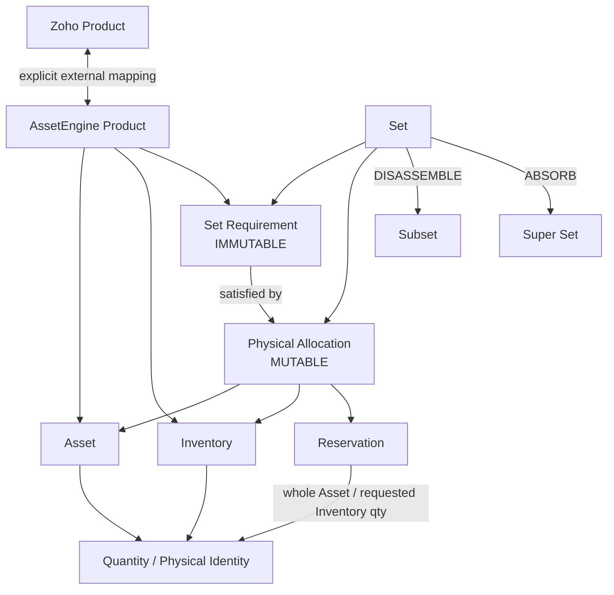
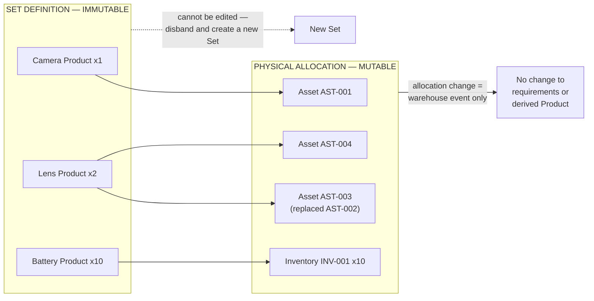
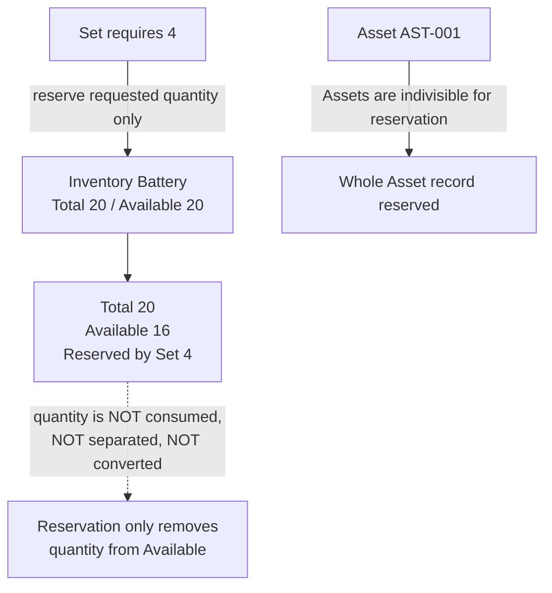
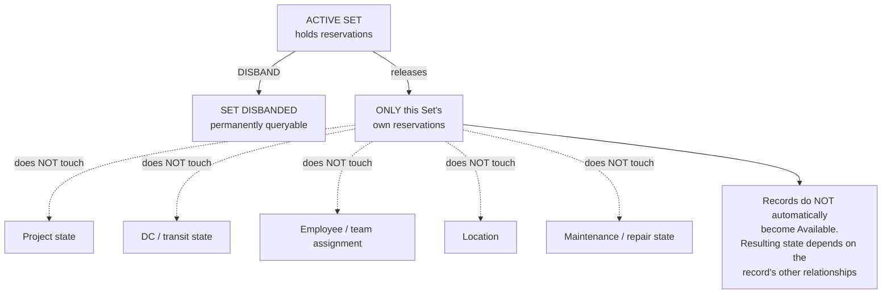
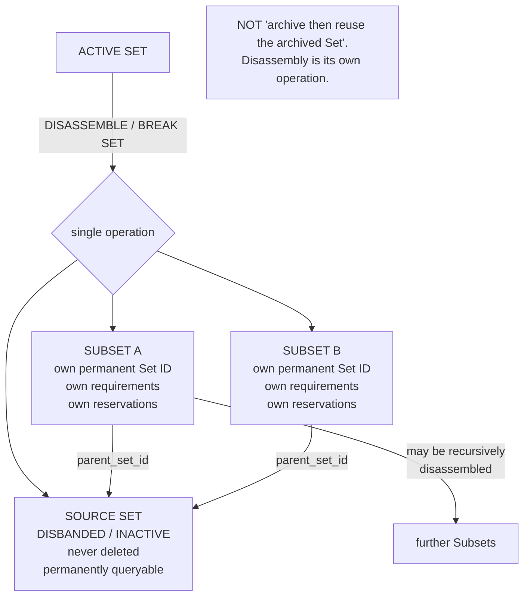
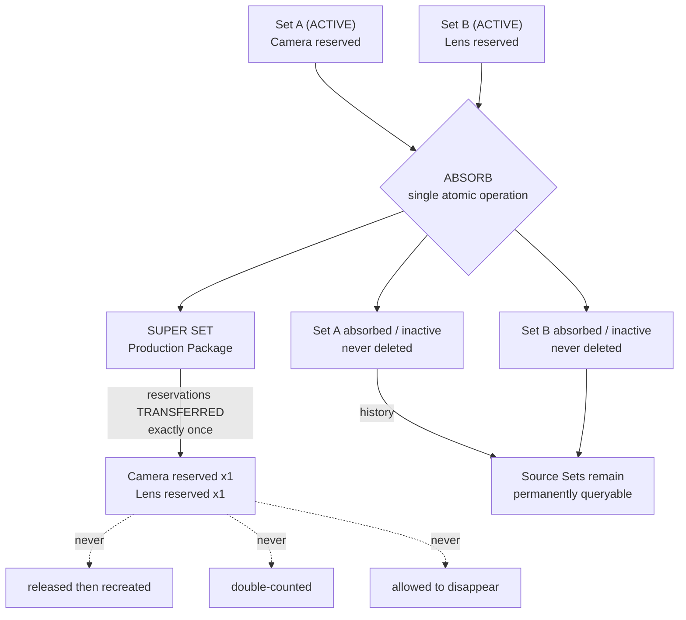
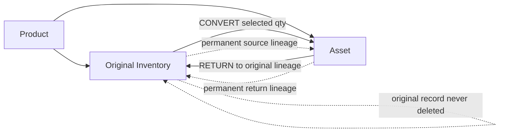
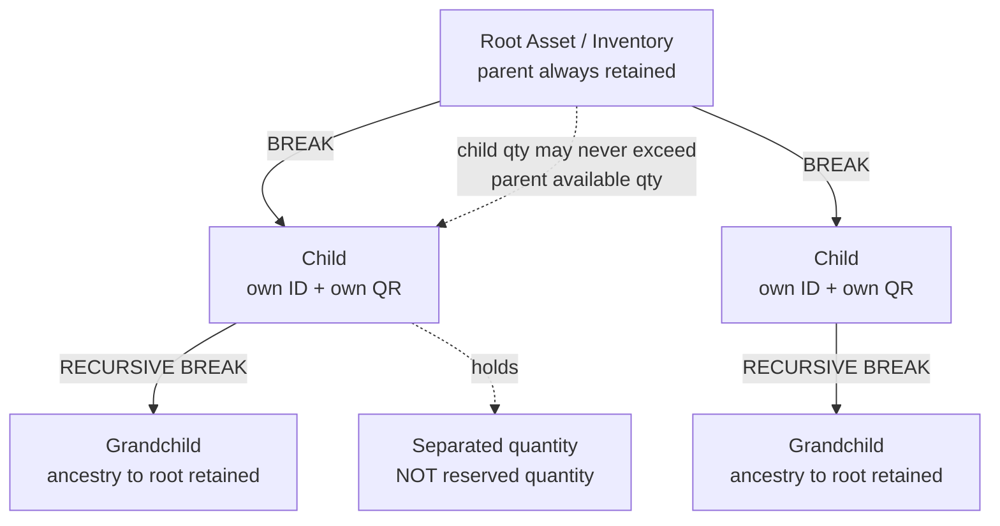
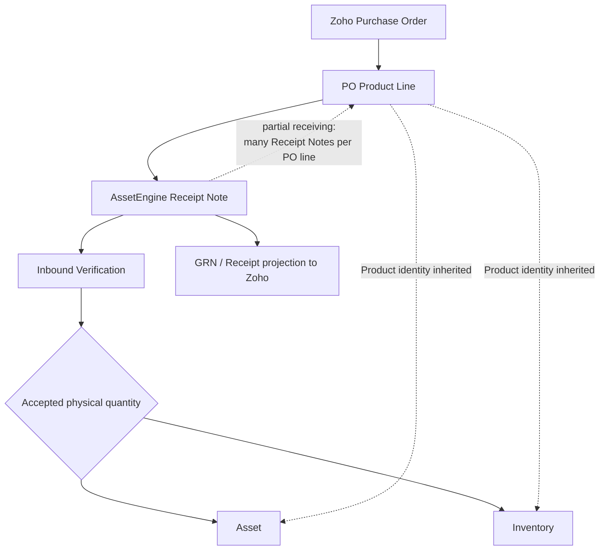

# AssetEngine Canonical Architecture

**Status:** Proposed canonical architecture — business decisions locked through 2026-08-28
**Revision:** 5 (Sourced vs Adopted lifecycle ADR)
**Purpose:** Single business / domain / lifecycle reference for AssetEngine implementation and Zoho integration
**Implementation status:** Architecture only. This document does **not** authorize code, schema, migration, production, Zoho or OAuth changes.

---

## Document control

### Revision history

| Rev | Date | Change |
|-----|------|--------|
| 1 | 2026-08-27 | Original canonical architecture |
| 2 | 2026-08-27 | Correction pass. Fifteen owner corrections applied. Reconciled against [`ARCHITECTURE_GAP_ANALYSIS.md`](./ARCHITECTURE_GAP_ANALYSIS.md) |
| 3 | 2026-08-28 | **ADR-CONVERSION-001** — Asset → Inventory return disposition. Inspection/Damaged remain on original lineage but are not Available. See §11, §42 |
| 4 | 2026-09-01 | **ADR-INTAKE-001** — Physical stock has two legitimate birth classes: Procurement Receipt and Non-Procurement Physical Intake. Historical §22 Receipt wording is not rewritten. |
| 5 | 2026-09-08 | **ADR-LIFECYCLE-002** / **ADR-DASHBOARD-001** — Sourced vs Adopted commercial lifecycles; Awaiting Adoption; Receipt Note calendar windows; Asset pie / Inventory donut. Full text: [`LIFECYCLE_SOURCED_ADOPTED_ADR.md`](./LIFECYCLE_SOURCED_ADOPTED_ADR.md). Historical §22 Receipt wording is not rewritten. |

### Section numbering

Sections **§1 through §36 keep their revision-1 numbers and titles**, so that section citations in [`ARCHITECTURE_GAP_ANALYSIS.md`](./ARCHITECTURE_GAP_ANALYSIS.md) remain valid. Content within them has been corrected.

New in revision 2: **§37** Security and authorization prerequisite · **§38** Migration and legacy safety · **§39** Terminology · **§40** Open decisions.

The Final canonical statement, which was §37 in revision 1, is now **§41**.

New in revision 3: **§42** Architecture Decision Records (same field structure as [`PRODUCT_ARCHITECTURE_DECISION.md`](./PRODUCT_ARCHITECTURE_DECISION.md) ADR-PRODUCT-*). **§1–§41 numbers are unchanged.**

### What revision 2 changed

| # | Correction | Sections touched |
|---|-----------|------------------|
| 1 | Set requirements immutable, physical allocation mutable | §2, §14, §16, §17, §20, §29, §32, §36 |
| 2 | Disband releases only its own reservations | §17, §29, §36 |
| 3 | Subset lifecycle via disassemble, not archive-and-reuse | §2, §18, §29, §32, §36 |
| 4 | Super Set as atomic absorption / reservation transfer | §2, §19, §29, §32, §36 |
| 5 | Reservation: whole Asset vs requested Inventory quantity | §14, §29, §36 |
| 6 | Break, Reservation and Conversion are three distinct mechanisms | §7, §12, §30, §36 |
| 7 | Conversion rules restated | §10, §11, §36 |
| 8 | Break rules restated | §12, §36 |
| 9 | Physical identity and QR restated | §8, §36 |
| 10 | Product rules restated | §3, §4, §6, §36 |
| 11 | Set → Product restated | §21, §36 |
| 12 | Receipt Note restated | §22, §36 |
| 13 | Security prerequisite added | **§37** (new) |
| 14 | Migration / legacy safety added | **§38** (new) |
| 15 | Phase order revised, reservation made foundational | §33 |

### Sources reconciled

- [`ARCHITECTURE_GAP_ANALYSIS.md`](./ARCHITECTURE_GAP_ANALYSIS.md) — 67 contradictions between revision 1 and production
- [`PRODUCT_ARCHITECTURE_DECISION.md`](./PRODUCT_ARCHITECTURE_DECISION.md) — 17 proposed Product ADRs
- [`PRODUCT_INTEGRATION_AUDIT.md`](./PRODUCT_INTEGRATION_AUDIT.md)
- [`ASSETENGINE_COMPLETE_ARCHITECTURE_AUDIT.md`](./ASSETENGINE_COMPLETE_ARCHITECTURE_AUDIT.md)

Where the owner's later decisions conflict with revision-1 wording, the later decision governs. Where evidence does not establish a rule, it is marked **OPEN DECISION** in §40 rather than assumed.

---

## 1. Core boundary

**Zoho = commercial / procurement system.**
**AssetEngine = physical / logistics system.**

Zoho owns Accounts, Contacts, Leads, Deals / commercial Projects, Quotes, Sales Orders, Invoices, Purchase Orders, Work Orders, and the shared Products catalogue.

AssetEngine owns Assets, Inventory, physical quantities and identities, QR identities, Receipt Notes / inbound receiving, Set requirements and physical allocation, reservation, Break / Individualize, Asset ↔ Inventory conversion, physical movement, logistics Projects, DC / dispatch, and operational history and lineage.

Zoho and AssetEngine communicate through the Zoho API / SDK. **They do not share a database.**

> **Legacy note.** Production currently holds Purchase Orders locally in AssetEngine (`project_orders`, `project_order_items`) and has no Zoho PO integration. The boundary above is the target, not the present state. Transition is governed by §38.

---

## 2. Core entity definitions

**Product**
Commercial identity of *what something is*. Product has its own AssetEngine identity and may map to a Zoho Product. **Product has no physical quantity.**

**Asset**
Company-owned item used for internal organizational purposes. It may be assigned to an employee or team once it is an Asset. Asset history is retained.

**Inventory**
Stock held for sale, project fulfilment, consumption, or future logistics use. One Inventory record can represent many units. Inventory is not assignable while it remains Inventory.

**Set**
An operational composition and reservation structure with two distinct layers:

- a **requirement layer** — the Set's definition, expressed in Products and quantities, **immutable after creation**;
- a **physical allocation layer** — the Assets and Inventory quantities currently satisfying those requirements, **mutable**.

A Set is not a physical ownership entity and is not inherently a Product.

**Set Requirement**
What a Set commercially requires: a Product and a quantity. Part of the immutable definition.

**Physical Set Component (Allocation)**
Which actual Asset, or which quantity of which Inventory record, currently satisfies a requirement. Mutable, and the thing that carries a reservation.

**Subset**
A full independent Set created by **disassembling** another Set. It has its own permanent Set ID, its own requirements, its own reservations and its own lifecycle, and it retains source-Set lineage. See §18.

**Super Set**
An aggregate of existing Sets, created by **absorption**. Source Sets become absorbed and inactive but are never deleted, and their physical reservations **transfer** rather than being released and recreated. See §19.

---

## 3. Product architecture

AssetEngine needs a **first-class Product entity**. `zoho_catalog` is not the long-term Product identity; it may remain as transitional cache and transport infrastructure.

Conceptual relationship:

```
AssetEngine Product
    │
    ├── Zoho Product reference (external mapping)
    ├── many Assets
    ├── many Inventory holdings
    └── Set requirements
```

Product is separate from Asset, from Inventory, and from Set. Product carries no quantity, no serial, no location, no condition, no assignment and no physical status.

Zoho Products and AssetEngine Products may originate in either system, because Products are **co-managed by Sales and Logistics**.

Valid conceptual origins include Zoho / Sales, AssetEngine / Logistics, Asset, Inventory, and Set commercialization. Exact provenance structure must be explicit and immutable once recorded.

---

## 4. Product co-management rules

**Name**
Co-managed with **explicit field-level conflict resolution**. If only one side changed since the last shared state, that side's change can synchronize. If both changed to different values, an **explicit conflict** is raised. **No silent last-write-wins.**

**Description**
**AssetEngine / Logistics authoritative.** AssetEngine owns the canonical Product Description. Zoho changes do not overwrite AssetEngine. AssetEngine may overwrite Zoho on its next authoritative update.

**SKU / Product Code**
Optional, open-ended, manually editable on both ends. AssetEngine does not generate and does not require an SKU. SKU is **not** the canonical identity and is **not** the primary matching key. It is not mandatory.

**Other Product fields**
Ownership must be explicitly documented for Make, Model, HSN, Unit, Price, Status and any other field **before implementation**. Set composition and physical logistics attributes are AssetEngine concerns. Until documented, these remain **OPEN DECISION** (§40 OD-01).

---

## 5. Product identity and Zoho mapping

Never conflate:

- AssetEngine Product ID
- Zoho Product ID
- AssetEngine Asset ID
- AssetEngine Inventory ID
- AssetEngine Set ID
- AssetEngine Project ID
- Zoho Deal / Project ID
- PO ID
- Receipt Note ID
- DC ID
- Manufacturer Serial
- QR identity

Zoho IDs are **stored as strings** in AssetEngine. BigInt is used **only at the SDK boundary** where required; the existing Product UPDATE BigInt fix must not be regressed.

The target architecture uses an **explicit external mapping** for Product ↔ Zoho Product rather than overloading `zoho_product_id` columns with opposite meanings.

External mapping must be **unique for the external system / module / record** and must carry enough provenance to prevent loops.

---

## 6. Zoho Product linking rule

**A standalone Zoho Product with no explicit AssetEngine link does nothing.**

AssetEngine must not automatically create or match an internal Product, Asset or Inventory record from an unlinked Zoho Product.

- No fuzzy name matching.
- No Make / Model matching.
- No SKU matching.
- No closest-match identity creation.

A pulled Zoho Product lands in the transitional cache. It **does not** thereby become an AssetEngine Product. An AssetEngine Product exists only when created through an approved business workflow.

The normal operational link path is:

```
Zoho Product
   ↓
Zoho Purchase Order
   ↓
AssetEngine Receipt Note
   ↓
Physical receipt
   ↓
Create Asset / Inventory
   ↓
Explicit Product relationship
```

A UI may **assist selection**, but the identity link must be created through an approved business workflow.

---

## 7. Quantity architecture

The Asset / Inventory record remains the operational parent. Quantity can remain aggregated.

```
Inventory INV-001
Product: Sony WF-C500
Quantity: 10
```

does **not** automatically mean 10 Inventory records.

The long-term model uses **structured subordinate quantity / physical-identity records** instead of comma-separated serial text. Quantity tracking can support aggregate and unit-level representations. Exact serial semantics are **deferred**.

### 7.1 Three distinct mechanisms

These three operations are frequently confused. They are **not** the same mechanism and must never be implemented with one another's machinery.

| Mechanism | What it does to quantity | Does it create records? | Does it change granularity? |
|-----------|--------------------------|-------------------------|------------------------------|
| **BREAK** | Moves quantity from parent to child. Parent's available representation **decreases**; children represent the separated quantity | **Yes** — child physical records | **Yes** |
| **RESERVATION** | Removes quantity from Available and records it as reserved **against a relationship**. Does not consume, move or transform the physical quantity | **No** | **No** |
| **CONVERSION** | Moves quantity between the Inventory and Asset operational domains. Converted quantity is no longer available Inventory | **Yes** — an Asset record | **No** (it changes domain, not granularity) |

Specifically:

- **BREAK has no "reserved by break" bucket.** Quantity moved to a child is *separated*, not *reserved*. See §12.
- **RESERVATION does not consume quantity.** The quantity still exists and still belongs to the same record; it is simply not available for other commitments. See §14.
- **CONVERSION does not delete the source.** The original Inventory record remains permanently. See §10.

### 7.2 Quantity conservation

The system must always be able to account for received quantity **without double counting**.

For any managed physical record:

```
RECEIVED / ORIGINAL quantity
  = AVAILABLE
  + RESERVED            (held against explicit relationships — §14)
  + SEPARATED           (moved to child records by BREAK — §12)
  + CONVERTED           (moved to the other operational domain — §10)
  + TERMINAL / NON-AVAILABLE
                        (consumed, sold, retired, written off, damaged, on hold —
                         each an explicitly defined disposition)
```

Two invariants follow:

1. **No quantity may be counted under two terms at once.** A unit that is separated into a child is not also reserved by the parent. A unit that is converted is not also available.
2. **Every term must be explicitly defined.** "Other" is not a permitted bucket; any non-available disposition must be a named state (§30).

Return from Asset to Inventory selects which term the quantity enters (**ADR-CONVERSION-001**, §11, §42): **AVAILABLE** increases Available Inventory; **INSPECTION / HOLD** and **DAMAGED / NOT AVAILABLE** enter **TERMINAL / NON-AVAILABLE**. They remain represented on the original Inventory lineage. They are not Available. A future first-class disposition engine must replace residual / overloaded-status representation; it is **not** designed here. See [`QUANTITY_PHYSICAL_IDENTITY_PHASE2_PLAN.md`](./QUANTITY_PHYSICAL_IDENTITY_PHASE2_PLAN.md) §11 and [`CONVERSION_PHASE4_PLAN.md`](./CONVERSION_PHASE4_PLAN.md) §5.4.

---

## 8. Physical identity and QR

> Revision-1 titled this section "Assetori identity and QR". "Assetori" was a typographical error for **AssetEngine**. No such concept exists.

Every active AssetEngine-managed Asset or Inventory record has an **AssetEngine identity** and a **QR representation**.

Manufacturer serial is optional and is **separate** from AssetEngine identity.

**Aggregated quantity does not create one QR per unit.** One managed aggregated record has one AssetEngine ID and one QR:

```
Inventory INV-001
Qty = 10
QR  = INV-001
```

When quantity is broken into independently managed child records:

- each child gets its own AssetEngine ID;
- each child gets its own QR;
- the parent keeps its own ID and its own QR.

Manufacturer serial handling and manufacturer-serial push to Zoho remain **DEFERRED**.

> **Legacy note.** Production `inventory_items` has no QR column and no QR generation. Half of this rule is currently unimplemented (see gap analysis GAP-801).

---

## 9. Asset ↔ Inventory boundary

**Inventory** — stock for sale, project fulfilment or consumption. Not assignable as an internal Asset while it remains Inventory.

**Asset** — company-owned internal-use item. Once fully converted into Asset management it may be assigned to an employee or team and enters the Asset lifecycle.

**There is no permanent hybrid "Inventory Asset" state.**

---

## 10. Inventory → Asset conversion

Conversion is an **explicit operational classification change**.

```
Inventory
   ↓ CONVERT
Asset
```

Locked rules:

- **Partial quantity is allowed.** Only the selected quantity leaves available Inventory.
- **The operator chooses** one quantity-tracked Asset, or individual Assets.
- **The original Inventory record remains permanently.** It is never deleted.
- **Converted quantity is no longer available Inventory.** It occupies the CONVERTED term of §7.2, not AVAILABLE.
- **Product identity survives** the conversion.
- **Source Inventory lineage survives** on the resulting Asset(s).

Worked example:

```
Inventory INV-001
Total Received:      10
Available Inventory: 10

Convert: 2

Total Received:       10
Available Inventory:   8
Converted to Assets:   2
```

The converted quantity is accounted for, not lost, and not available.

Conversion produces Assets that **remain connected** to their source Inventory record and to their Product. It never produces disconnected Assets.

---

## 11. Asset → Inventory return

Asset → Inventory **always returns to the original Inventory lineage.** There is no arbitrary destination picker and no selection of a different destination Inventory record.

The operator chooses the **return condition**:

- Available
- Inspection / Hold
- Damaged / Not Available

Locked rules:

- The Asset record is **not deleted**; it remains historically visible.
- Asset-specific history — employee/team assignment, maintenance, internal-use history — **remains intact** in Asset history.
- The original Inventory record receives the returned quantity and a corresponding Inventory-side history event.
- The returned quantity enters the term matching the chosen condition: AVAILABLE, or the appropriate non-available disposition (§7.2, §30).
- **Only AVAILABLE increases Available Inventory.** Inspection / Hold and Damaged / Not Available stay on the original Inventory lineage, remain represented and traceable, and **do not** count as Available (**ADR-CONVERSION-001**, §42).
- Phase 4 may record that condition on the conversion event / residual non-available quantity. It must **not** invent a final disposition schema. Inspection, Damaged, Consumed, Retired, and similar states must later become independently managed dispositions that preserve Product, AssetEngine identity, quantity lineage, conversion lineage, history, and availability accounting — without deleting or rewriting the original record. See [`CONVERSION_PHASE4_PLAN.md`](./CONVERSION_PHASE4_PLAN.md) and [`QUANTITY_PHYSICAL_IDENTITY_PHASE2_PLAN.md`](./QUANTITY_PHYSICAL_IDENTITY_PHASE2_PLAN.md) §11.

---

## 12. Break / Individualize / recursive lineage

### Break

Break **changes granularity**.

```
Inventory / Asset Parent  Qty 10
        ↓ BREAK Qty 3
Parent available representation = 7
Children represent              = 3
```

Locked rules:

- Break is **non-destructive**.
- **The parent remains.**
- **The child represents separated quantity** — not reserved quantity. There is no "reserved by break" bucket (§7.1).
- **Recursive breaking is allowed** to any depth.
- **Children retain ancestry** to their immediate parent and to the original root.
- **Individualization is a special form of Break** — one that produces individually managed children.
- **No child quantity may exceed the available quantity of its parent.**

### Make Individual

A specialized Break creating individually managed children, each with its own AssetEngine ID and QR (§8).

### Recursive break

```
INV-001
 └── INV-002
      └── INV-003
           └── INV-004
```

Every descendant retains ancestry to the original root.

### Merge / return

A generic merge may exist, but it **must not interfere with Set, Subset or Super Set relationships**. Merge is lineage-based. Asset → Inventory return is lineage-based and always returns to the original Inventory (§11).

Neither Break nor merge deletes a parent or a child. Records participating in lineage remain permanently queryable.

---

## 13. Lineage vs Set composition vs Set hierarchy

These are **three separate systems**.

| System | Question it answers |
|--------|--------------------|
| **Conversion / Break lineage** | "Where did this physical record come from?" |
| **Set composition** | "What is operationally grouped and reserved together?" |
| **Set hierarchy** | "Which Sets were disassembled into Subsets, or absorbed into Super Sets?" |

**Do not use one mechanism to implement the others.** In particular, do **not** reuse `parentid` or conversion ancestry as the primary Set hierarchy mechanism.

> **Legacy note.** Production `assets.parentid` currently encodes split lineage, legacy Set membership and sub-assembly membership simultaneously, with no discriminator (gap analysis GAP-401). This is the single contradiction that cannot be resolved additively. Governed by §38.

---

## 14. Set lifecycle, definition immutability and reservation

### 14.1 Creation

A newly created Set is **immediately ACTIVE**. There is no ordinary Draft → Active lifecycle.

### 14.2 The two layers

| Layer | Contents | Mutable? |
|-------|----------|----------|
| **Set definition / requirements** | Product requirements and their quantities | **IMMUTABLE after creation** |
| **Physical allocation** | Which Assets, and which quantities of which Inventory records, satisfy those requirements | **MUTABLE** |

### 14.3 Requirements are immutable

A Set's Product requirements **cannot be edited after creation**.

```
Camera  × 1
Lens    × 2
Battery × 10

        ✗ cannot become

Camera  × 1
Lens    × 3          ← requirement change is NOT permitted
Battery × 10
```

To change what a Set requires:

```
Old Set
  ↓ DISBAND / ARCHIVE
New Set created with the new requirements
```

The old Set is never deleted (§14.5).

### 14.4 Physical allocation is mutable

The physical allocation **may change while the requirement is preserved**.

```
Requirement:        Lens × 2

Current allocation: AST-001
                    AST-002

        ↓ AST-002 removed, AST-003 allocated

Current allocation: AST-001
                    AST-003

Requirement:        Lens × 2      ← unchanged
```

Therefore:

> **SET ADD and SET REMOVE remain valid operations, but ONLY as physical allocation operations. They do NOT mutate the Set definition.**

Precise synonyms: SET ADD = **ALLOCATE**; SET REMOVE = **DEALLOCATE**. Both operate exclusively on the allocation layer.

An allocation change is a **warehouse event**. It does not change the Set's commercial definition, and therefore does not change any Product derived from that Set (§21).

### 14.5 Deletion

Sets **cannot be deleted** through normal business operations. Historical records remain permanently queryable. This applies equally to disbanded, archived, absorbed and disassembled Sets.

### 14.6 Mixed Sets

A Set may contain both Assets and Inventory.

```
Camera Kit
├── Camera  Asset     × 1
├── Lens    Asset     × 2
└── Battery Inventory × 10
```

### 14.7 Reservation model

Allocating a physical record to a Set creates a **reservation**. Reservation removes quantity from Available; it does not consume, move or transform it (§7.1).

**For an Asset:** reserving into a Set reserves the **whole Asset operational record**. An Asset is indivisible for this purpose.

**For Inventory:** reserving into a Set reserves **only the requested quantity**.

```
Inventory Battery
Total     = 20
Available = 20

Set requires = 4

After allocation:

Total            = 20
Available        = 16
Reserved by Set  =  4
```

> **Do not reserve the entire Inventory record merely because it participates in a Set.**

### 14.8 Add / remove effects

| Operation | Effect |
|-----------|--------|
| **SET ADD (allocate)** | Available decreases; reservation against that Set increases |
| **SET REMOVE (deallocate)** | Reservation against that Set decreases; the released quantity returns to the record's accounting, subject to §17 |

### 14.9 Insufficient quantity

If the requested Set quantity exceeds the currently available Inventory quantity, **the operation fails and makes no partial reservation.**

### 14.10 Eligibility

If an Asset, or the required Inventory quantity, is already committed to another operational relationship, adding it to a new Set is **rejected**. Reservation is the mechanism that makes this enforceable, which is why reservation must be a **reusable, general facility** rather than a Set-internal feature (§33).

---

## 15. Set completeness

Completeness is **computed state**, not lifecycle state. It is derived by comparing the allocation layer against the immutable requirement layer.

```
EMPTY
INCOMPLETE
COMPLETE
OVERCOMPLETE
```

Examples:

```
Required: Camera 1/1, Lens 2/2, Battery 10/10   → COMPLETE
          Lens 1/2                              → INCOMPLETE
          Battery 15/10                         → OVERCOMPLETE
```

Completeness changes as allocation changes. It never changes the requirement.

> **Terminology warning.** Production exposes a field named `composition` returning `EMPTY` / `MIXED` / `ASSET` / `INVENTORY`. That is a description of *what kinds of records are present*, not completeness, and `EMPTY` means something different in each vocabulary (gap analysis GAP-503). Completeness and composition are distinct concepts and must not share a field.

---

## 16. Set substitution

**No Product substitution is allowed within a Set.** The requirement layer is immutable (§14.3), so a required Product can never be exchanged for a different Product.

**Physical substitution within a requirement is permitted**, and is the normal purpose of the allocation layer (§14.4): one Asset satisfying "Lens × 2" may be replaced by another Asset of the same required Product.

If procurement requirements genuinely change, change the relevant upstream PO / commercial process and create a new Set as appropriate.

**No exception or override mechanism exists inside Set allocation** — an allocation may not satisfy a requirement for a different Product.

---

## 17. Set disband

Disband releases **only that Set's own physical reservations**.

It does **not** reset or overwrite:

- Project state
- DC / transit state
- Employee / team assignment
- Location
- Repair / maintenance state
- Any other operational relationship

**Disband does not automatically make physical records Available.** Releasing the Set's reservation removes that one commitment; the resulting state of the physical record depends on its other operational relationships. A record that is also on a project, dispatched, under inspection or in repair remains in that state, and disband sets no status of its own.

Thus **Set membership is one independent operational dimension** among several.

Disband does not delete the Set (§14.5). A disbanded Set remains permanently queryable, with its requirement layer and its allocation history intact.

---

## 18. Subsets

A Subset is a full independent Set derived by **disassembling** a Set.

### 18.1 The operation

```
ACTIVE SET
    ↓
DISASSEMBLE / BREAK SET
    ↓
SOURCE SET becomes DISBANDED / INACTIVE
    ↓
one or more NEW SETS are created
    ↓
new Sets are marked as SUBSETS
    ↓
each Subset has its own permanent Set ID
    ↓
each Subset retains parent_set_id / source-Set lineage
```

**An ACTIVE Set cannot directly become a Subset.** Disassembly is the single operation that transitions the source Set to DISBANDED / INACTIVE and creates the new Subsets. It is one business operation, not a sequence the operator assembles manually.

> This is **not** "archive an active Set and then use the archived Set." Disassembly is its own operation with its own semantics. An archived Set is not a staging area for Subset creation.

### 18.2 Properties of each Subset

Each Subset:

- gets its own **permanent Set ID**;
- has its own **requirements** (immutable, per §14.3) and its own **allocation layer**;
- has its own **reservations**;
- has its own **lifecycle**;
- may itself be recursively disassembled;
- **retains `parent_set_id` / source-Set lineage.**

### 18.3 The source Set

The source Set is **never deleted**. It remains permanently queryable for history, in DISBANDED / INACTIVE state, with its original requirement layer and allocation history intact.

Reservations held by the source Set pass to the Subsets as part of the same operation; no physical quantity is left double-reserved and none silently disappears (the same conservation requirement as §19.2).

---

## 19. Super Sets

A Super Set aggregates existing Sets.

```
Camera Kit A
Audio Kit A
Lighting Kit A
       ↓ ABSORB
Production Package
```

### 19.1 The operation is atomic absorption

Super Set creation is an **atomic absorption and reservation transfer**.

```
Set A                     Set B
  Camera reserved           Lens reserved

              ↓ ABSORB  (single atomic operation)

Super Set
  ├── Set A   (absorbed / inactive)
  └── Set B   (absorbed / inactive)

  Camera reservation  ── transferred, held once
  Lens   reservation  ── transferred, held once
```

Source Sets become **absorbed / inactive**.

**An ACTIVE Set cannot be used directly to create a Super Set.** Absorption is the operation that transitions it.

### 19.2 Reservation transfer, not release-and-recreate

Existing reservations **transfer to the Super Set hierarchy exactly once.** They are **not** released and then recreated as an independent second reservation.

There must be no moment in the conceptual transaction where:

- reservations are **double-counted**;
- reservations **disappear**;
- the same physical quantity is **reserved twice**.

The Super Set does **not** independently re-reserve the physical children. The reservation that already exists is the reservation the hierarchy holds.

### 19.3 History

The source Sets remain **permanently queryable for history** — their records, IDs, requirement layers, allocation history and complete histories remain. They are never deleted (§14.5).

---

## 20. Set requirements vs physical allocation

These are **mandatory separate layers**.

### Requirement layer — immutable

What the Set is defined to contain:

```
Camera  Product × 1
Lens    Product × 2
Battery Product × 10
```

### Physical allocation layer — mutable

What currently satisfies the requirement:

```
Camera  → AST-001
Lens    → AST-002
Lens    → AST-003
Battery → INV-001 × 10
```

Rules:

- **Changing the physical allocation does not change the Product requirement.**
- Physical substitutions are **not silently allowed** — they are explicit allocation operations against a named requirement (§16), recorded in history.
- An allocation must satisfy a requirement for the **same** Product.
- Set membership is **not purely informational**: every allocation carries a reservation (§14.7).

### Why the separation is mandatory

With a single layer, a warehouse substitution is indistinguishable from a commercial change. The system would then have to treat every physical swap as a change to the Set's commercial definition — rewriting derived Products and any commercial documents referencing them — or ignore all changes and miss genuine ones. There is no third option, because the data could not tell the two apart.

The separation additionally makes **completeness** computable (§15), lets a Set be defined before it is stocked, and preserves what was committed at a point in time.

---

## 21. Set → Product commercialization

A Set may be **explicitly** commercialized into an AssetEngine Product.

```
Set
 ↓ explicit Commercialize
AssetEngine Product
 ↓ explicit Publish
Zoho Product
```

Both steps are explicit and separate. Neither happens as a side effect of creating a Set or of allocating to one.

- The Set's requirements **remain structured in AssetEngine.**
- The Zoho Product Description is a **human-readable projection** of the composition. It may contain lines such as `Camera — Make / Model / Description`.
- **The Zoho Description is NOT the source of truth for Set composition.** It is written for humans and is never read back as structured data.

Because a Set's requirements are immutable (§14.3), a commercialized Product's composition is stable for the life of that Set. Allocation changes never alter it (§14.4). A change in requirements means a new Set, and therefore a commercialization decision about the new Set.

The Set-derived Product is **not** the Set. Set Product ≠ Set ID: the Set is an operational structure with its own lifecycle, while the Product is a commercial identity referenced by external commercial documents.

Product versioning rules for Set-derived Products remain **OPEN DECISION** (§40 OD-05) — but note that under §14.3 a live Set's definition cannot change, so the question applies to the relationship between successive Sets, not to edits of one Set.

---

## 22. Receipt Note / GRN

Receipt Note is an **AssetEngine receiving transaction**. It is currently **planned, not existing**.

Target flow:

```
Zoho Purchase Order
      ↓
AssetEngine Receipt Note
      ↓
Inbound / physical verification
      ↓
Accepted quantity
      ↓
Create Asset OR Inventory
      ↓
GRN / receipt projection to Zoho
```

Locked rules:

- **A Zoho Product by itself does nothing** (§6).
- **A PO line supplies Product context to the Receipt Note.**
- **The physical Asset / Inventory created from receiving inherits the Product relationship from the PO / Receipt context.**
- **Partial receiving is supported.** A PO line can be received through multiple Receipt Notes.
- Rejected and damaged quantities are **distinct** from accepted quantities.
- Only accepted quantities normally enter physical Asset / Inventory representation.

```
PO:      10
RN-001:  accepted 6
RN-002:  accepted 4
Total accepted: 10
```

Receipt Note is the workflow in which physical creation normally occurs, and the workflow that normally establishes the Product relationship.

---

## 23. Purchase Orders

Zoho Purchase Orders are the procurement source of record.

- A quotation may produce multiple vendor POs where required.
- Each PO retains a back-link to the originating Quote.
- AssetEngine consumes PO context to perform physical receiving; the PO remains a commercial / procurement object.

> **Legacy note.** AssetEngine currently holds POs locally and is the de facto PO system of record. Transition of PO authority is a deliberate migration, governed by §38, and is scoped in §33 Phase 9.

---

## 24. Customer Purchase Orders

Customer POs are distinct from vendor procurement POs and represent incoming customer-side commercial documents. They will be linked into the broader Sales / Procurement lifecycle in a separate implementation phase (§33 Phase 9).

---

## 25. Work Orders

Work Orders are siblings to Purchase Orders and represent outsourced work or services such as fabrication, installation, repair, commissioning or AMC.

They do **not** automatically create physical Inventory. Detailed lifecycle is **deferred** (§33 Phase 9).

---

## 26. Projects

AssetEngine Projects have their own **AssetEngine Project ID**.

The Zoho Deal / Project ID is a **supporting external reference** and **must not replace** the AssetEngine Project ID.

AssetEngine Projects will eventually manage physical Assets, Inventory, Sets, logistics, rentals and DC.

Project allocation is expected to reuse the same **requirement / allocation** separation as Sets (§20) and the same **reservation** facility (§14.7), rather than a project-specific mechanism.

---

## 27. DC / Dispatch

DC is an **outbound logistics transaction**.

```
Asset / Inventory
      ↓
DC
      ↓
Project / Customer / Destination
```

DC is **not** itself an Asset or Inventory record. Detailed DC state transitions are **deferred** until implementation of that module (§33 Phase 10). DC is expected to consume the shared reservation facility rather than define its own.

---

## 28. History / deletion principles

Historical physical reality must remain **reconstructable**.

- Assets with operational history are **not casually hard-deleted**.
- Original Inventory records participating in conversion are **never deleted**.
- **Sets cannot be deleted** through normal business operations — including disbanded, archived, absorbed and disassembled Sets.
- **Break keeps the parent**, and keeps the child.
- **Conversion keeps source and destination lineage.**
- **Set membership history remains available** when an allocation is removed, or a Set is disbanded, disassembled or absorbed — including who performed the operation and when.

---

## 29. Operation semantics

| Operation | Meaning | Layer affected |
|-----------|---------|----------------|
| **CREATE** | Create a new operational entity with permanent identity | — |
| **EDIT** | Change editable attributes under field ownership. **Never changes Set requirements** (§14.3) | attributes only |
| **ARCHIVE / DISBAND** | End active use while preserving history. Releases only that Set's own reservations (§17) | Set |
| **BREAK** | Decompose quantity; parent retained; child represents separated quantity | physical |
| **INDIVIDUALIZE** | Break into independently managed children | physical |
| **CONVERT** | Change Inventory ↔ Asset operational classification | physical, cross-domain |
| **RETURN** | Asset returns to original Inventory lineage, with operator-chosen condition | physical |
| **MERGE BACK** | Lineage-based return / aggregation; must not disturb Set relationships | physical |
| **RESERVE** | Hold a whole Asset, or a requested Inventory quantity, against a relationship | reservation |
| **RELEASE** | Release a specific reservation only; sets no status of its own | reservation |
| **SET ADD** (ALLOCATE) | Allocate a physical record to satisfy an **existing** requirement; creates a reservation. **Does not mutate the Set definition** | **allocation only** |
| **SET REMOVE** (DEALLOCATE) | Release that allocation's reservation only. **Does not mutate the Set definition** | **allocation only** |
| **SET DISBAND** | Release the Set's reservations without resetting unrelated operational state | Set + reservation |
| **DISASSEMBLE / BREAK SET** | Single operation: source Set → DISBANDED / INACTIVE, and one or more Subsets created with source lineage (§18) | Set hierarchy |
| **ABSORB (SUPER SET)** | Single atomic operation: source Sets → absorbed / inactive, reservations transferred exactly once (§19) | Set hierarchy + reservation |
| **RECEIVE** | Establish accepted physical quantity through a Receipt Note | physical |
| **DISPATCH** | Move physical quantity through a DC / outbound transaction | physical |
| **CONSUME / SELL** | Terminal or non-available physical disposition; detailed rules **deferred** | physical |

There is **no operation that edits a Set's requirements.** That is the definition of §14.3.

---

## 30. Quantity state model

Quantity lifecycle is viewed in three layers.

### Expectation

`EXPECTED` comes from the PO. **It is not available AssetEngine stock.**

### Physical / accounting states

Potential states include:

- `RECEIVED`
- `AVAILABLE`
- `RESERVED` — held against an explicit relationship (§14.7); still owned, not consumed
- `IN_TRANSIT`
- `CONSUMED`
- `SOLD`
- `RETIRED`
- `WRITTEN_OFF`

Exact terminal and Project / DC states are **deferred** as a first-class disposition engine. Named non-available return conditions already exist for conversion (**ADR-CONVERSION-001**): Inspection / Hold and Damaged / Not Available land in **TERMINAL / NON-AVAILABLE**, not AVAILABLE. Consumed Inventory and Retired Assets are the same class of problem and must not remain permanently as arbitrary flags or overloaded `status` strings.

Each state maps onto exactly one term of the conservation equation in §7.2. `RESERVED` is a real accounted state, not a derived label and not a synonym for separated or converted quantity.

### Transformations

- `CREATE`
- `RECEIVE`
- `BREAK`
- `INDIVIDUALIZE`
- `CONVERT`
- `RETURN`
- `MERGE_BACK`
- `RESERVE` / `RELEASE`
- `DISPATCH`
- `CONSUME`

Transformations are **events / operations**, not a substitute for current state. Break, Reserve and Convert are three different transformations with three different effects (§7.1).

---

## 31. Cross-system product lifecycle

```
                 ZOHO / SALES
                     │
                Zoho Product
                     │
                     │ may be used in
                     ▼
                   Quote
                     │
             Sales Order / Invoice
                     │
                  Procurement
                     │
                 Purchase Order
                     │
                     ▼
                 ASSETENGINE
                     │
               Receipt Note / GRN
                     │
             ┌───────┴────────┐
             ▼                ▼
          Inventory         Asset
             │                │
             └───────┬────────┘
                     ▼
                  Quantity
                     │
          ┌──────────┼──────────┐
          ▼          ▼          ▼
         Set       Project       DC
          │
          ▼
     Set Product
          │
          ▼
      Zoho Product
```

The loop is safe **only** when explicit Product mapping, provenance and field ownership are implemented (§5, §6, §4).

---

## 32. Canonical diagrams

### 32.1 Product / physical model



### 32.2 Set: immutable requirements, mutable allocation



### 32.3 Reservation



### 32.4 Set disband



### 32.5 Subset — disassembly



### 32.6 Super Set — atomic absorption and reservation transfer



### 32.7 Conversion



### 32.8 Break



### 32.9 Receipt



---

## 33. Implementation dependency order

Revised in revision 2 so that dependencies are realistic.

### PHASE 0 — Architecture reconciliation and safety prerequisites

- Reconcile this document against the gap analysis
- Contain actively destructive production behaviour
- Establish authorization prerequisites (§37)
- Establish legacy quarantine decisions (§38)

### PHASE 1 — Product identity foundation

- AssetEngine Product entity
- Explicit external Zoho mapping
- Provenance
- **No behaviour-breaking sync rewrite yet**
- Safe coexistence with the transitional `zoho_catalog`

### PHASE 2 — Quantity / physical identity foundation

- Quantity model
- Structured physical identity records
- Conservation (§7.2)
- AssetEngine IDs and QR for every managed record (§8)

### PHASE 3 — Reservation foundation

- A **reusable** reservation mechanism
- Quantity-specific Inventory reservation
- Whole-Asset reservation
- Authorization and transaction safety

### PHASE 4 — Conversion

- Inventory → Asset
- Asset → original Inventory
- Lineage

### PHASE 5 — Break / Individualize

- Recursive Break
- Child lineage
- Parent preservation

### PHASE 6 — Set engine

- Immutable requirements
- Mutable physical allocation
- Reservation (consuming Phase 3)
- Completeness
- Disband
- Subset
- Super Set

### PHASE 7 — Receipt Note / GRN

- Zoho PO pull
- Receipt reconciliation
- Physical creation
- GRN projection

### PHASE 8 — Zoho Product / Set integration

- Product synchronization
- Set Custom Module
- Set commercialization

### PHASE 9 — PO / Work Order / Customer PO

Including deliberate transition of PO authority from AssetEngine-local structures to Zoho (§23, §38).

### PHASE 10 — Projects / DC / Rentals

Implemented after the physical, quantity and reservation foundations are stable.

### 33.1 Why reservation is foundational

Reservation is placed at **Phase 3**, before the Set engine at Phase 6, for four reasons.

**Reservation is a quantity concept, not a Set concept.** The conservation equation in §7.2 contains a `RESERVED` term. Quantity cannot be conserved correctly until reservation is a first-class, accounted term. Building it inside the Set engine would mean the quantity model is incomplete for three phases while conversion (Phase 4) and Break (Phase 5) are built on top of it.

**More than one consumer needs it.** Sets reserve (§14.7). Projects will reserve (§26). DC will reserve (§27). If reservation is implemented as Set-internal behaviour, a second and third implementation become inevitable, and the "already committed to another operational relationship" eligibility rule in §14.10 becomes unenforceable — because each consumer would hold its own private notion of commitment with no shared ledger to consult.

**Super Set absorption is a reservation transfer, not a Set operation.** §19.2 requires that reservations move exactly once, with no moment of double-counting or disappearance. That is a property of the reservation facility and its transactional guarantees. It cannot be expressed if reservation is merely an implicit consequence of Set membership rows.

**Disband depends on reservation being separable.** §17 requires that disband release only the Set's own reservations while leaving project, DC, assignment, location and maintenance state untouched. That is only possible if each reservation is an explicit, attributable record naming its holder. Without it, "release only this Set's reservation" has no referent.

Consequently, Phase 6 **consumes** the Phase 3 facility rather than defining its own, and Phases 4 and 5 can rely on a complete quantity model.

---

## 34. Implementation protocol

Every implementation phase follows:

```
AUDIT
  ↓
PLAN
  ↓
IMPLEMENT
  ↓
TEST
  ↓
REPORT
  ↓
APPROVAL
  ↓
NEXT PHASE
```

Implementation must not proceed through multiple architecture phases in one uncontrolled pass.

For production:

- do not modify unrelated modules;
- do not change OAuth without explicit approval;
- do not overwrite tokens or credentials;
- do not blindly run migrations;
- do not delete historical data;
- preserve legacy structures until migration compatibility is demonstrated;
- provide a rollback strategy for schema changes.

---

## 35. Known implementation gaps

The current production code does not fully implement this architecture. Known gaps include:

- no first-class AssetEngine Product entity;
- current `zoho_catalog` is a Zoho Product cache;
- `zoho_product_id` meanings differ by table;
- legacy and Managed Set implementations coexist;
- **no reservation mechanism of any kind exists** — Set membership currently has no effect on availability;
- **no quantity conservation check exists**;
- **no Set requirement layer exists** — only physical allocation, so completeness is not computable;
- **Subsets and Super Sets are unrepresentable** — there is no Set hierarchy;
- **Sets have no history** — removals record no actor, reason or removal time;
- current Asset rows can represent multiple physical meanings;
- current serial handling is not a structured identity model;
- true Asset ↔ Inventory conversion is not implemented;
- current split / unsplit behaviour is not the target safe lineage model, and includes destructive paths;
- Receipt Note / GRN is planned but not implemented;
- current Asset → Zoho Product synchronization is legacy behaviour and **must not be copied blindly** into the new Product architecture;
- Purchase Orders are currently local to AssetEngine rather than consumed from Zoho.

A full enumeration with evidence is in [`ARCHITECTURE_GAP_ANALYSIS.md`](./ARCHITECTURE_GAP_ANALYSIS.md).

**Legacy behaviour must not override the locked domain rules in this document.** See §38.

---

## 36. Locked architecture rules

### Product

1. Product is a first-class AssetEngine business entity.
2. Zoho Product is an external representation / mapping.
3. Product has no physical quantity.
4. Product is separate from Asset, Inventory and Set.
5. Product Name is co-managed with explicit field-level conflict resolution; no silent last-write-wins.
6. Product Description is AssetEngine / Logistics authoritative.
7. SKU / Product Code is optional, open-ended, and manually editable on both ends.
8. SKU is not mandatory and is never the canonical identity.
9. SKU is not the primary matching key.
10. Unlinked standalone Zoho Products do nothing in AssetEngine.
11. No fuzzy, Make/Model, SKU or closest-match identity creation.
12. A pulled Zoho Product does not automatically become an AssetEngine Product.
13. Product links arise through explicit business workflows.
14. Zoho IDs are stored as strings; BigInt only at the SDK boundary; the existing fix must not be regressed.
15. External mapping is unique per external system / module / record and carries provenance.

### Physical identity and QR

16. Every managed physical Asset / Inventory record has an AssetEngine identity.
17. Every managed physical Asset / Inventory record has a QR representation.
18. Aggregated quantity does not generate a QR per underlying unit.
19. One managed aggregated record has one AssetEngine ID and one QR.
20. When quantity is broken into independently managed children, each child gets its own ID and QR, and the parent keeps its own.
21. Manufacturer serial is optional and separate from AssetEngine identity.
22. Manufacturer serial rules and Zoho serial push are deferred.

### Quantity

23. Quantity can remain aggregated.
24. Structured subordinate quantity / physical-identity records are the long-term replacement for comma-separated serial text.
25. Received quantity must always be accountable without double counting.
26. BREAK, RESERVATION and CONVERSION are three distinct mechanisms and must not share machinery.
27. BREAK has no "reserved by break" bucket; broken quantity is *separated*, not *reserved*.
28. RESERVATION does not consume physical quantity; it removes quantity from Available and records it against the relationship.
29. CONVERSION moves quantity between operational domains; converted quantity is not available Inventory.
30. No quantity may be counted under two conservation terms at once.
31. Every non-available disposition must be an explicitly named state.

### Asset / Inventory

32. Inventory is stock held for sale, project fulfilment or consumption.
33. Asset is company-owned internal-use equipment.
34. Inventory is not assignable while it remains Inventory.
35. There is no permanent hybrid Inventory-Asset state.

### Conversion

36. Inventory → Asset conversion is allowed, with partial quantity.
37. The operator chooses grouped Asset vs individual Assets.
38. Original Inventory records are never deleted.
39. Converted quantity is no longer available Inventory.
40. Product identity survives conversion.
41. Source Inventory lineage survives on the resulting Asset(s).
42. Conversion never produces Assets disconnected from their source Inventory or Product.
43. Asset → Inventory always returns to the original Inventory lineage; a different destination is never selected.
44. Return condition is operator-selected: Available / Inspection-Hold / Damaged-Not Available.
45. The Asset record remains historically visible, with its Asset-specific history intact.

### Break

46. Break is non-destructive.
47. Parent records remain.
48. Children represent separated quantity.
49. Break is recursive to any depth.
50. Children retain ancestry to immediate parent and to the original root.
51. Individualization is a special form of Break.
52. No child quantity may exceed the available quantity of its parent.
53. Neither Break nor merge deletes a parent or a child.
54. Merge must not interfere with Set, Subset or Super Set relationships.

### Lineage

55. Conversion / Break lineage, Set composition, and Set hierarchy are three separate systems.
56. `parentid` or conversion ancestry must not be reused as the Set hierarchy mechanism.

### Sets — definition and allocation

57. Set creation means immediately ACTIVE.
58. **Set definition / requirements are IMMUTABLE after creation.**
59. **Physical allocation is MUTABLE.**
60. To change requirements, the Set is disbanded and a new Set created.
61. SET ADD and SET REMOVE are valid **only** as physical allocation operations and never mutate the Set definition.
62. No operation edits a Set's requirements.
63. Sets cannot be deleted — including disbanded, archived, absorbed and disassembled Sets.
64. Sets can contain both Assets and Inventory.
65. Set requirements and physical allocation are mandatory separate layers.
66. Set membership is not purely informational; every allocation carries a reservation.
67. Set composition is structured in AssetEngine.

### Sets — reservation

68. Reserving an Asset into a Set reserves the whole Asset operational record.
69. Reserving Inventory into a Set reserves only the requested quantity.
70. An Inventory record is not wholly reserved merely because it participates in a Set.
71. Insufficient available quantity rejects Set addition, with no partial reservation.
72. Set removal releases only that allocation's reservation.
73. Reservation must be a reusable facility, not Set-internal behaviour.
74. If an Asset or required Inventory quantity is already committed elsewhere, adding it to a new Set is rejected.

### Sets — completeness and substitution

75. Completeness is computed state: EMPTY / INCOMPLETE / COMPLETE / OVERCOMPLETE.
76. Completeness is derived by comparing allocation against requirements; it never changes requirements.
77. Product substitution is not allowed inside a Set.
78. Physical substitution within the same required Product is permitted as an allocation operation.
79. An allocation may not satisfy a requirement for a different Product.
80. Genuine procurement requirement changes occur upstream through PO / commercial processes.

### Sets — disband, Subset, Super Set

81. Disband releases only that Set's own reservations.
82. Disband does not reset Project, DC, assignment, location, maintenance or other operational state.
83. Disband does not automatically make physical records Available.
84. An ACTIVE Set cannot directly become a Subset.
85. Subsets are created by DISASSEMBLE / BREAK SET — a single operation, not archive-then-reuse.
86. Disassembly transitions the source Set to DISBANDED / INACTIVE and creates the Subsets in one operation.
87. Each Subset has its own permanent Set ID, requirements, allocation, reservations and lifecycle.
88. Each Subset retains `parent_set_id` / source-Set lineage.
89. The source Set is never deleted and remains permanently queryable.
90. An ACTIVE Set cannot be used directly to create a Super Set.
91. Super Set creation is an atomic absorption and reservation transfer.
92. Existing reservations transfer to the Super Set hierarchy exactly once.
93. Reservations are never released and then recreated during absorption.
94. At no point may reservations be double-counted, disappear, or reserve the same quantity twice.
95. Absorbed source Sets remain permanently queryable for history.

### Set → Product

96. A Set is commercialized into a Product only by explicit action.
97. Publication to Zoho is a separate explicit action.
98. Set requirements remain structured in AssetEngine.
99. The Zoho Description is a human-readable projection and is never the authoritative Set composition.
100. Set Product ≠ Set ID.

### Receiving and procurement

101. Receipt Note is an AssetEngine receiving transaction.
102. Receipt Note compares actual receipt against Zoho PO expectations.
103. A Zoho Product by itself does nothing; a PO line supplies Product context.
104. Physical creation normally occurs in the Receipt Note workflow.
105. Product identity is inherited from the PO / Receipt line during normal receiving.
106. Partial receipts are supported; a PO line may be received through multiple Receipt Notes.
107. Rejected and damaged quantities are distinct from accepted quantities.
108. Zoho is authoritative for commercial Purchase Orders.
109. AssetEngine is authoritative for physical / logistics records.

### Process

110. Historical physical lineage remains reconstructable.
111. Set membership history remains available after removal, disband, disassembly or absorption, including actor and time.
112. Zoho synchronization must be explicit, idempotent and provenance-aware.
113. All new state-changing operations require authenticated and authorized actors (§37).
114. Legacy behaviour is not automatically compliant architecture (§38).
115. No legacy structure is deleted merely to make the new architecture work (§38).
116. Implementation proceeds one controlled phase at a time.

---

## 37. Security and authorization prerequisite

**New in revision 2.**

All new state-changing operations introduced by this architecture **must require authenticated and authorized actors.**

This applies at minimum to:

- conversion (Inventory → Asset, Asset → Inventory)
- break
- individualize
- Set allocation
- Set reservation and release
- Set disband
- Subset creation (disassembly)
- Super Set absorption
- receiving (Receipt Note, GRN)
- quantity movement of any kind

Because reservation and quantity accounting must be conserved (§7.2), these operations must also be **transactionally safe**: a reservation, transfer or conversion either completes wholly or not at all. This is a specific requirement of Super Set absorption (§19.2), where a partially applied transfer would double-count or lose a reservation.

Every operation must record the acting actor, so that history satisfies §28 and §36 rule 111.

> **This is an implementation prerequisite, not an authorization to change authentication now.** No authentication or authorization change is made by this document. Production currently exposes several unauthenticated state-changing routes (gap analysis GAP-901); remediation is scoped to §33 Phase 0.

---

## 38. Migration and legacy safety

**New in revision 2.**

**Legacy behaviour is not automatically treated as compliant architecture.** The existence of a production behaviour is not evidence that it satisfies this document. Where production and this document disagree, this document defines the target and the gap analysis defines the distance.

Where production contains:

- legacy `parentid` Set relationships;
- legacy Set-as-Asset records;
- delimited serial fields;
- existing Asset → Zoho Product synchronization behaviour;
- AssetEngine-local Purchase Order structures;

these must be **migrated or quarantined deliberately**, as explicit, reviewed decisions with their own audit, plan and rollback strategy.

**No legacy structure is to be deleted merely to make the new architecture work.**

Specifically:

- **Do not delete or rename legacy tables or columns** to simplify a new model. Retain them until migration compatibility is demonstrated (§34).
- **Do not reinterpret ambiguous legacy data silently.** `assets.parentid` carries three distinct meanings with no discriminator (§13); any separation requires a per-row interpretation pass with recorded decisions, not a blanket assumption.
- **Do not extend legacy behaviour that contradicts a locked rule.** The current Asset → Zoho Product push can create duplicates and overwrite Sales edits; it is legacy behaviour to be replaced, not a foundation to build on (§35).
- **Quarantine is a valid outcome.** A legacy structure may be frozen read-only, with new work directed to the new model, provided the decision is explicit and the historical data remains queryable.
- **Schema drift must be reconciled before it is built upon.** Production contains structures that do not match their migrations; migrations are therefore not a reliable description of production until reconciled.

Every migration or quarantine decision must preserve the reconstructability of historical physical reality (§28).

---

## 39. Terminology

**New in revision 2.** These terms are used consistently throughout this document and should be used consistently in implementation, documentation and code.

| Term | Meaning | Not to be confused with |
|------|---------|-------------------------|
| **Product** | Commercial catalogue identity. No quantity | Asset, Inventory, Set, Kind, Zoho record |
| **Asset** | One company-owned internal-use physical record | Inventory, Product |
| **Inventory** | A stock holding that may represent many units | Asset, Product |
| **Set** | Operational composition with an immutable requirement layer and a mutable allocation layer | Product, Subset, Super Set |
| **Set definition / requirement** | What the Set requires: Product + quantity. **Immutable** | Physical allocation |
| **Physical allocation** | Which Asset, or which Inventory quantity, currently satisfies a requirement. **Mutable** | Set definition, reservation |
| **Reservation** | Quantity held against an explicit relationship. Removes from Available; does not consume | Allocation (the allocation *carries* a reservation), separation, conversion |
| **Completeness** | Computed comparison of allocation against requirements: EMPTY / INCOMPLETE / COMPLETE / OVERCOMPLETE | Composition (kinds of records present) |
| **Break** | Changes granularity; parent retained; child holds separated quantity | Reservation, conversion, delete |
| **Separated quantity** | Quantity moved to a child record by Break | Reserved quantity |
| **Individualize** | A Break producing individually managed children | Break generally, split |
| **Conversion** | Moves quantity between the Inventory and Asset domains | Break, reservation, transfer |
| **Lineage** | "Where did this physical record come from?" — conversion and Break ancestry | Set composition, Set hierarchy |
| **Set hierarchy** | "Which Sets were disassembled or absorbed?" | Lineage, `parentid` |
| **Disband** | Release a Set's own reservations, preserving all other state | Delete, archive-as-removal, making records Available |
| **Disassemble / Break Set** | Single operation creating Subsets and disbanding the source Set | Break (quantity), disband alone |
| **Subset** | Independent Set created by disassembly, retaining source lineage | Set component, child record |
| **Super Set** | Aggregate created by atomic absorption with reservation transfer | Legacy "Superset" box-set asset (§35) |
| **Absorb** | The atomic Super Set operation transferring reservations exactly once | Release-and-recreate, re-reserve |

> **Naming collision.** Production code uses "Superset" to mean a legacy asset box-set. That usage is unrelated to **Super Set** in this document and must be disambiguated during implementation.

---

## 40. Open decisions

**New in revision 2.** These are not deferred features; they are decisions the evidence does not settle and that must not be invented by an implementer. Each names what it blocks.

| # | Open decision | Blocks |
|---|---------------|--------|
| **OD-01** | Field ownership for Make, Model, HSN, Unit, Price, Status, Category and vendor information (§4 requires this before implementation) | Phase 1 |
| **OD-02** | The mechanism of Name conflict resolution: how an explicit conflict is surfaced, whether it blocks the sync, and who resolves it | Phase 1 |
| **OD-03** | Whether one AssetEngine Product may map to more than one Zoho Product, i.e. 1:1 or 1:N | Phase 1 mapping uniqueness |
| **OD-04** | Backfill policy for existing production data: the 202 cached Zoho catalogue rows, the test-seeded row, and the asset already round-tripped through Zoho | Phase 1 |
| **OD-05** | Product versioning across successive Sets: when a new Set supersedes a commercialized Set, does the new Set's Product replace or accompany the previous Product | Phase 8 |
| **OD-06** | Whether a Set's descriptive attributes (name, description) may be corrected after creation, given that requirements are immutable and the Set ID and code are immutable | Phase 6 |
| **OD-07** | Whether a Set-derived Product may itself be a requirement of another Set | Phase 6 |
| **OD-08** | How Product and the existing Kind taxonomy coexist, and whether Make / Model become Product attributes | Phase 1 |
| **OD-09** | Whether rejected or damaged received quantities may ever create physical records, given §11 has a Damaged / Not Available condition | Phase 7 |
| **OD-10** | Return quantity semantics when only some of several individually converted Assets are returned | Phase 4 |
| **OD-11** | Whether a Product declares that its instances are serialised, and whether that is enforced | deferred with serial rules |
| **OD-12** | Whether AssetEngine ever publishes stock quantity to Zoho | Phase 8 |
| **OD-13** | Disposition of `temporary_assets`: Receipt Note prior art, a third physical entity, or retire | Phase 7 |
| **OD-14** | Whether the legacy `parentid` Set model is migrated to the new Set engine or frozen read-only | Phases 5 and 6 |
| **OD-15** | Where PO authority resides during transition, and for how long both representations coexist | Phase 9 |
| **OD-16** | Which workflows count as "approved" for creating a Product ↔ Asset / Inventory link during Phases 2-6, before Receipt Note exists. §6 permits UI-assisted selection through an approved workflow, but the set of approved workflows is not yet named | Phases 2-6 |

---

## 41. Final canonical statement

*Revision-1 §37.*

AssetEngine is the physical / logistics system that maintains what the organisation actually holds, how much exists, what physical identities exist, where those resources are, how they are grouped, transformed, received, reserved, dispatched and historically traced. Zoho is the commercial / procurement system managing the business documents and the shared Product catalogue.

Products bridge the commercial and physical domains. Assets and Inventory represent physical reality. Quantity and physical identity provide granularity. Sets provide operational composition and reservation, through an **immutable requirement layer** and a **mutable physical allocation layer**. Reservation holds physical capacity against explicit relationships without consuming it. Break and Conversion change physical representation while preserving lineage. Receipt Notes bridge Purchase Orders to physical receipt. Historical physical relationships remain reconstructable.

This document is the canonical architecture reference until an explicitly approved ADR supersedes a decision.

---

## 42. Architecture Decision Records

Same field structure as [`PRODUCT_ARCHITECTURE_DECISION.md`](./PRODUCT_ARCHITECTURE_DECISION.md) (`ADR-PRODUCT-001` onward). Domain prefix names the subject. Product ADRs stay in that file. Conversion / quantity ADRs are recorded here so they bind the canonical quantity and conversion rules.

**ADR-CONVERSION-001** is **ACCEPTED** (owner decision 2026-08-28). It does **not** authorize implementation.

**ADR-LIFECYCLE-002** and **ADR-DASHBOARD-001** are **ACCEPTED** as owner direction (2026-09-08). They do **not** authorize implementation. Full text: [`LIFECYCLE_SOURCED_ADOPTED_ADR.md`](./LIFECYCLE_SOURCED_ADOPTED_ADR.md).

---

### ADR-CONVERSION-001
**Title:** Asset → Inventory return disposition — only AVAILABLE is Available Inventory
**Problem:** Returning an Asset to Inventory can produce physically different conditions. Treating all returns as Available would incorrectly make damaged or held stock saleable/allocatable.
**Options:** (a) Every return increases Available Inventory. (b) Return always to the original Inventory lineage, but only the AVAILABLE condition increases Available Inventory; Inspection / Hold and Damaged / Not Available remain represented on that lineage and are unavailable. (c) Immediately design a first-class disposition schema (separate holdings or disposition records) for Inspection, Damaged, Consumed, Retired, and similar states.
**Decision:** (b) for Phase 4 and current architecture. (c) is a **mandatory future** architecture, not designed in this ADR.
**Rationale:** Preserves lineage and physical history while preventing damaged or held material from entering normal available stock. Canonical §11 already requires return to the original Inventory lineage and an operator-chosen condition; this ADR locks the **accounting** of that condition against §7.2 (AVAILABLE vs TERMINAL / NON-AVAILABLE) and against Phase 2 quantity conservation ([`QUANTITY_PHYSICAL_IDENTITY_PHASE2_PLAN.md`](./QUANTITY_PHYSICAL_IDENTITY_PHASE2_PLAN.md) §11). Conversion mechanics are in [`CONVERSION_PHASE4_PLAN.md`](./CONVERSION_PHASE4_PLAN.md) §5.4 and §16.
**Trade-offs:** Current implementation can use condition/status representation (conversion event `condition` / `reason_code`, and non-available remainder on the original Inventory row). That is honest enough to keep held or damaged quantity out of Available, but it is a residual — not independent management. A future dedicated disposition engine is required for richer management.
**Future impact:** The eventual inventory disposition architecture must explicitly manage Inspection / Hold, Damaged / Not Available, Consumed Inventory, Retired Assets, and other terminal / non-available dispositions. It must integrate with quantity conservation (§7.2) and reservation (Phase 3). It must preserve original Product identity, AssetEngine physical identity, quantity lineage, conversion lineage, historical events, and availability accounting. It must allow those quantities to be managed separately **without deleting or rewriting the original record**. This ADR does **not** specify that schema.
**Status:** ACCEPTED (2026-08-28)

---

### ADR-INTAKE-001
**Title:** Physical stock has two legitimate birth classes — Procurement Receipt and Non-Procurement Physical Intake
**Problem:** After P0 lifecycle containment, the operational rule “Receipt Note is the only birth point for physical stock” blocked legitimate non-procurement holdings (opening balance, legacy existing stock, donation, external / non-PO acquisition). Restoring `POST /api/assets` or `POST /api/inventory/items` would reopen arbitrary physical create.
**Options:** (a) Keep Receipt as the sole birth path and invent fake POs/Receipts for existing stock. (b) Reopen general-purpose Asset/Inventory create. (c) Add a first-class Physical Intake operation that creates Asset or Inventory from an existing Product, with explicit provenance, without PO or Receipt fiction.
**Decision:** (c). Receipt Notes remain the canonical birth path for **procurement** stock. Physical Intake is the controlled canonical birth path for **legitimate non-procurement** stock. Direct Asset/Inventory create stays contained.
**Rationale:** Operators must be able to register existing physical holdings without corrupting procurement history. Provenance (`physical_intake_id`, intake type, reason, actor) is reconstructable without SQL. Asset/Inventory IDs remain the physical identity; `INTAKE-` is an operation/audit reference.
**Trade-offs:** Two birth classes must stay distinct in UI and lineage. Internal Transfer is intake provenance only in this ADR — not a transfer ledger. Physical Intake does not reserve, convert, break, or create Sets.
**Future impact:** A later transfer engine may replace INTERNAL_TRANSFER provenance-only intake. Disposition / opening-balance reporting can read `physical_intake` without joining Receipt or PO tables. Do not merge the two provenance classes.
**Status:** ACCEPTED and implemented (2026-09-01)

---

### ADR-LIFECYCLE-002
**Title:** Physical holdings have two commercial lifecycles — Sourced and Adopted
**Problem:** Operators cannot distinguish procurement-born stock from Physical Intake stock that still has no commercial parent. The business requires Adopted holdings to be backlinked to a Purchase Order and given a Receipt Note, and to appear on the Dashboard until that happens.
**Options:** (a) Invent a PO/RN at intake time. (b) Leave Adopted holdings permanently parentless except for optional PO provenance. (c) Keep Physical Intake as birth; require PO + adoption Receipt Note to complete Adopted; surface parentless holdings as Awaiting Adoption.
**Decision:** (c), with OD-ADOPT-1 closed: every Physical Intake starts **Awaiting PO** (intake type must not default No PO Required). After register, all such holdings appear on **Awaiting Adoption**. The operator then leaves them waiting, marks **No PO Required**, or completes PO backlink + adoption Receipt Note. Sourced = PO → Receipt Note → Asset/Inventory (RN creates physical). Adopted RN parents existing physical; it must not create a second holding or increase quantity.
**Rationale:** Honest birth (ADR-INTAKE-001) plus reconstructable commercial parent without fake receiving-into-existence. No PO Required is an after-the-fact operator decision, not a birth default.
**Trade-offs:** Two birth classes stay distinct. Current intake-type defaults to `NOT_REQUIRED` are superseded at create. Commercial provenance does not yet create an adoption RN. Historical `NOT_REQUIRED` rows are not silently rewritten without an approved backfill.
**Future impact:** Awaiting Adoption dashboard list; adoption RN write path. Named migrations only.
**Status:** ACCEPTED (2026-09-08). Not implemented. Full text: [`LIFECYCLE_SOURCED_ADOPTED_ADR.md`](./LIFECYCLE_SOURCED_ADOPTED_ADR.md)

---

### ADR-DASHBOARD-001
**Title:** Operations Dashboard — Awaiting Adoption, Receipt Note calendar windows, Asset pie and Inventory donut
**Problem:** Dashboard stage counts omit parentless Adopted stock, Receipt Note totals are not honest calendar windows, and holdings composition (Rented/Demo/Owned and Sold/In Stock) is not a first-class operator view.
**Options:** (a) Filter the existing `limit=100` lists in the browser. (b) Dedicated aggregate APIs using PostgreSQL window functions, plus Awaiting Adoption and two composition chart cards.
**Decision:** (b). Period filters are Monthly / Quarterly / Yearly in `Asia/Kolkata` via `date_trunc` and `COUNT`/`SUM`/`LAG` window functions. Receiving Open vs Total is filtered in SQL. Asset pie slices: Rented, Demo, Owned. Inventory donut slices: Sold, In Stock. Metric: Count or Value.
**Rationale:** Capped client lists cannot produce correct period or composition numbers.
**Trade-offs:** New read APIs and chart UI. Adoption write path is a separate implementation step from the first chart drop.
**Future impact:** Operations dashboard layout. Indexes / named migrations if required.
**Status:** ACCEPTED (2026-09-08). Not implemented. Full text: [`LIFECYCLE_SOURCED_ADOPTED_ADR.md`](./LIFECYCLE_SOURCED_ADOPTED_ADR.md)

---

*End of canonical architecture, revision 5. Revision 1–4 historical text is not rewritten. ADR-LIFECYCLE-002 and ADR-DASHBOARD-001 record Sourced vs Adopted and the Dashboard analytics direction.*
