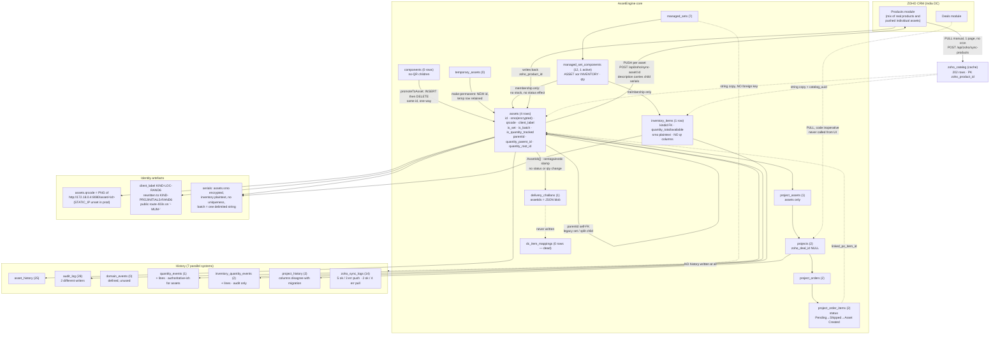
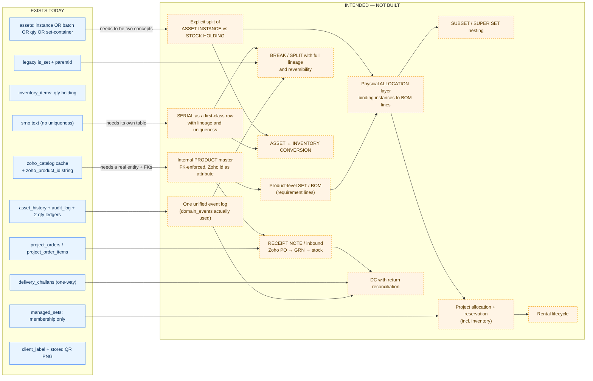

# AssetEngine — Complete Architecture and Workflow Audit

**Audit date:** 26 August 2026
**Target:** Production AssetEngine — `192.168.6.237`, container `asset-manager-prod`, port `8080`, database `asset_manager` (container `asset-manager-db`, PostgreSQL 15)
**Scope:** Read-only discovery. No application code, schema, migration, production data, Zoho data or OAuth credential was modified during this audit. Nothing was restarted.
**Method:** Live schema inspection via `psql`, live row sampling, source reading of `web-app/asset-manager-backend` and `web-app/asset-manager-frontend`, migration file reading, documentation cross-reading.

> **Reading rule for this document.** Where the code, the database and the UI disagree, all three positions are reported. Where evidence is missing, the finding is marked **UNKNOWN** with a note on what evidence would settle it. Nothing here is a proposal; this is a map of what exists.

---

## 1. Executive Summary

AssetEngine is a **single-tenant-shaped asset logistics monolith** built as one large Express application (`server.js`, 11,869 lines, 222 route registrations) over PostgreSQL/Knex with Redis caching and a vanilla-JS SPA frontend (~1.1 MB of hand-written JS across 32 files, entry `js/main.js`).

The ten findings that matter most before any redesign:

1. **There is no Product entity in AssetEngine.** There is a cached Zoho product catalog (`zoho_catalog`, 202 rows) and a `zoho_product_id` string column on `assets`, `inventory_items` and `managed_sets`. No foreign key connects them. "Product" is a *label attached to a row*, not a record with its own life.
2. **`zoho_product_id` means two contradictory things.** It is written when an asset is *created from* a Zoho catalog product, and it is also written when an asset is *pushed to Zoho as a new Product* (`zohoService.handleSyncResponse`, line 901). The column cannot tell you which direction the relationship runs.
3. **An Asset row is not reliably "one physical thing."** Depending on flags it is: a unique serialised object, a quantity balance (`is_quantity_tracked`), a multi-serial batch (`is_batch`, serials concatenated in one encrypted string), or a set container (`is_set`, holding nothing physical). All four live in the same table with the same ID space.
4. **Inventory and Assets share an ID space with no cross-table uniqueness guard.** Both are generated by `generateModernAssetId()`. The only cross-table ID trigger in the database (`trg_check_assets_dup`) protects `assets` ↔ `components`, not `assets` ↔ `inventory_items`.
5. **Two Set systems are live at once.** Legacy sets (`assets.is_set` + `assets.parentid`, with recursive status propagation and price rollup) and Managed Sets (`managed_sets` / `managed_set_components`, membership-only, no status effect, no stock effect). They are different concepts sharing the word "Set".
6. **Quantity has two incompatible engines.** Assets use an event-sourced path (`applyQuantityEvent` → `quantity_events` + `quantity_event_lines`) that also writes the row. Inventory updates the row directly and then writes an event as an audit note (`recordInventoryQuantityEvent`). Neither is the sole source of truth; the row is.
7. **`quantity_precision` does nothing.** It is stored on both tables and never used for rounding, validation or display. Frontend conversion hardcodes `.toFixed(4)`.
8. **Lineage is only partly recorded, and one operation destroys it.** `/api/assets/split` records `SPLIT_CHILD_CREATED` history and sets `parentid`, but `/api/assets/unsplit` **hard-deletes the child row** for batch parents (line 11686), leaving orphan history rows pointing at an ID that no longer exists.
9. **True Asset ↔ Inventory conversion does not exist.** The only cross-table conversions are `components` → `assets` (`promoteToAsset`) and `temporary_assets` → `assets` (`/api/temporary-assets/:id/make-permanent`).
10. **Roughly 100 of 222 routes carry no authentication middleware**, including `POST /api/dc`, `POST /api/employees`, `POST /api/assets/bulk`, `POST /api/assets/split` and `GET /api/scan` (a network port scanner). CORS is `Access-Control-Allow-Origin: *` with credentials enabled (line 2151).

Production is also very lightly loaded: 4 assets, 1 inventory item, 7 managed sets, 2 projects, 1 delivery challan, 78 employees, 202 catalogue rows. **Most of the architecture described below has never been exercised at volume.**

---

## 2. System Map

Route counts and line numbers refer to `web-app/asset-manager-backend/server.js` unless stated. Frontend files are under `web-app/asset-manager-frontend/js/`.

### 2.1 Module inventory

| # | Module | Purpose | Primary tables | Primary routes | Frontend | Services |
|---|--------|---------|----------------|----------------|----------|----------|
| 1 | **Assets** | Core tracked item registry | `assets`, `components`, `asset_it_details`, `asset_hierarchy` (dead — no app reader/writer) | `GET/POST /api/assets`, `PUT/DELETE /api/assets/:id`, `/api/asset-details/:id`, `/api/assets/bulk`, `/api/assets/:id/sell`, `/api/assets/:id/release-to-store`, `/api/assets/retired`, `/api/assets/recycle-bin`, `/api/assets/:id/restore` | `dashboard.js` (465 KB), `asset-view.js`, `contextMenu.js` | `encryptionService`, `zohoService` |
| 2 | **Inventory** | Quantity-oriented stock items (preview-flagged, live in prod) | `inventory_items`, `inventory_kinds`, `inventory_folders`, `inventory_components` | `/api/inventory/items`, `/api/inventory/item-details/:id`, `/api/inventory/kinds`, `/api/inventory/folders`, `/api/inventory/movements*`, `/api/inventory/consumed`, `/api/inventory/items/:id/delete\|restore` | `inventory.js` | `inventoryMovementService` |
| 3 | **Managed Sets** | Named grouping of assets + inventory | `managed_sets`, `managed_set_components` | `/api/managed-sets` (+ `/:id`, `/components`, `/archive`, `/restore`, `/eligible-assets`, `/eligible-inventory`) | `kitSets.js` | `kitSetService` |
| 4 | **Legacy Sets** | Parent asset containing child assets | `assets.is_set`, `assets.parentid`, `components.parentid` | `/api/assets/make-set`, `/api/assets/break-set`, `/api/assets/unsplit`, `/api/hierarchy/tree` | `dashboard.js`, `hierarchy.js` | `promoteToAsset`, `updateAssetStatus` |
| 5 | **Projects** | Job/site to which assets are assigned | `projects`, `project_assets`, `project_history` | `GET/POST /api/projects`, `PATCH /api/projects/:id`, `/api/projects/:id/assets`, `/assign-asset`, `/unassign-asset/:assetId`, `/api/projects/:id/history`, `/api/projects/search` | `projects.js` (171 KB) | `updateAssetStatus` |
| 6 | **Purchase Orders** | Vendor orders inside a project | `project_orders`, `project_order_items` | `/api/projects/:id/orders`, `/api/orders`, `/api/orders/:orderId`, `PUT /api/orders/:orderId/status`, `/api/assets/:id/link-po-item` | `projects.js` | — |
| 7 | **Temporary Assets** | Rented/borrowed gear on a project | `temporary_assets` | `/api/projects/:id/temporary-assets`, `/api/temporary-assets`, `/:id/make-permanent`, `DELETE /:id` | `projects.js` | — |
| 8 | **Dispatch / DC** | Delivery challan for outbound movement | `delivery_challans`, `dc_item_mappings` (0 rows), `dc_remark_templates` (created at runtime; **absent from prod**) | `GET/POST /api/dc`, `/api/dc/:id`, `/api/dc-remarks*` | `projects.js`, `dcProjectFetcher.js` | — |
| 9 | **Employees** | Staff directory + assignment target | `employees`, `department_quotas` | `/api/employees`, `/api/employees/bulk`, `/api/employees/:name/history`, `/api/quotas` | `employees.js` | — |
| 10 | **Quantity** | Quantity tracking and mutation | `assets.quantity_*`, `quantity_events`, `quantity_event_lines`, `inventory_quantity_events(+_lines)` | `/api/quantity/split\|issue\|consume\|adjust`, `/api/quantity/events/:rootId`, `/api/quantity/replay/:rootId`, `/api/inventory/quantity/events/:rootId`, `/api/inventory/movements` | `quantity-history-modal.js`, `dashboard.js` | `applyQuantityEvent`, `recordInventoryQuantityEvent`, `inventoryMovementService` |
| 11 | **Split / Break** | Divide a batch or detach a child | `assets` (self-FK), `asset_history` | `/api/assets/split`, `/api/assets/unsplit`, `/api/quantity/split`, `/api/assets/break-set` | `dashboard.js`, `projects.js` | — |
| 12 | **Serial numbers** | Identify physical units | `assets.srno` (encrypted), `assets.serialno`, `inventory_items.srno/serialno` | Embedded in create/update/split; `/api/assets/search` | `dashboard.js`, `inventory.js` | `encryptionService` |
| 13 | **QR** | Label + lookup | `assets.qrcode`, `assets.noqr`, `assets.client_label`, `projects.qrcode`, `delivery_challans.qrcode` | `/api/qr/:id`, `/api/qr/generate/:text`, `/api/qr/dynamic/asset/:id`, `/api/qr/dynamic/project/:id`, `/api/public/assets/:label`, `/asset/:id`, `/public/asset/:label` | `qr.js` (unused), `asset-view.js`, `index.html` scanner markup | `qrcode` npm |
| 14 | **History / Audit** | Operational record | `asset_history`, `audit_log`, `domain_events`, `project_history`, `zoho_sync_logs` | `/api/assets/:id/history`, `/api/audit`, `/api/audit-logs*`, `/api/recent-activity`, `/api/reports/asset-history` | `dashboard.js`, `quantity-history-modal.js` | `logAssetHistory`, `appendAudit` |
| 15 | **Recovery Center** | Restore soft-deleted rows | `assets.is_deleted`, per-entity flags | `/api/recovery-center/entity-types\|items\|summary`, `/:entityType/:id/restore` | `recovery-center.js` | `recoveryCenterService` |
| 16 | **Zoho integration** | CRM/catalog sync | `zoho_catalog`, `zoho_sync_logs`, `oauthtoken` (empty; tokens in file) | `/api/zoho/sync-asset/:id`, `/api/zoho/sync-products`, `/api/zoho/sync-deals`, `/api/zoho/catalog`, `/api/zoho/status`, `/api/zoho/oauth/*` | `dashboard.js`, `inventory.js` (catalog picker) | `zohoService` |
| 17 | **Hierarchy / taxonomy** | Folder + kind trees | `folders`, `asset_kinds`, `inventory_folders`, `inventory_kinds` | `/api/folders`, `/api/asset_kinds`, `/api/hierarchy/tree`, `/api/inventory/folders\|kinds` | `hierarchy.js`, `dashboard.js`, `inventory.js` | — |
| 18 | **Auth / RBAC** | Login, roles, permissions | `users`, `roles`, `permissions`, `role_permissions`, `auth_tokens`, `password_resets`, `companies` | `/api/auth/*`, `/api/users*`, `/api/roles`, `/api/permissions`, `/api/rbac/*`, `/api/tenant/users*`, `/api/signup` | `auth.js`, `rbac.js`, `admin.js` | JWT + bcrypt |
| 19 | **Warranty / AMC** | Expiry tracking + email alerts | `assets.warranty_months`, `amc_months`, `warranty_tracking`, `purchasedate` | `/api/settings/email*`, warranty scan inside email scheduler | `warranty.js` | `sendWarrantyEmail` (line 2179) |
| 20 | **OCR** | Document extraction to Excel/PDF/Word | filesystem OCR history JSON | 12 routes `/api/ocr/*` | `ocr.js` | Python/JS OCR helpers |
| 21 | **Network scanner** | LAN discovery for IT assets | none (live scan) | `/api/scan`, `/api/network-info`, `/api/network/credentials`, `/api/network/contacts` | `networkScanner.js`, `itAssets.js` | `evilscan`, `arp` |
| 22 | **ARRI / Service portal** | Job cards for service business | `arri_clients`, `arri_job_cards` | `/api/arri/*`, `/api/service/*` | `servicePortal.js`, `arri.js` | `googleSheetsService` |
| 23 | **External API** | Integration surface for other systems | reuses assets/projects | `/api/external/projects`, `/api/external/assets`, `/api/external/stats`, `/api/external/sheets-sync` | `integration_client.js` | `googleSheetsService` |
| 24 | **Tally** | Accounting export | none (XML over TCP) | `/api/settings/tally`, `/api/tally/sync` | `settings.js` | `sendTallyRequest` |
| 25 | **Company templates / quotes** | Document templates | `company_templates`, `quotes`, `layouts`, `layout_markers` | `/api/company-templates*` | `companyTemplates.js` | — |
| 26 | **Dynamic short codes** | Redirect codes | `dynamic.json` on disk | `/api/dynamic*` | — | `readDynamic`/`writeDynamic` |

### 2.2 Modules that do **not** exist

| Requested module | Status |
|------------------|--------|
| **Receipt Note / GRN / inbound receiving** | Not present in schema, routes or UI. See §18. |
| **Work Orders** | Not present as an AssetEngine module. See §19. |
| **Locations as an entity** | No `locations` table. Location is free text on `assets.currentlocation`, normalised only through a hardcoded `locCode` dictionary in `utils.js:171`. |
| **Attachments as an entity** | No attachment table. Files land on disk (`/uploads`, icons, OCR history) with no per-entity attachment record. |
| **Rental lifecycle** | `OPERATIONAL_STATUS.RENTAL` exists as a status string in `web-app/shared/lifecycleModel.js:88` and nothing else. |
| **Subsets / Super Sets** | No implementation. `is_set` parents can nest via `parentid`, which is the closest analogue. |

---

## 3. Database Architecture (live production schema)

51 tables, **0 views**, **0 enums**, **2 triggers**. Verified with `pg_stat_user_tables`, `pg_constraint`, `pg_trigger`, `information_schema.columns`.

### 3.1 Live row counts (exact, 26 Aug 2026)

| Table | Rows | Table | Rows |
|-------|------|-------|------|
| `assets` | 4 | `managed_sets` | 7 |
| `components` | 0 | `managed_set_components` | 12 (1 active) |
| `inventory_items` | 1 | `zoho_catalog` | 202 |
| `inventory_kinds` | 2 | `zoho_sync_logs` | 14 |
| `inventory_folders` | 1 | `employees` | 78 |
| `inventory_components` | 0 | `projects` | 2 |
| `asset_history` | 25 | `project_assets` | 1 |
| `audit_log` | 28 | `project_orders` | 2 |
| `domain_events` | **0** | `project_order_items` | 2 |
| `quantity_events` | 1 | `project_history` | 2 |
| `quantity_event_lines` | 1 | `delivery_challans` | 1 |
| `inventory_quantity_events` | 2 | `dc_item_mappings` | **0** |
| `inventory_quantity_event_lines` | 2 | `temporary_assets` | 0 |
| `asset_hierarchy` | 1 | `oauthtoken` | 0 |
| `asset_it_details` | 3 | `users` | 2 |

### 3.2 What one row represents

| Table | One row is… | Caveat |
|-------|-------------|--------|
| `assets` | **An operational asset holding**, which may be (a) one serialised unit, (b) a quantity balance of identical units, (c) a batch of N serialised units sharing one row, or (d) a set container with no physical existence. | The four meanings are distinguished only by flags `is_quantity_tracked`, `is_batch`, `is_set`. Nothing prevents all three flags being set at once — production row `HAR-MUM-0826-IEIZP5-U` has `is_set=1` **and** `is_batch=1` **and** `is_quantity_tracked=1`. |
| `components` | A **no-QR child part** of an asset, awaiting promotion. Empty in production. | Shares the ID space with `assets`; the only enforced cross-table ID rule in the DB. |
| `inventory_items` | **A stock holding of a consumable/quantity item at a location.** | Structurally near-identical to `assets` (52 columns, many the same names) but with `folderid`/`kindid` FKs that `assets` lacks. |
| `inventory_kinds` / `inventory_folders` | Taxonomy nodes with surrogate IDs (`IK-…`, `IF-…`). | `asset_kinds` uses the **name** as primary key; `inventory_kinds` uses an **ID**. This asymmetry is the root of the "Invalid inventory category" class of bugs. |
| `managed_sets` | **A named grouping declaration.** Nothing physical. | `status` ∈ {DRAFT, ACTIVE, ARCHIVED} enforced by check constraint. |
| `managed_set_components` | **A membership assertion** linking one set to one asset or one inventory item. | Soft-removed with `is_active=false`, so historic membership survives. 11 of 12 production rows are inactive. |
| `asset_history` | **A narrative event about one asset ID.** | No FK to `assets` — history survives hard deletion of the asset, becoming orphaned. |
| `audit_log` | A coarse CRUD/action record with a severity. | Overlaps `asset_history` with no defined division of responsibility. |
| `domain_events` | Generic entity event envelope. | **Zero rows. The table is defined and unused.** |
| `quantity_events` + `quantity_event_lines` | An asset quantity event header and its per-asset deltas. | 1 event in production (an `INIT`). |
| `inventory_quantity_events` + `_lines` | The same shape for inventory. | Written **after** the row is updated, as an audit note. |
| `projects` | **A job/deal the company is executing.** | Has `zoho_deal_id` and `zoho_project_id_key`; both NULL in production. |
| `project_assets` | **An assignment of one asset to one project**, typed `Permanent`/other. | No surrogate key, no history column; deletion is the unassignment mechanism in some paths. |
| `project_orders` | **A purchase order raised inside a project.** | Called "orders" in code, "PO" in UI. `ponumber` is free text. |
| `project_order_items` | **A PO line**, optionally linked to the asset that fulfilled it (`assetid`). | This is the closest thing to receiving that exists. |
| `delivery_challans` | **An outbound dispatch document.** | Items are stored as a JSON text blob in `assetids`; the normalised `dc_item_mappings` table exists but has **0 rows**. |
| `temporary_assets` | **A non-owned item used on a project** (rental/borrow), with quantity and estimated price. | Can be promoted into a real asset, keeping the temp row. |
| `zoho_catalog` | **A cached Zoho CRM Product.** | PK is the Zoho ID. No FK from assets/inventory. |
| `employees` | A staff member. | Referenced by name string in `assets.assignedto`, not by FK. |
| `asset_it_details` | IT network attributes for an asset. | Duplicates seven columns that also exist on `assets`. Both are written. |
| `asset_hierarchy` | A parent/child/position triple. | 1 row. Superseded by `assets.parentid`; effectively vestigial. |

### 3.3 Constraints actually enforced in production

**Foreign keys (24 total).** Notable:

- `assets.parentid → assets.id ON DELETE SET NULL` — deleting a parent silently orphans children.
- `assets.linked_po_item_id → project_order_items.id ON DELETE SET NULL`.
- `managed_set_components.{set_id, asset_id, inventory_item_id} → … ON DELETE RESTRICT` — the strictest referential policy in the database; you cannot delete an asset that is (or ever was) in a set.
- `dc_item_mappings.assetid → assets.id ON DELETE CASCADE` — but the table is unused.
- `inventory_items.{kindid, folderid} → … ON DELETE RESTRICT`.
- `project_assets.{projectid, assetid} → … ON DELETE CASCADE`.

**Check constraints (6, all on Managed Sets):**

```
managed_set_components_type_check       component_type IN ('ASSET','INVENTORY')
managed_set_components_xor_check        exactly one of asset_id / inventory_item_id
managed_set_components_asset_quantity_check  component_type <> 'ASSET' OR quantity = 1
managed_set_components_quantity_positive_check  quantity > 0
managed_sets_status_check               status IN ('DRAFT','ACTIVE','ARCHIVED')
managed_sets_archive_consistency_check  ARCHIVED ⇔ archived_at IS NOT NULL
```

Managed Sets is the **only** part of the schema with real domain invariants. Assets, inventory, quantity, serials, status and QR have **no** check constraints at all.

**Unique constraints:** `managed_sets.set_code`, `dc_item_mappings(dc_id, assetid)`, `employees.employeeid`, `arri_clients.name`. There is **no unique constraint on any serial number column**.

**Triggers (2):** `trg_check_assets_dup` on `assets` and `trg_check_components_dup` on `components`, both running `check_cross_table_id_duplication()`, which blocks the same lowercase ID existing in both tables. This is the only database-level identity rule in the system.

### 3.4 Schema provenance problem

`knex_migrations` lists 32 applied migrations. Several facts do not reconcile:

1. Migration `20260730090000_create_inventory_preview_tables.js` is **recorded as applied** in production, but its body begins:

```5:12:web-app/asset-manager-backend/migrations/20260730090000_create_inventory_preview_tables.js
exports.up = async function (knex) {
  const result = await knex.raw('select current_database() as db_name');
  const dbName = result?.rows?.[0]?.db_name || result?.[0]?.db_name || '';

  if (dbName !== 'asset_manager_test') {
    console.log(`[inventory-preview] Skipping inventory preview tables for database ${dbName}`);
    return;
  }
```

The production database is `asset_manager`, so this migration created nothing — yet the inventory tables exist in production **with the exact FK names the migration would have created** (`fk_inventory_items_kindid_inventory_kinds`). **UNKNOWN:** whether the tables were created by an earlier version of these files or by manual DDL. Evidence that would settle it: the DDL history / ops notes for the 8080 host. Either way, **the production inventory schema is not reproducible from the migration folder.**

2. `20260824120000_create_managed_sets_tables.js` exists on disk, is **not** in `knex_migrations`, and has an *earlier* timestamp than the applied `20260825120000_create_managed_sets_v2.js`. It creates two different tables (`sets`, `set_components`) that no code reads. The next `knex migrate:latest` on any environment will execute it.

3. **Column-level drift in three tables.** `project_history` in production has `status` and `note`; its migration defines `action`, `user`, `details`. `temporary_assets` in production has `name` and `quantity real`; neither is in `20260417060510_create_initial_schema.js:349-365`, and the create handler writes `quantity` (8777) as if it were part of the contract. `projects.company_id` is read by code (8686) and exists in **neither** the migration nor the production table.

Verified live:

```
temporary_assets: id, name, status, is_deleted, deleted_at, itemname, type,
                  category, make, model, estimatedprice, quantity, projectid,
                  timestamp, currency, ispermanent, linked_po_item_id
```

Docs also list tables that do not exist in production: `dc_remark_templates` (see below), `network_credentials`, `network_contacts` (`docs/03_DATABASE.md:59,98`). Conversely, production has `remark_templates`, which **no application code references** — the DC remarks feature reads and lazily creates `dc_remark_templates` instead (4054-4064), so that feature has never run against this database.

---

## 4. Identity Architecture

### 4.1 Generators

| Identity | Format | Generator | Example (production) |
|----------|--------|-----------|----------------------|
| Asset ID | `TYPE-LOC-MMYY-RAND6-X` | `generateModernAssetId()` → `IdGenerator.generateAssetId()` (`IdGenerator.js:2`), type/location from hardcoded dictionaries in `utils.js:145,171` | `HAR-MUM-0726-55QOFA-R` |
| Inventory ID | identical format | **the same** `generateModernAssetId()` (`server.js:4974`) | `MIS-MUM-0826-H4XVLL-W` |
| Component ID | identical format | `generateModernAssetId()` (`server.js:5038`) | — |
| Set-head / segment ID | `<parentId>-<4 digits of epoch>` | inline in make-set (`server.js:6688`) | — |
| Child segment ID | `<childId>-S<3 digits>` | inline (`server.js:6771`) | — |
| Managed Set ID | `SET-YYYYMMDD-XXXXXX` | `kitSetService` | `SET-20260825-0582C6` |
| Set Code | user-supplied, defaults to the Set ID | `kitSetService.createSet` | `TEST-MANAGED-SET-001`, `4536`, `SET-20260825-21D1C2` |
| Project ID | `LOC-MMYY-RAND6-P` | `IdGenerator.generateProjectId` | `MUM-0526-664651-P` |
| PO ID | `PO-<epoch ms>-<rand>` | inline | `PO-1779691453564-194` |
| PO line ID | serial integer | Postgres sequence | `2` |
| DC ID | `DC<epoch ms>` | inline | `DC1779692008938` |
| DC number | `YY/NNNN` | inline counter | `26/0001` |
| Temp asset ID | `TEMP-<epoch>-<rand>` | `IdGenerator.generateTempAssetId` | — |
| Client label | `KIND-LOC-RAND6` at creation; `KIND-PROJECTINITIALS-RAND6` after project split | `server.js:6325` and `server.js:11458,11555` | `APP-MUM-PZ2J6E`, `APP-ASN-MMKBX9` |
| Zoho Product ID | 19-digit Zoho ID | Zoho CRM | `1205624000001284002` |

`generateSplitAssetId(parentId, index)` → `PARENT-1` exists in `IdGenerator.js:41` and `utils.js:524` but **is not called by the split routes**, which use `generateModernAssetId` instead. Dead generator.

### 4.2 Identity matrix

Legend: ✔ yes · ✖ no · — not applicable · **?** unknown.

| Identity | Generated by | Stored in | Immutable | Globally unique | User-visible | Used as FK | Encrypted | Sent to Zoho | Read from Zoho | Survives split | Survives set membership |
|----------|--------------|-----------|-----------|-----------------|--------------|-----------|-----------|--------------|----------------|----------------|------------------------|
| Asset ID | AssetEngine | `assets.id` | ✔ in practice (no rename route) | Within `assets` + `components` (trigger). **Not** vs `inventory_items` | ✔ | ✔ (10 FKs) | ✖ | ✖ (never sent) | ✖ | Parent keeps ID; child gets a **new** ID | ✔ |
| Inventory ID | AssetEngine | `inventory_items.id` | ✔ | Within `inventory_items` only | ✔ | ✔ (4 FKs) | ✖ | ✖ | ✖ | no inventory split exists | ✔ |
| Component ID | AssetEngine | `components.id` | ✔ | vs `assets` (trigger) | partly | ✔ | ✖ | ✖ | ✖ | — | — |
| Managed Set ID | AssetEngine | `managed_sets.id` | ✔ | ✔ (PK) | ✔ | ✔ | ✖ | ✖ | ✖ | — | — |
| Set Code | **User** (defaults to Set ID) | `managed_sets.set_code` | ✖ (editable) | ✔ (unique constraint) | ✔ | ✖ | ✖ | ✖ | ✖ | — | — |
| Product ID (internal) | — | **does not exist** | — | — | — | — | — | — | — | — | — |
| Zoho Product ID | Zoho | `assets.zoho_product_id`, `inventory_items.zoho_product_id`, `managed_sets.zoho_product_id`, `zoho_catalog.zoho_product_id` (PK) | ✔ | ✔ in Zoho | partly (catalog picker) | ✖ **no FK anywhere** | ✖ | ✔ (as record id on update) | ✔ | child does **not** inherit it | ✔ |
| `catalog_uuid` | ? | `inventory_items.catalog_uuid` | — | — | ✖ | ✖ | ✖ | ✖ | ✖ | — | — (empty in production) |
| Project ID | AssetEngine | `projects.id` | ✔ | ✔ | ✔ | ✔ | ✖ | ✖ | ✖ | — | — |
| Zoho Deal ID | Zoho | `projects.zoho_deal_id` | ✔ | ✔ | ✖ | ✖ | ✖ | ✖ | ✔ (sync-deals) | — | — |
| Zoho project key | Zoho | `projects.zoho_project_id_key` | ? | ? | ✖ | ✖ | ✖ | ? | ? | — | — |
| PO ID / line ID | AssetEngine | `project_orders.id`, `project_order_items.id` | ✔ | ✔ | ✔ | ✔ | ✖ | ✖ | ✖ | — | — |
| Receipt Note ID | — | **does not exist** | — | — | — | — | — | — | — | — | — |
| DC ID | AssetEngine | `delivery_challans.id` | ✔ | ✔ | ✔ | ✔ (unused table) | ✖ | ✖ | ✖ | — | — |
| Serial number | Vendor/user | `assets.srno` (ciphertext), `assets.serialno` (bulk import only), `inventory_items.srno` | ✖ (freely editable) | ✖ **no uniqueness anywhere** | ✔ | ✖ | ✔ deterministic on assets, ✖ on inventory | ✔ **inside product descriptions** (`zohoService.js:497`) | ✖ | serial split moves the serial to the child | ✔ |
| QR code | AssetEngine | `assets.qrcode` (PNG data URL) | ✖ (regenerable) | — | ✔ | ✖ | ✖ | ✖ | ✖ | child is created with `qrcode: null` | ✔ |
| Client label | AssetEngine | `assets.client_label` | ✖ (rewritten on project split/unassign) | not enforced | ✔ (public URL) | ✖ | ✖ | ✖ | ✖ | child gets a project-flavoured label | ✔ |
| Parent ID | AssetEngine | `assets.parentid`, `components.parentid`, `inventory_items.parentid`, `inventory_kinds.parentid`, `folders.parentid` | ✖ | — | partly | ✔ self-FK | ✖ | ✖ | ✖ | set on child at split | legacy sets only |
| Quantity parent / root | AssetEngine | `assets.quantity_parent_id`, `quantity_root_id`, `inventory_items.*` | ✖ | — | ✖ | ✖ **no FK** | ✖ | ✖ | ✖ | set by make-set only | — |
| Batch ID | — | **does not exist**; `is_batch` is a boolean flag | — | — | ✔ (checkbox) | — | — | — | — | — | — |

### 4.3 Identity findings

- **The system has no stable identity for a physical unit.** The stable identifiers are row IDs. When a batch row is split, the units that leave get brand-new IDs and the units that stay keep the parent ID — so "which physical object is this?" cannot be answered from the ID alone.
- **Client label is the only user-facing external identity**, and it is mutated by project operations (`server.js:11458`, `8523`, `8616`), so a printed client label can stop matching the record.
- **`assets.id` and `inventory_items.id` are drawn from one generator with no shared uniqueness check.** A collision is unlikely (36⁷ space) but structurally unguarded, and any future "convert" feature will have to decide whether the ID moves.

---

## 5. Product Architecture

### 5.1 Findings

| Question | Answer | Evidence |
|----------|--------|----------|
| Is there an AssetEngine product table? | **No.** | No table in the 51-table production list represents an internal product. |
| Is the Zoho catalog merely cached? | **Yes.** | `zoho_catalog` (202 rows), PK `zoho_product_id`, columns `product_name, unit_price, make, model, hsn_code, description, sku, is_active, last_synced_at`. Written only by `zohoService.syncProductsFromZoho` (`zohoService.js:781-791`). |
| How are Zoho Products pulled? | Manual trigger `POST /api/zoho/sync-products` (2749) → SDK `Products` module → upsert into `zoho_catalog`. No scheduler found. | `zohoService.js:~740-795` |
| Where is Zoho Product ID stored? | `assets.zoho_product_id`, `inventory_items.zoho_product_id`, `managed_sets.zoho_product_id`, `zoho_catalog.zoho_product_id` | schema |
| Can multiple assets reference the same Zoho product? | **Yes** — nothing prevents it (no unique, no FK). | schema |
| Is there a product relationship on Assets/Inventory? | Only a **string column**. Joins are done ad hoc in queries; no FK, so a catalog purge would silently orphan every reference. | schema |
| Is `catalog_uuid` used? | Column exists on `inventory_items`; empty in production; written by the "create inventory from catalog" flow (`inventory.js:1555`). | live row dump |
| Are product records immutable? | No — they are overwritten wholesale on each catalog sync. | `zohoService.js:784` |
| Can a product exist without an asset/inventory? | **Yes** — 202 catalog rows, 5 referencing rows. |
| Can an asset exist without a product? | **Yes** — 2 of 4 production assets have empty `zoho_product_id`. |
| Can inventory exist without a product? | **Yes** — the single production inventory item has empty `zoho_product_id`. |

### 5.2 The direction ambiguity

`zoho_product_id` is written by two different flows with opposite meanings:

1. **Catalog → Asset** (Zoho is the master): user picks a catalogue product and creates an item from it.
2. **Asset → Catalog** (AssetEngine is the master): `POST /api/zoho/sync-asset/:id` pushes the asset into Zoho **as a new Product** and writes the returned Zoho ID back onto the asset row:

```897:903:web-app/asset-manager-backend/services/zohoService.js
                if (actionResponse instanceof ZOHOCRMSDK.Record.SuccessResponse) {
                    const zohoId = actionResponse.getDetails().get('id');

                    // Update local "Memory"
                    await db('assets').where('id', parentId).update({
                        zoho_product_id: zohoId
                    });
```

Production `zoho_sync_logs` shows both happening: `PULL_CATALOG` (2 success, 4 error) and `PUSH_ASSET_CREATE`/`PUSH_ASSET_UPDATE` (5 success, 3 error). The two assets with a `zoho_product_id` got it from **pushes**, not from catalogue selection.

Consequence: **a Zoho "Product" in this deployment may be a product type or a single physical asset.** The catalogue is being polluted with instance-level records, and AssetEngine cannot distinguish the two cases from its own data.

### 5.3 Actual implemented shape

```
                 ┌───────────────────────────────┐
                 │      ZOHO CRM  (Products)     │
                 │  product types AND pushed     │
                 │  individual assets, mixed     │
                 └───────────┬───────────────────┘
        PULL (manual)        │        PUSH (manual, per asset)
   POST /api/zoho/sync-products    POST /api/zoho/sync-asset/:id
                             │
                 ┌───────────▼───────────────────┐
                 │   zoho_catalog  (cache only)  │
                 │   PK zoho_product_id · 202 rows│
                 └───────────┬───────────────────┘
                             │  ✗ no foreign key — string copy only
              ┌──────────────┴───────────────┐
              ▼                              ▼
   assets.zoho_product_id        inventory_items.zoho_product_id
        (2 of 4 rows)                 (0 of 1 rows)
              │                              │
              └──────────► managed_sets.zoho_product_id (unused) ◄──┘

   There is NO AssetEngine product record between the catalogue and the item.
```

---

## 6. Asset Lifecycle

Every operation below was read in `server.js`. "History" means a row in `asset_history` via `logAssetHistory`; "Audit" means a row in `audit_log` via `appendAudit`.

### 6.1 CREATE — `POST /api/assets` (6266, JWT + RBAC)

| Aspect | Behaviour |
|--------|-----------|
| User sees | "Add Item" modal in `dashboard.js`; requires Item Name, Category, Type. |
| Frontend sends | Flat JSON with mixed casing; server accepts both `ItemName` and `itemname`. |
| Backend does | RBAC forces `department` for non-admins and zeroes price without `asset.edit_price` (6274-6282). Generates ID (6305). Builds `client_label` = `KIND-LOC-RAND6` (6325). Generates a QR PNG unless `noqr` (6330-6339). Encrypts serial deterministically (6360). Inserts. |
| DB writes | 1 `assets` row; optionally 1 `asset_it_details` row; optionally N `components` rows (children, always `NoQR=1`); optionally sets `parentid` on linked existing assets (6483); optionally updates `project_order_items.status='Asset Created'` (6492). |
| History | 1 `asset_history` `CREATE`; **2** `audit_log` `CREATE` rows (6391 and 6508 — a duplicate). If quantity-tracked, 1 `quantity_events` `INIT` with one line (6420). |
| Identity | New Asset ID, new client label, QR bound to the ID. |
| Zoho | **None.** Creation never contacts Zoho. |
| Reversible | Soft delete only. |

Two defects visible at creation:
- **Currency default disagrees with the schema**: code writes `'USD'` when absent (6380); the column default is `'INR'`.
- **The stored QR encodes an unreachable URL in production.** `STATIC_IP` is not set in `asset-manager-prod` (verified via `printenv`), so `ip = getLocalIP()` returns the container address `172.18.0.4`, producing `http://172.18.0.4:8080/asset/<id>`.

### 6.2 EDIT — `PUT /api/assets/:id` (8885)

Full-row update. Writes `asset_history` entries for changed status/assignment/location; writes `audit_log` `UPDATE`. Does **not** emit a quantity event when quantity fields change through this path — the row is updated directly, so `quantity_events` and the row can diverge.

### 6.3 ASSIGN / UNASSIGN (employee)

`assignedto` is a **free-text name** on `assets` (production value `Anurag Satish Ubhalkar`). There is no FK to `employees`. History action `ASSIGNMENT_CHANGE` (3 rows in production) and `UNASSIGNED` (1 row).

### 6.4 PROJECT ASSIGN / UNASSIGN

`POST /api/projects/:id/assign-asset` (8426) and `DELETE /api/projects/:id/unassign-asset/:assetId` (8546). Both funnel through `updateAssetStatus` (435), which:

1. updates `assets.status` (+ any extra columns),
2. inserts/deletes `project_assets` when `projectId` is given (457-470),
3. writes `asset_history` `STATUS_CHANGE`,
4. **recurses into children found by `parentid` when the row has `is_set`** (476-481).

The recursion is the only status cascade in the system and it follows **legacy** sets only. Managed Set membership has no effect on status.

Assign also rewrites `client_label` to `KIND-PROJECTINITIALS-RAND6` (8523) and unassign reverts it (8616) — visible in production data as `APP-ASN-MMKBX9`.

### 6.5 STATUS CHANGE

Statuses in production data: `In Store`, `In-Use`, `Project`, `Sold`. The canonical registry in `web-app/shared/lifecycleModel.js` defines 11 lifecycle codes and 14 operational statuses, plus a full transition map and `assertTransition()`.

**`assertTransition` is never called.** Grep across `web-app` finds `resolveLifecycle` used only by `recoveryCenterService.js`. Ad-hoc statuses are written directly elsewhere — e.g. `'All Assigned'` in make-set (6710), which is not in the registry. **The lifecycle model is documentation, not enforcement.**

### 6.6 SELL / RETIRE — `POST /api/assets/:id/sell` (799)

Sets `status='Sold'`, `is_retired=1`, stores a JSON blob in `sale_details`, writes `ASSET_SOLD` history. No quantity change, no Zoho effect, no reversal endpoint. Two production assets are in this state.

### 6.7 RELEASE TO STORE — `POST /api/assets/:id/release-to-store` (836)

Inward-inspection completion: sets `status='In Store'`, `condition`, appends remarks, and **hardcodes `currentlocation='Mumbai'`** (853). Recurses into legacy set children. History `STATUS_CHANGE` with the inspection note (production shows one `INSPECTION_PASSED` row from an older path).

### 6.8 DELETE / RESTORE

`DELETE /api/assets/:id` (9461) is a **soft delete** (`is_deleted=1`, `deleted_at`, `deleted_by`); `POST /api/assets/:id/restore` (9596) reverses it; `/api/assets/recycle-bin` (978) and the Recovery Center list them. `DELETE /api/assets/bulk` (9361) exists. Managed Set membership uses `ON DELETE RESTRICT`, so a hard delete of a set member is impossible at the database level.

### 6.9 Operations that do **not** exist for assets

Move (as an operation — location is just an editable field), transfer between locations with history, return-from-DC, reservation, check-out/check-in, maintenance, disposal.

---

## 7. Inventory Lifecycle

### 7.1 CREATE — `POST /api/inventory/items` (4940)

Gated by `rejectInventoryPreviewOnNonTest` → `isInventoryPreviewPort()` (375), which returns **true unless `FEATURE_INVENTORY_ENABLED=false`**. The variable is unset in production, so **inventory is fully enabled in production** despite the docs describing it as a test-only preview.

ID from `generateModernAssetId` (4974). `KindID` must exist in `inventory_kinds.id` (4954) — the validation that produces the "Invalid inventory category" error when an asset-kind *name* is submitted into an inventory field. Optional child rows go to `inventory_components`. On quantity tracking, writes an `INIT` event through `recordInventoryQuantityEvent`.

### 7.2 EDIT — `PUT /api/inventory/items/:id` (5100)

Full-row overwrite with the same category validation. Quantity changes here are direct column writes followed by an `ADJUST` audit event. Production evidence — the only inventory item:

- `quantity_total = 3`, `quantity_available = 1`
- events: `INIT` (total +1, available +1), `ADJUST` (total +2, available +0)
- metadata of the ADJUST: `{"prev_quantity_total":1,"new_quantity_total":3,"prev_quantity_available":1,"new_quantity_available":1}`

The sums reconcile with the row **in this instance**, but only because the code wrote both. Nothing enforces it, and available never moved when total did.

### 7.3 MOVEMENTS — `POST /api/inventory/movements` (4810)

`services/inventoryMovementService.js` defines a movement registry (`MOVEMENT_TYPES`, lines 36-111). **`RECEIVE` and `ADJUST` are declared with `enabled: false`; only `CONSUME` is live** (`applyConsumeMovement`, 194-337). Consumption decrements `quantity_available`, can set status `Consumed`, and records an event.

So the inventory verbs the UI implies (receive, adjust, transfer) are: receive **disabled**, adjust **only via full-row PUT**, transfer **not implemented**.

### 7.4 Column usage in practice

| Column | Actual use |
|--------|-----------|
| `quantity_total` | Authoritative stock figure written directly by create/update/consume. |
| `quantity_available` | Written by the same paths; not derived; can drift from `total` with no reconciliation job. |
| `quantity_precision` | **Stored and never read.** No rounding, validation or formatting anywhere. |
| `quantity_unit` | Free text, trimmed only (`normalizeQtyUnit`, 1687). No unit registry, no validation. Production value `Nos`. |
| `quantity_note` | Free text; exists only on `inventory_items` (assets have no equivalent). |
| `serialno` | Present but empty in production; `srno` carries the value (`TES789`), **unencrypted** on inventory. |
| `kindid` | FK to `inventory_kinds` with RESTRICT. The one strongly-typed taxonomy link in the system. |
| `catalog_uuid` | Written only by the catalog-create path; empty in production. |
| `zoho_product_id` | Empty in production; never pushed. |
| `is_set` / `set_price_mode` | Columns copied from the assets design; **no inventory set logic reads them.** |
| `is_batch` | Column exists; no inventory batch UI. |

### 7.5 Inventory operations that do not exist

Split, break, promote-to-asset, dispatch, project assignment, QR (no `qrcode`/`noqr`/`client_label` columns), archive (only soft delete), transfer.

---

## 8. Quantity Architecture

### 8.1 Two engines

| | Assets | Inventory |
|--|--------|-----------|
| Entry points | `/api/quantity/issue` (6935), `/consume` (7067), `/adjust` (7172, admin-only), `/split` (6524); `POST /api/assets` INIT | `POST/PUT /api/inventory/items`, `POST /api/inventory/movements` (CONSUME only) |
| Event writer | `applyQuantityEvent` (1996-2056) — writes the event **and** applies deltas to the row | `recordInventoryQuantityEvent` (4560-4618) — writes the event **after** the row was already changed |
| Tables | `quantity_events` + `quantity_event_lines` | `inventory_quantity_events` + `inventory_quantity_event_lines` |
| Replay endpoint | `GET /api/quantity/replay/:rootId` (7256) sums line deltas | none |
| Authoritative | **The row.** Events are complete only if every mutation went through the event path — and `PUT /api/assets/:id` does not. | **The row**, explicitly. Events are an audit trail. |
| Production volume | 1 event | 2 events |

`/api/quantity/replay/:rootId` is the only reconstruction tool, it covers assets only, and it is **unauthenticated**.

### 8.2 Meaning of quantity

- **Asset quantity** means "how many identical units this holding represents", but only when `is_quantity_tracked=1`. Two production assets have no quantity at all; one has `quantity_total=1` alongside `is_batch=1`.
- **Inventory quantity** means "stock on hand at this location", with `available` intended as the unreserved part — though nothing reserves.
- **Set component quantity** (`managed_set_components.quantity`) means "how many of this item the set declares", forced to exactly 1 for assets by check constraint. It is **not** deducted from anything.

### 8.3 `quantity_precision`

Stored on `assets` and `inventory_items`, parsed at create (`server.js:6350`), floored in the frontend before submit (`dashboard.js:7950`), and then **never used**. Precision 0 and precision 2 behave identically. Conversions in `dashboard.js:1873-1917` are computed client-side and hardcode `.toFixed(4)`. Inventory workspace quantity inputs use `step="1"` regardless of precision (`inventory.js:1797`).

### 8.4 Conversions

`conversion_unit`, `conversion_factor`, `conversion_mode` exist on both tables. The "Apply Conversion" tool computes the new number **in the browser** and submits the result; the backend stores whatever it is given. Therefore: conversions are **not** reversible from stored data, do **not** create an event of their own, do **not** touch product identity, serials, or availability semantics — they simply rewrite the number and unit.

### 8.5 Every quantity mutation endpoint

| Endpoint | Entity | Event? | Auth |
|----------|--------|--------|------|
| `POST /api/assets` (INIT) | asset | ✔ | JWT |
| `PUT /api/assets/:id` | asset | ✖ | JWT |
| `POST /api/quantity/issue` | asset | ✔ | **none** |
| `POST /api/quantity/consume` | asset | ✔ | **none** |
| `POST /api/quantity/adjust` | asset | ✔ | in-handler `requireAdmin` |
| `POST /api/quantity/split` | asset | ✔ | **none** |
| `POST /api/assets/split` | asset | ✖ (history only) | **none** |
| `POST /api/assets/unsplit` | asset | ✖ (history only) | JWT |
| `POST /api/assets/make-set` | asset | ✖ (history only) | JWT |
| `POST /api/inventory/items` | inventory | ✔ audit-style | JWT |
| `PUT /api/inventory/items/:id` | inventory | ✔ audit-style | JWT |
| `POST /api/inventory/movements` (CONSUME) | inventory | ✔ | JWT |

Six quantity-mutating paths bypass the event system entirely, and four require no authentication.

---

## 9. Serial Number Architecture

| Question | Answer |
|----------|--------|
| Where stored | `assets.srno` (primary), `assets.serialno` (bulk-import path only, `server.js:7641`), `inventory_items.srno` / `serialno`, `components.srno`, `arri_job_cards.serialno` |
| Encrypted | Assets: **yes**, `encryptionService.encryptDeterministic` at create (6360) and split (11565). Inventory: **no**. Components: **no**. |
| Unique | **No constraint anywhere.** One application-level check exists, in the Google Sheets sync path (`server.js:11788`). |
| Multiple serials per row | Yes — batch assets store them delimited in one `srno` string, parsed with `split(/[\n,]+/)` (11520). |
| Multiple serials per inventory row | No parsing logic exists. |
| Quantity must equal serial count | Only enforced *at serial split*, which force-syncs `quantity_total = quantity_available = remaining serial count` (11532). Otherwise they drift freely. |
| Box serial vs unit serial | **Not distinguished.** No column, flag or convention. |
| Serials can be broken out | Yes, for assets: `POST /api/assets/split` with a `serials` array creates one child per serial. |
| Serials can be reassigned | Yes — `srno` is an ordinary editable field. |
| Serial history | Only indirectly: `SPLIT_PARENT_UPDATED` stores the old and new serial lists in `asset_history.oldvalue/newvalue` (11604). Ordinary edits store no serial diff. |
| Serial lineage | None. |

**"Enable Batch S/N" (`is_batch`)** does exactly this: it turns on a multi-line serial textarea in the modal and makes the frontend derive `quantity_total` from the number of lines entered (`dashboard.js:7858-7870`). The backend stores the concatenated string encrypted. It creates no per-serial record, no child rows, and no uniqueness check.

**Serial leakage to Zoho.** `buildAssetDescription` (`zohoService.js:480-514`) lists every child asset with `child.serialno || child.srno` into the Zoho Product description. For assets created through the normal path, `serialno` is empty and `srno` is **ciphertext**, so the description pushed to Zoho contains encrypted serial blobs — the encryption is defeated in intent and the data is meaningless in Zoho.

---

## 10. QR Architecture

Five distinct QR mechanisms exist.

| # | Mechanism | Route / column | Encodes | Notes |
|---|-----------|----------------|---------|-------|
| 1 | **Stored asset QR** | `assets.qrcode` (PNG data URL), written at create (6339) | `http://<STATIC_IP or getLocalIP()>:<PORT>/asset/<id>` | In production `STATIC_IP` is unset → encodes `172.18.0.4:8080`, unreachable. |
| 2 | **On-demand QR by ID** | `GET /api/qr/:id` (9744) | same URL shape | Regenerates; can persist back. |
| 3 | **Arbitrary text QR** | `GET /api/qr/generate/:text` (6192) | whatever is passed | Unauthenticated. |
| 4 | **Dynamic asset/project QR** | `GET /api/qr/dynamic/asset/:id` (6214), `/project/:id` (6240) | uses `req.get('host')` — the **correct** host | Unauthenticated; not stored. |
| 5 | **Public client-label QR** | `/public/asset/:label` page + `GET /api/public/assets/:label` (2645) | client label | See defect below. |

Plus: `projects.qrcode`, `delivery_challans.qrcode`, and a `/api/dynamic/:code` short-code redirector backed by `dynamic.json`.

**Is QR an identity?** No. It is a **rendering of a lookup URL**. The identity is the Asset ID (mechanisms 1-4) or the client label (mechanism 5). Deleting `qrcode` loses nothing but the picture.

**No-QR items** are represented two ways: `assets.noqr=1` (skip QR generation) and membership of the `components` table (always `NoQR=1`, promoted later by `promoteToAsset`). Inventory has no QR concept at all — no `qrcode`, `noqr` or `client_label` columns — yet `inventory.js:1087` renders a QR print button that calls `window.printAssetLabel`, which is never defined.

**Public lookup is self-blocking.** The public endpoint rejects labels that look internal:

```2649:2652:web-app/asset-manager-backend/server.js
        // Security check: Only allow lookup by client_label, never by internal ID
        if (label.includes('-MUM-') || label.includes('SET-')) {
            return res.status(403).json({ error: 'Direct internal ID access is restricted for security.' });
        }
```

But the default client label format **is** `KIND-MUM-RAND6` for every Mumbai asset (three of four production assets: `APP-MUM-PZ2J6E`, `HAR-MUM-55QOFA`, `HAR-MUM-IEIZP5`). The public page therefore returns 403 for the majority of real labels; only labels re-stamped with project initials (`APP-ASN-MMKBX9`) pass. The same endpoint also returns `SerialNo` without authentication.

---

## 11. Parent / Child Architecture

There are **five** parent-ish mechanisms, three of them on `assets` alone.

| Mechanism | Column/table | Set by | Meaning | Cleared by |
|-----------|--------------|--------|---------|------------|
| Legacy hierarchy | `assets.parentid` (self-FK, `SET NULL`) | make-set, split, `linkedIds` at create | "child of this set/batch parent" | break-set, unsplit (set case) |
| Quantity lineage | `assets.quantity_parent_id` | make-set batch segmentation (6698, 6781) | "quantity was carved out of this row" | never |
| Quantity root | `assets.quantity_root_id` | create (6411) | event grouping key | never |
| Component table | `components.parentid` (FK CASCADE) | asset create with nested components | no-QR sub-part | promotion |
| Managed membership | `managed_set_components` | Managed Sets UI | declared membership | soft removal |
| Vestigial | `asset_hierarchy(parentid, assetid, position)` | ? (1 row) | superseded | — |
| Inventory | `inventory_items.parentid`, `inventory_components.parentid` | inventory create | sub-item | — |

`assets.parentid` is **overloaded**: the same column means "member of a legacy set", "split child of a batch", and "linked sub-asset", and the code must inspect the parent's flags to tell which (`unsplit`, 11671, branches on `parent.IsBatch || parent.IsQuantityTracked`).

Concepts present vs absent:

| Concept | Present? |
|---------|----------|
| Parent | ✔ (`parentid`) |
| Child | ✔ |
| Component | ✔ two ways (`components` table, and child assets) |
| Box / individual distinction | ✖ |
| Subset | ✖ (nesting is possible via `parentid` but nothing models it) |
| Super Set | ✖ as a concept; the word appears in comments (`zohoService.js:517`, `server.js:2698`) meaning "a set pushed to Zoho" |
| Lineage across operations | Partial — `parentid` + history text only |
| Batch as an entity | ✖ (flag only) |

---

## 12. Break / Split Architecture

### 12.1 `POST /api/assets/split` (11328, **unauthenticated**)

Two modes.

**Quantity split** (11361-11511):

| | |
|--|--|
| Original record | **Kept.** `quantity_total` and `quantity_available` are decremented (11372-11378). |
| New record | One child asset, new ID from `generateModernAssetId`, `parentid = parent`, `is_quantity_tracked=1`, `is_batch=0`, `qrcode: null`, `asset_value` pro-rated. |
| Merge behaviour | If a child already exists for the same project or assignee, quantity is **merged into it** instead of creating a new row (11391, 11419). |
| Serial | Child copies `parent.SrNo` verbatim — i.e. the **same serial string is now on two rows**. |
| QR | Child has none. |
| Client label | Project splits stamp `KIND-PROJECTINITIALS-RAND6`. |
| Product | `zoho_product_id` is **not** copied. |
| History | `SPLIT_CHILD_CREATED` on the child, `QUANTITY_REDUCED` on the parent, `QUANTITY_INCREASED` on merge. |
| Quantity events | **None.** The event tables are bypassed. |
| Project | Inserts `project_assets` when `projectId` is supplied. |

**Serial split** (11513-11604):

| | |
|--|--|
| Original record | Kept; `srno` rewritten to the remaining serials, `quantity_total/available` force-synced to the remaining count (11529-11536). |
| New records | One child per requested serial, each holding one encrypted serial, `is_quantity_tracked=0`. |
| History | `SPLIT_CHILD_CREATED` per child (with the serial in `newvalue`), `SPLIT_PARENT_UPDATED` with old and new serial lists. |

### 12.2 `POST /api/assets/unsplit` (11621, JWT)

| Parent type | Behaviour |
|-------------|-----------|
| Batch / quantity parent | Adds the child's quantity back, deletes the child's `project_assets` rows, then **hard-deletes the child from `assets` and `components`** (11684-11687). History `SPLIT_CHILD_RESTORED` is written **on the parent**. |
| Anything else (treated as a set) | Clears `parentid`, sets `status='In Store'`, **hardcodes `currentlocation='Mumbai'`**, clears `assignedto`, writes `BREAK_SET` history. |

Consequences worth stating plainly:

- Unsplitting a quantity child is **destructive**: the child ID disappears, its own history rows remain in `asset_history` pointing at a non-existent asset, and the child's serial (if any) is **not** merged back into the parent's `srno`.
- A serial-split child unsplit into a non-batch parent keeps its own row but the parent never regains the serial — the serial list has permanently lost that entry.

### 12.3 `POST /api/assets/break-set` (6852)

Detaches children of a legacy set. Behaviour differs from unsplit's set branch in how `parentid` is handled and what history is written — two code paths implementing "break" with different results.

### 12.4 `POST /api/quantity/split` (6524, unauthenticated)

A separate, event-based quantity split that writes `quantity_events`. Two split implementations for assets coexist; the dashboard uses `/api/assets/split`.

### 12.5 Reconstructability

Given production's single `quantity_events` row and 25 `asset_history` rows, and given that split/unsplit/make-set write history text but no structured events: **a break or split can be described from history, but not replayed or reversed programmatically.** For unsplit, the destroyed child cannot be reconstructed at all — its attributes were never copied anywhere before deletion.

---

## 13. Conversion Architecture

**TRUE ASSET ↔ INVENTORY CONVERSION DOES NOT CURRENTLY EXIST.**

Searched semantically for asset→inventory, inventory→asset, promote, convert, clone, copy, make-permanent, temporary. What exists:

| Implementation | From → To | Original kept? | New ID? | History | Notes |
|----------------|-----------|----------------|---------|---------|-------|
| `promoteToAsset` (394) | `components` → `assets` | **No** — row is deleted after insert (420) | **No** — same ID moves tables | `PROMOTED` history row | The only true "move" in the system; guarded by the cross-table trigger. |
| `POST /api/temporary-assets/:id/make-permanent` (8790) | `temporary_assets` → `assets` | **Yes** — temp row retained, `ispermanent=1` | **Yes** — new asset ID | history on the new asset | The nearest precedent for a future conversion design. |
| "Create inventory from catalog" (`inventory.js:1555`) | `zoho_catalog` → `inventory_items` | catalogue row untouched | new inventory ID | none | A create, not a conversion. |
| `/api/assets/split` | asset → asset | yes | yes | yes | Same table. |
| Legacy make-set batch segmentation (6688) | asset → asset | yes | yes | `BATCH_SEGMENTED` | Same table. |

There is **no** code path that moves a row between `assets` and `inventory_items` in either direction, and no column on either table records that such a move happened.

---

## 14. Set Architecture

### 14.1 The two systems

| | Legacy Sets | Managed Sets |
|--|-------------|--------------|
| Storage | `assets.is_set=1` + children via `assets.parentid` | `managed_sets` + `managed_set_components` |
| Created by | `POST /api/assets/make-set` (6653) | `POST /api/managed-sets` (2829) |
| Container is | **A real row in `assets`** — it has an ID, a QR, a status, a location, a price mode, and can itself be assigned to a project | A row in `managed_sets` only |
| Members | Assets and `components` rows | Assets **and** inventory items |
| Status effects | **Yes** — `updateAssetStatus` recurses to all children (476-481) | **None** |
| Price | `set_price_mode = SUM_OF_CHILDREN` | none |
| Quantity | Children can be quantity-carved into the set (`quantity_parent_id`) | `quantity` column, forced to 1 for assets |
| Multiple membership | An asset has exactly one `parentid` | Enforced in service code: one **active** set per asset; inventory may be in many |
| Removal | `break-set` / `unsplit` clears `parentid` | `is_active=false`, row retained |
| Archive | none | `status='ARCHIVED'` + `archived_at`, enforced by check constraint |
| Delete | delete the parent asset | **No delete route.** `ON DELETE RESTRICT` on all three FKs |
| Zoho | `POST /api/zoho/sync-asset/:id` pushes a legacy set as a Zoho Product with a "KIT INCLUDES" description | `managed_sets.zoho_product_id` exists, never written |
| Production | one asset carries `is_set=1` | 7 sets, 12 membership rows |

**They are different concepts wearing the same word.** A legacy set is a *physical container asset*; a Managed Set is a *declaration of grouping*. Nothing reconciles them, except a read-time bridge in `kitSetService.listSets/getSet` (165-225) that unions `managed_sets` with `assets.is_set=1` so the Sets screen shows both.

### 14.2 Managed Sets, answered precisely

| Question | Answer |
|----------|--------|
| Can assets be members? | Yes, quantity forced to 1 by check constraint. |
| Can inventory be members? | Yes, quantity > 0 free. |
| Can they coexist in one set? | Yes — production set `SET-20260825-FB075C` holds 3 assets and 1 inventory item. |
| Can one asset be in multiple sets? | Only one **active** membership (service-level rule); historic inactive rows in other sets are normal. Production asset `HAR-MUM-0726-55QOFA-R` appears in four sets, all inactive. |
| Can inventory be in multiple sets? | Yes. |
| What does component quantity mean? | A declared count. **Purely informational.** |
| Does membership affect stock? | No. Adding 2 units of inventory to a set does not reduce `quantity_available`. |
| Does membership affect asset status? | No. |
| Removal | Soft — `is_active=false`; the row and its `added_at` survive. |
| Archive | Set-level status change; components are untouched and remain queryable. |
| Restore | `POST /api/managed-sets/:id/restore` flips status back and clears `archived_at`. |
| Deletion | Not exposed; RESTRICT FKs make cascade deletion impossible. |
| Membership history | **Retained** in the component rows themselves. There is no separate membership event log, so *why* and *by whom* a member left is not recorded. |

---

## 15. Product-Level vs Physical-Level Sets

**This distinction does not exist in AssetEngine today.**

A product-level requirement layer ("Camera ×1, Lens ×2, Battery ×10") would need a set definition that references *product types* and a separate allocation layer that binds specific `assets` / `inventory_items` rows to those lines. What exists:

- `managed_set_components` references **only concrete rows** (`asset_id` or `inventory_item_id`, enforced by the XOR check). There is no product-type column, no `required_quantity` vs `allocated_quantity`, no fulfilment state.
- `managed_sets.zoho_product_id` hints at a product-level idea but is never written.
- Legacy sets are entirely physical — a container asset with concrete children.
- There is no product entity to point a requirement at (§5).

The nearest existing analogue to a "requirement line" anywhere in the system is `project_order_items` (a PO line with `qtyordered`, `uom` and an optional fulfilling `assetid`) — a procurement construct, not a set construct.

---

## 16. Project Architecture

### 16.1 What a project is

`projects` holds a customer job: name, client name (free text, no FK), location, currency, status, start/end dates, owner/coordinator emails, a QR payload, `initials`, full consignee/buyer billing blocks (GSTIN, state, state code) and soft-delete flags. **One row = one customer job / deal workspace.**

Created by `POST /api/projects` (5661, admin/manager). ID via `generateProjectId(location)` → `LOC-MMYY-RAND6-P`, with a fallback of `'PRJ' + Date.now()` (5686). Default status `'Planning'`; the Kanban UI uses `Planning | Active | On Hold | Completed` (`projects.js:478`).

`projects.company_id` is referenced in code (8686) but **is not in any migration** and is not in the production schema.

### 16.2 Zoho relationship

`projects.zoho_deal_id` and `projects.zoho_project_id_key` exist and are written **only** by `zohoService.syncDealsFromZoho` (`zohoService.js:854-876`), reachable via `POST /api/zoho/sync-deals` (2724).

- **Direction: pull only.** No route pushes a project to Zoho.
- **No frontend calls it.** There is no UI trigger for deal sync anywhere in `js/`.
- The handler uses SDK `getFieldValue` for `Deal_Name`/`Type` (849-850), an accessor that throws on SDK 8.0 — the same bug that was fixed in the products path by switching to `getKeyValue`. **In practice this sync is inoperative.**
- When it does insert, it uses the Zoho `Project_ID` custom field as the local primary key, bypassing `generateProjectId` entirely — so a Zoho-born project would have a different ID shape from a locally-born one.
- Both columns are **NULL for both production projects**.

**Answer to "do both a Zoho Project ID and an AssetEngine Project ID exist?"** The columns exist for both; only the AssetEngine ID is populated. Today there is exactly one project identity in use.

### 16.3 Asset ↔ project relationship

`project_assets(projectid, assetid, assigneddate, type)`, composite PK, both FKs CASCADE. Written from **eight** places: `updateAssetStatus`, `assign-asset`, `/api/assets/split`, `/api/quantity/split|issue|consume`, `make-set`, `POST /api/dc` (type `'DC'`), `make-permanent`, and deleted by project delete.

Status effects:

| Operation | Status written | Location written | Other |
|-----------|----------------|------------------|-------|
| Assign (8517-8531) | `Project` | `On Site` | `assignedto = 'Project: <name>'`, `client_label` rewritten to project initials |
| Unassign (8608-8627) | `Under Inspection` | `Warehouse` | clears `assignedto`, clears `linked_po_item_id` |
| Release to store (848) | `In Store` | `Mumbai` | records condition |
| DC auto-link (3993) | **unchanged** | `On Site` | `assignedto = 'Project: <ref>'` |
| Project delete (5622-5627) | looks for `In-Use`, `Project Assigned`, `Shipped` → sets `In-Stock` | — | **None of those three strings is what assign writes** |

That last row is a live defect: deleting a project will not reset assets that were assigned through the normal path, because the assign path writes `Project` and the cleanup path looks for `In-Use`/`Project Assigned`/`Shipped`, and it writes `In-Stock` which is not the string the rest of the system uses (`In Store`).

Assignment is guarded by `getAssetAssignmentStatus` (2612-2637), which blocks assigning an asset that is already with a user or another project.

### 16.4 Inventory and projects

**Inventory cannot be assigned to a project.** There is no `project_inventory` table, no `projectid` on `inventory_items`, and no write of an inventory ID into `project_assets`. The route named `GET /api/projects/:id/available-inventory` (11833) queries the **assets** table — and selects `a.unitprice`, a column that does not exist in production (verified: `ERROR: column a.unitprice does not exist`), so **the route fails at runtime**. The project workspace UI instead calls `/api/assets?status=In Store,Owned,Demo` (`projects.js:2461`).

**Managed Sets cannot be assigned to a project either.** `kitSetService.js` contains zero project references.

### 16.5 Temporary assets

`temporary_assets` carries non-owned gear on a project (`projectid`, `estimatedprice`, `quantity`, `ispermanent`, `linked_po_item_id`). `GET /api/projects/:id/assets` unions permanent assets and temporary rows (8375-8394).

`POST /api/temporary-assets/:id/make-permanent` (8790, **no authentication**):

1. inserts a **new** `assets` row with a **new ID** — the `TEMP-…` ID is not carried over;
2. sets the new asset's status to `'In Store'` even though it immediately links it to a project;
3. inserts `project_assets`;
4. sets `temporary_assets.ispermanent = 1` and **keeps the temp row**;
5. writes `audit_log` `CONVERT_TEMP` and `asset_history` `CREATE`.

No reverse operation exists.

### 16.6 Purchase orders inside projects

`project_orders` (header) + `project_order_items` (lines, statuses `Pending` → `Partially Fulfilled` → `Shipped` → `Asset Created`). Full CRUD exists (8088, 8158, 8255, 9348) plus `POST /api/assets/:id/link-po-item` (9617). Asset creation can link back to a PO line and flip it to `Asset Created` (6492). DC creation flips linked lines to `Shipped` (4026).

Production has 2 POs and 2 lines, one of which is linked to a real asset with status `Shipped`. **This is the only fulfilment chain that exists in the product today**, and it runs PO line → asset, with no receiving document in between.

---

## 17. Dispatch / DC Architecture

### 17.1 What a DC is

`delivery_challans` = **one outbound dispatch document**. Columns: `id`, `challanno`, `customername`, `deliverydate`, `assetids` (JSON text array), `status`, `qrcode`, `createdby`, `timestamp`, `payloadjson` (the whole printable document), `remarks`, soft-delete flags.

IDs: internal `DC<epoch ms>`; human `YY/NNNN` generated by reading the last `challanno LIKE 'YY/%'` and incrementing (3834-3853) — a **non-atomic sequence** that can collide under concurrency.

### 17.2 Routes

`GET /api/dc` (3718), `GET /api/dc/:id` (3764), `POST /api/dc` (3802), plus `/api/dc-remarks` CRUD. **There is no update, cancel or delete route for a DC.** All DC routes are **unauthenticated**.

### 17.3 What can be dispatched

| Type | On a DC? |
|------|----------|
| Assets | ✔ — `AssetIds[]` loaded from `assets` |
| Legacy sets | ✔ — children are pulled in to enrich the description (3817-3822) |
| Managed Sets | ✖ |
| Inventory items | ✖ |
| Free-text lines | Partly — the printable `payload.items` carries editable description/qty/rate, stored only inside `payloadjson` |

### 17.4 Effects

1. `assets.sentagainstdc = challanNo` and optionally `boughtagainstpo` (3859-3864).
2. **Status is not changed.** No `updateAssetStatus` call in the DC path.
3. **Quantity is not decremented.**
4. If `payload.meta.referenceNo` matches a `projects.projectname`, the asset is linked to that project with `type='DC'`, `assignedto='Project: <ref>'`, `currentlocation='On Site'`, and an `asset_history` `PROJECT_CHANGE` row (3993-3998). Matching a project **by name string** is the only linkage mechanism.
5. Linked PO lines are flipped to `Shipped` (4022-4029).
6. `audit_log` `DC_CREATED` (4032). Production contains exactly one such row.
7. `dc_item_mappings` is **never written** — production has 1 DC and 0 mapping rows. The normalised table exists in the schema, is documented in `docs/03_DATABASE.md:58`, and is dead.

### 17.5 Reversibility and output

A DC cannot be cancelled, voided or reversed through the product. `sentagainstdc` is a write-only stamp that no return flow clears. Printing is browser-side only (`window.print()` with a `print-dc` CSS class, `dashboard.js:1189-1200`); there is no server-generated PDF. Zoho is not involved in any way.

### 17.6 Return path

There is **no return-from-DC flow**. The only inward process is project unassign → `Under Inspection` → inward inspection modal → `POST /api/assets/:id/release-to-store`. It is not connected to the DC that sent the item out.

---

## 18. Receipt Note / Inbound Status

**RECEIPT NOTES DO NOT EXIST.** A repository-wide search for `receipt note`, `receiptnote`, `goods receipt` and `GRN` returns no matches in schema, routes, services, frontend or documentation (the only hit is an unrelated hash inside `package-lock.json`).

**WORK ORDERS DO NOT EXIST.** Searches for `work order`, `workorder`, `wo_` return nothing. They are also absent from the Zoho integration.

### What exists today that a future inbound chain could build on

| Chain step | Existing mechanism | Gap |
|-----------|--------------------|-----|
| Zoho PO | **Nothing.** Zoho Purchase Orders are not integrated. Local `project_orders` are AssetEngine-only and manually keyed. | Needs a Zoho PO pull, new scopes, new tables. |
| Receipt Note | **Nothing.** | Entire document, lines, statuses, partial receipt logic. |
| Inbound operation | **Nothing** for assets. For inventory, a `RECEIVE` movement type is *declared* in `inventoryMovementService.js:37-42` with `enabled: false`. | Enable + implement; assets have no receive verb at all. |
| Product | No product entity (§5). | Prerequisite for matching receipts to catalogue lines. |
| Inventory / Asset creation | `POST /api/assets` and `POST /api/inventory/items` exist and can be linked to a PO line via `linked_po_item_id` (assets only). | Inventory has no PO link column. |
| Line satisfaction | `project_order_items.status` transitions (`Pending` → `Partially Fulfilled` → `Shipped` → `Asset Created`) and a fulfilment count computed at read time (7900-7904). | No partial-quantity receipt maths; status is a string, not a quantity ledger. |
| Zoho receipt push | **Nothing.** | — |

**Everything in the receiving column above is PLANNED, not EXISTING**, other than the asset↔PO-line link.

---

## 19. Zoho Integration

### 19.1 Transport

`@zohocrm/nodejs-sdk-8.0` v3, India production data centre (`INDataCenter.PRODUCTION()`, `zohoService.js:340`), OAuth at `accounts.zoho.in`, API at `www.zohoapis.in`. Tokens live in a **file store** (`zoho_tokens.txt`) wired through `ZOHOCRMSDK.FileStore` (281). The `oauthtoken` table exists from migration `20260716062949` and is **not used** (0 rows in production, consistent with the code). SDK module metadata is cached in `zoho_resources/`; SDK logs go to `web-app/sdk_logs.log`.

Scopes granted: `ZohoCRM.modules.products.ALL`, `ZohoCRM.modules.deals.READ`, `ZohoCRM.settings.fields.READ`, `ZohoCRM.settings.modules.READ`.

### 19.2 Module matrix

| Zoho module | Direction | Status |
|-------------|-----------|--------|
| **Products** | PULL (catalog → `zoho_catalog`) **and** PUSH (asset → Zoho Product) | **Live.** The only working integration. |
| **Deals** | PULL only (→ `projects`) | Code exists, never called from the UI, and uses an SDK accessor (`getFieldValue`) that throws on SDK 8.0. Effectively inoperative. |
| Settings (fields/modules) | READ | SDK-internal metadata refresh; helper functions `inspectModuleFields`/`testConnection` are not routed. |
| Accounts | — | **Not implemented.** Only a schema placeholder column. |
| Contacts, Leads, Quotes, Sales Orders, Purchase Orders, Invoices, Vendors, Work Orders, Files | — | **Not implemented.** Some appear only as cached SDK metadata files. |
| Custom modules | — | **Not implemented.** |

### 19.3 Product pull

`POST /api/zoho/sync-products` → `syncProductsFromZoho` (709-813). Manual only; **no cron**. Five-minute debounce via cache key `zoho:last_catalog_sync`. **Single page of `getRecords` — no pagination**, so a catalogue larger than one page is silently truncated. Upserts into `zoho_catalog`; never deletes; never sets `is_active`; **never writes to `assets` or `inventory_items`**.

Field map: `id → zoho_product_id`, `Product_Name → product_name`, `Unit_Price → unit_price`, `Description → description`, `Product_Code → sku`, `Make → make`, `Model → model`, `HSN_Code → hsn_code`.

The route comment at `server.js:2747` describes this as syncing the "local Assets catalog", which is misleading — it touches only the cache table.

### 19.4 Asset push

`POST /api/zoho/sync-asset/:id` → `syncAssetToZoho` (520-589). Sends `Product_Name`, `Description`, `Unit_Price`, and custom `Make`/`Model`. Does **not** send SKU, HSN, the AssetEngine asset ID, quantity, or location. Creates or updates depending on whether `zoho_product_id` is already set, then writes the returned Zoho ID back onto the asset (901-903).

**Serial numbers leave the system here.** For an asset with children, the description is a "KIT INCLUDES" list containing each child's `serialno || srno` (493-500). Because normal asset creation stores serials only in the **encrypted** `srno`, what is transmitted to Zoho is ciphertext. Documented policy (`docs/SET_ARCHITECTURE_AUDIT.md:101-112`, `docs/MANAGED_SETS_ARCHITECTURE.md`) says serials must not be sent to Zoho; the running code sends them.

### 19.5 Identity mapping

| Column | Written by | Populated in prod |
|--------|-----------|-------------------|
| `zoho_catalog.zoho_product_id` | catalog pull | 202 rows |
| `assets.zoho_product_id` | **push write-back only** | 2 of 4 assets |
| `inventory_items.zoho_product_id` | inventory create/update from catalogue UI | 0 |
| `inventory_items.catalog_uuid` (`ZCAT-<zohoId>`) | frontend catalogue flow | 0 |
| `projects.zoho_deal_id`, `zoho_project_id_key` | deal sync (inoperative) | 0 |
| `managed_sets.zoho_product_id`, `sets.zoho_product_id` | nothing | 0 |
| `projects.zoho_account_id` / `clients.zoho_account_id` | nothing | — |

**Zoho does not store any AssetEngine identifier.** No custom field carries the asset ID, and there is no reverse mapping table. If `assets.zoho_product_id` is lost, the link cannot be rebuilt except by name matching.

### 19.6 Logging and resilience

`zoho_sync_logs` receives `PUSH_ASSET_CREATE|UPDATE`, `PUSH_ASSET` (error) and `PULL_CATALOG` rows via `logSync` (594-610). The deals path never logs. Production totals: 5 successful pushes, 3 push errors, 2 successful pulls, 4 pull errors — **a 44% historical failure rate on Zoho operations.** There is no retry, no backoff, no queue, no transaction around the catalogue upsert loop, and `logSync` failures are swallowed.

---

## 20. History / Audit Architecture

### 20.1 Seven parallel systems

| System | Writer | Scope | Production rows |
|--------|--------|-------|-----------------|
| `asset_history` | `logAssetHistory(assetId, action, oldValue, newValue, user, details, trx)` (665) | Asset narrative events | 25 |
| `audit_log` | **two writers**: `appendAudit(entry)` (`utils.js:108`) and `logAudit(user, action, details, assetId, severity, trx)` (684) | Coarse CRUD + module actions | 28 |
| `domain_events` | `recordDomainEvent({...})` (4626) — **3 call sites, all asset soft-delete/restore** | Generic envelope | **0** |
| `quantity_events` + `_lines` | `applyQuantityEvent` (1996) | Asset quantity ledger | 1 |
| `inventory_quantity_events` + `_lines` | `recordInventoryQuantityEvent` (4560) | Inventory quantity audit | 2 |
| `project_history` | direct inserts, no helper | Project status notes | 2 |
| `zoho_sync_logs` | `zohoService.logSync` | Integration | 14 |

There is no `emitDomainEvent`; the table that looks like the future unified event log has never received a row.

### 20.2 What is recorded, and what is not

Actions actually present in production `asset_history`: `CREATE` (7), `STATUS_CHANGE` (7), `ASSIGNMENT_CHANGE` (3), `PROJECT_CHANGE` (3), `ASSET_SOLD` (2), `UNASSIGNED` (1), `LOCATION_CHANGE` (1), `INSPECTION_PASSED` (1).

Operations that write **no** history at all:

- every Managed Set operation (create, add, remove, archive, restore) — the v2 migration states this explicitly at line 15;
- every inventory operation except quantity events;
- asset soft delete and restore (they write `domain_events` + `audit_log`, but **not** `asset_history`);
- project create/delete (audit only), employee CRUD, folder/kind changes;
- DC creation writes only `audit_log` `DC_CREATED` plus per-asset `PROJECT_CHANGE` if a project matched.

`project_history` inserts use the column names `status` and `note`, while the table defines `action`, `user`, `details` (5750-5756, 8313-8318). The production table has `status` and `note` columns — meaning the **live table does not match its own migration**, another symptom of the schema-provenance problem in §3.4.

The employee history endpoint filters `audit_log` for actions `ASSIGN`, `BULK_ASSIGN`, `RETURN` (4241) — **none of which any code writes.** The endpoint can only ever return rows matched by a text search on the employee name.

### 20.3 Reconstructability, answered

| Scenario | Can it be reconstructed? |
|----------|--------------------------|
| Asset split into 5 children via `/api/assets/split` | **Partially.** Child IDs and serials appear in `asset_history` text; there are no structured deltas and no quantity events. |
| Asset split via `/api/quantity/split` | **Yes** — header + per-asset delta lines, replayable through `/api/quantity/replay/:rootId`. |
| Unsplit of a batch child | **No.** The child row is hard-deleted; only a `SPLIT_CHILD_RESTORED` note on the parent survives, and the child's own history rows become orphans. |
| Inventory quantity changes | **Yes, numerically**, from `inventory_quantity_events` — but the events are written after the fact, so they are a record of intent, not the mechanism. |
| Item joins and leaves a Managed Set | **Yes, but only from state**: the `managed_set_components` row survives with `is_active=false`. No actor, no reason, no timestamp of removal. |
| Managed Set archived | **Yes** — status + `archived_at`, and components are deactivated. Note that `restoreSet` does **not** reactivate components, so archive→restore silently empties a set. |
| Component promoted to asset | **One-way.** The `components` row is deleted; only a `PROMOTED` history row remains. |
| Temporary asset made permanent | **Yes** — the temp row is retained with `ispermanent=1`, and history/audit rows exist. |
| Asset soft-deleted | **Yes** — `domain_events` DELETE with quantity metadata, reversible through the Recovery Center. |
| Inventory consumed | Event exists; **no reverse movement is wired**, and `CONSUMED` has an empty transition list in the lifecycle model. |

---

## 21. Delete / Archive Semantics

| Entity | Hard delete | Soft delete | Archive | Guards | Effect on children / links | Restore |
|--------|-------------|-------------|---------|--------|---------------------------|---------|
| `assets` | **No route** (purge disabled, 601-604) | `is_deleted`, `deleted_at`, `deleted_by` | `is_retired` + status `Sold`/`Scraped` | blocks if project-linked, employee-assigned, or has set/quantity children (9470-9540) | relationships deliberately preserved (9549) | Recovery Center + legacy `/api/assets/:id/restore` |
| `inventory_items` | No | `is_deleted`, `deleted_at` | status `Consumed` | preview flag | components not cascaded | `/api/inventory/items/:id/restore` — **not** exposed in the Recovery Center |
| `inventory_components` | **Yes — hard `.del()`** when removed from a PUT payload (5277-5279) | column exists but unused | — | none | — | none |
| `components` | **Yes** — deleted on promotion (420) | none | — | trigger prevents ID reuse | — | none |
| `managed_sets` | No — FK RESTRICT | No | `status='ARCHIVED'` + `archived_at` | archived sets are immutable | components deactivated | `/restore` (header only; **components stay inactive**) |
| `managed_set_components` | No | No | `is_active=false` | one active set per asset | members untouched | re-add reactivates the row |
| `projects` | No | `is_deleted`, `deleted_at` | none | admin only | unassigns assets (with the string-mismatch bug of §16.3), deletes `project_assets`, soft-deletes temp assets | **no restore route** |
| `delivery_challans` | **No delete route at all** | columns exist | status only | — | — | — |
| `employees` | **Yes — hard `.del()`** (4372) | none | status column | **none** | assets keep the employee's name in `assignedto` as a dangling string | none |
| `asset_kinds` | Two routes registered (4407 soft, 5537 hard). **Express uses the first**, so the soft one wins and the hard one is unreachable. | 4412 | — | the unreachable route has the guards | — | none |
| `folders` | **Yes — hard `.del()`** (5529) | none | — | blocked if it has kind children | — | none |
| `temporary_assets` | No | `is_deleted` | `ispermanent` | — | — | none |

**Recovery Center** (`services/recoveryCenterService.js`, routes 910-973, UI `recovery-center.js`): registry-based, **assets enabled only**; Inventory, Projects and Employees are registered with `enabled: false` and their restore throws. Permanent delete is disabled by design (914, 934). `docs/architecture/RECOVERY_CENTER.md` describes retention policies that are not implemented.

Zoho mappings are never cleared by any delete or archive, so a restored asset keeps pointing at its Zoho product.

---

## 22. User Workflow Maps

Notation: **User action → UI file → API → backend function → DB → result.**

**Create Asset** — "Add Item" → `dashboard.js` submit handler (7810+) → `POST /api/assets` (6266) → inline handler → insert `assets` (+`asset_it_details`, +`components`) → `asset_history CREATE`, 2× `audit_log CREATE`, optional `quantity_events INIT` → cache invalidated → grid reloads.

**Create Inventory** — Inventory workspace → `inventory.js:openInventorySharedModal` sets `window.__inventoryModalActive = true` (482) → shared modal in `dashboard.js` routes the submit to `POST /api/inventory/items` (4940) → kind validated against `inventory_kinds.id` → insert + `INIT` event. *The flag is never reset*, so a subsequent asset submit in the same session can be routed to the inventory API and rejected with "Invalid inventory category".

**Edit Asset / Inventory** — same shared modal; `form.dataset.inventoryEditId` decides POST vs PUT (7917). Missing dataset ⇒ an edit silently becomes a create.

**Set creation** — Sets view → `kitSets.js` modal → `POST /api/managed-sets` → `kitSetService.createSet` → insert `managed_sets` → no history.

**Set membership** — "Add component" → `POST /api/managed-sets/:id/components` → `addComponent` (301-412) rejects assets already in an active set, forces asset quantity to 1 → insert or reactivate `managed_set_components` → no stock or status effect.

**Set removal / archive** — `DELETE …/components/:componentId` → `is_active=false`; `POST …/archive` → status + `archived_at` + deactivate components. Restore brings back the header only.

**Break / Split** — dashboard or project workspace → `POST /api/assets/split` (unauthenticated) → new child rows, parent decremented, history text → `POST /api/assets/unsplit` merges and **deletes** the child.

**Quantity adjustment** — asset: quantity modal → `/api/quantity/adjust` (admin-checked in-handler). Inventory: there is no quantity-only endpoint, so the UI sends a **full `PUT /api/inventory/items/:id`**, which re-validates the category — this is why a quantity edit can fail with a category error.

**Conversion** — the only "convert" the user can perform is the quantity/unit conversion tool, which computes in the browser (`dashboard.js:1873-1917`) and saves a plain number.

**Project assignment** — project workspace → `POST /api/projects/:id/assign-asset` → `updateAssetStatus(..., 'Project', …, projectId)` → `assets.status/location/assignedto/client_label` + `project_assets` + `asset_history` + recursion into legacy set children.

**DC creation** — DC view (`dashboard.js:26+`) stages assets → `POST /api/dc` (unauthenticated) → `delivery_challans` insert, `assets.sentagainstdc` stamp, optional project link by name, PO lines to `Shipped`, `audit_log DC_CREATED` → browser print.

**Zoho product pull** — context menu → `POST /api/zoho/sync-products` → `zoho_catalog` upsert → catalogue picker refreshed.

**Zoho product push** — asset view (admin/manager only, `asset-view.js:667`) → `POST /api/zoho/sync-asset/:id` → Zoho Product created/updated → `assets.zoho_product_id` written back.

---

## 23. Contradictions

Each item lists what the layers say, without reconciliation.

| # | Contradiction |
|---|---------------|
| 1 | **Docs vs production (inventory gating).** `docs/03_DATABASE.md:87` and `docs/09_CURRENT_STATE.md:38` say inventory is test-DB only. The gate `isInventoryPreviewPort()` (375) enables inventory unless explicitly disabled, and production carries live inventory tables, an item and events. |
| 2 | **Migration vs production schema.** The inventory migration short-circuits for any DB that is not `asset_manager_test`, yet the tables exist in `asset_manager` with the exact FK names from that migration. The schema is not reproducible from migrations. |
| 3 | **`project_history` migration vs production vs code.** Migration defines `action/user/details`; production has `status/note`; code inserts `status/note`. |
| 4 | **UI "Set" vs two implementations.** The Sets screen unions `managed_sets` and `assets.is_set=1` (`kitSetService.js:165-225`), presenting a physical container asset and a membership declaration as the same kind of object. |
| 5 | **Set quantity vs stock.** A Managed Set can declare `quantity = 2` of an inventory item whose `quantity_available` is 1. Nothing checks or reserves. |
| 6 | **UI "quantity tracked" vs event authority.** The quantity history modal presents an event timeline, but `PUT /api/assets/:id`, `/api/assets/split`, make-set and unsplit all change quantities without events. |
| 7 | **`quantity_precision` in the UI vs nowhere in behaviour.** The modal exposes a precision field; no code reads it; conversions hardcode 4 decimals. |
| 8 | **Public QR/label lookup blocks its own labels.** `/api/public/assets/:label` rejects anything containing `-MUM-` (2650), which is the default shape of every Mumbai client label. |
| 9 | **Stored QR vs dynamic QR.** Stored QR encodes `getLocalIP()` (the container IP `172.18.0.4` in production); the dynamic QR routes use `req.get('host')` correctly. Two mechanisms, two answers. |
| 10 | **Serial policy docs vs Zoho push.** Docs forbid sending serials to Zoho; `buildAssetDescription` sends them — as ciphertext. |
| 11 | **Encryption intent vs storage.** Asset serials are encrypted; inventory serials are plaintext; the bulk import path writes a *second* column (`serialno`) that the normal paths never populate. |
| 12 | **Assign writes `Project`; project delete looks for `In-Use`/`Project Assigned`/`Shipped` and writes `In-Stock`.** Four status vocabularies in one flow, none of which is the canonical `In Store`. |
| 13 | **Lifecycle model vs reality.** `lifecycleModel.js` defines transitions and `assertTransition`; nothing calls it, and make-set writes the unregistered status `'All Assigned'` (6710). |
| 14 | **Duplicate route registrations.** `GET /api/projects` (5572 authenticated vs 7827 open), `GET /api/users` (1732 vs 6163), `DELETE /api/asset_kinds/:name` (4407 soft vs 5537 hard), `GET /asset/:id` (2586 vs 9854). The first registration wins; the second is dead code that still reads as live. |
| 15 | **`dc_item_mappings` documented and schema-present, never written.** DC items live in a JSON blob instead. |
| 16 | **`GET /api/projects/:id/available-inventory` is named for inventory, queries assets, and crashes** on a non-existent column. |
| 17 | **`GET /api/projects/:id` selects `endDate`**, a column that does not exist (production has `enddate`; a case-sensitive `endDate` attribute does not exist — verified against `pg_attribute`). |
| 18 | **Employee history endpoint filters for actions no writer produces** (`ASSIGN`, `BULK_ASSIGN`, `RETURN`). |
| 19 | **Create-asset currency default `'USD'` (6380) vs column default `'INR'`.** |
| 20 | **Runtime DDL.** `asset_history` is created at startup (632) and `dc_remark_templates` is created on demand by an **unauthenticated** `GET /api/dc-remarks` (4054-4062). Schema changes can be triggered by an HTTP request. |
| 21 | **DC remark templates: table name mismatch.** Production has `remark_templates`, which **no code references**; the code reads and creates `dc_remark_templates`, which **does not exist in production**. The feature has therefore never run against this database. |
| 22 | **Docs list tables that do not exist** (`network_credentials`, `network_contacts`, `dc_remark_templates`) and omit ones that do (`remark_templates`, `layouts`, `layout_markers`, `department_quotas`, `hsn_codes`, `company_templates`). |
| 23 | **Zoho route comment says it syncs the "local Assets catalog"** (2747); it writes only `zoho_catalog`. |
| 24 | **Managed Set archive → restore loses membership** (components are deactivated on archive and not reactivated on restore) while the UI presents archive/restore as symmetric. |
| 25 | **`inventory.js:1087` renders a QR print button** for a module with no QR storage, calling `window.printAssetLabel`, which is never defined. |
| 26 | **`projects.js:1197` calls `GET /api/dc?search=…`; the handler ignores `search`** (3718-3762) and returns every DC. The UI filters nothing server-side and presents the full list as a search result. |
| 27 | **`temporary_assets` create sends `quantity` (8777) and `projects` code reads `company_id` (8686).** `quantity` exists in production but in no migration; `company_id` exists in neither. |

---

## 24. Legacy Systems Still Active

| Legacy system | Currently used? | What uses it | Removable? |
|---------------|-----------------|--------------|------------|
| Legacy sets (`is_set` + `parentid`) | **Yes** | make-set/break-set, status cascade, DC descriptions, Zoho kit push, one production asset | **No** — it is the only set model with physical semantics |
| `assets.parentid` overloading | **Yes** | split children, legacy sets, linked sub-assets | No — three features depend on the same column |
| `components` table | Schema live, **0 rows** | asset create with nested components, `promoteToAsset`, the DB trigger | Not safely — the trigger and promote path reference it |
| `asset_hierarchy` | **1 row; no application reader or writer.** Referenced only by migrations and `scripts/align_*`/`inspect_remote_db.js` ops tooling. | ops scripts only | Yes, functionally — but it carries two FKs to `assets` |
| `remark_templates` (production table) | **No code references it at all.** The DC remarks feature uses `dc_remark_templates`, which does not exist in production. | nothing | Unknown origin — needs ops confirmation |
| `asset_it_details` | **Yes** (3 rows) — duplicated with columns on `assets` | asset create/detail | No — both are written and read |
| `domain_events` | Table live, **0 rows** | 3 soft-delete call sites (which do write it — the zero count means no asset has been deleted in this DB) | No — it is the restore mechanism |
| `oauthtoken` table | **No** | nothing | Yes |
| Second `GET /api/projects` (7827) | **Unreachable** | — | Yes, after confirming no proxy hits it first |
| Second `DELETE /api/asset_kinds/:name` (5537) | **Unreachable** | — | Yes |
| `generateSplitAssetId` | **No** | nothing | Yes |
| `dc_item_mappings` | **No** | nothing | Not yet — it is the only normalised DC line model available |
| Unapplied migration `20260824120000_create_managed_sets_tables.js` | **Not applied**, will run on next `migrate:latest` | nothing | Should be reviewed before the next migration run |
| `/api/quantity/*` event API vs `/api/assets/split` | **Both live** | dashboard uses `/api/assets/split`; the event API is used by quantity modals | No — different callers |
| `js/qr.js`, `js/admin.js`, `js/arri.js` | Documented as orphaned (`docs/09_CURRENT_STATE.md:53`) | — | Verify then remove |
| Tally integration | Routes live, config in `dynamic.json` | settings UI | Unknown usage |
| OCR module (12 routes, unauthenticated) | Routes live | `ocr.js`; `main.js` import reportedly commented | Unknown |
| `/api/scan` network scanner | Live, **unauthenticated** | `networkScanner.js` | Business decision |

---

## 25. Entity Classification

Based only on the implementation.

| Concept | Classification today | Note |
|---------|---------------------|------|
| **Product** | **CATALOG / REFERENCE (external)** | Exists only as a cached Zoho row plus a string column. Not master data inside AssetEngine. |
| **Asset** | **PHYSICAL ENTITY + QUANTITY HOLDING + RELATIONSHIP ENTITY**, simultaneously | Does not fit cleanly. One table plays three roles selected by flags. |
| **Inventory item** | **QUANTITY HOLDING** | Cleanest classification in the system, though it carries unused asset-shaped columns. |
| **Legacy set** | **PHYSICAL ENTITY** (a container asset) | It has an ID, QR, status and location like any other asset. |
| **Managed set** | **RELATIONSHIP ENTITY** | Pure membership declaration. |
| **Subset / Super Set** | **DOES NOT EXIST** | — |
| **Project** | **MASTER DATA** with transactional edges | Has billing blocks, status, history. |
| **DC** | **TRANSACTION** (document) | Immutable once created; no reversal. |
| **Receipt Note** | **DOES NOT EXIST** | — |
| **PO** | **TRANSACTION** | Header + lines with fulfilment status. |
| **Work Order** | **DOES NOT EXIST** | — |
| **Serial** | **ATTRIBUTE**, not identity | A text field on a row; not unique, not modelled. |
| **QR** | **REFERENCE / rendering** | A picture of a lookup URL. |
| **Client label** | **IDENTITY (external-facing)** | The only identifier designed to be shown to customers — and it is mutable. |
| **Employee** | **MASTER DATA**, referenced by name string | No FK from assets. |
| **Temporary asset** | **TRANSACTION** with a promotion path | — |
| **`asset_history` / `audit_log` / `quantity_events`** | **HISTORY** | Three overlapping histories, none complete. |
| **`zoho_catalog`** | **CATALOG (cache)** | — |
| **Location** | **ATTRIBUTE (free text)** | No entity. |

---

## 26. Mermaid — Actual Current Architecture



## 27. Mermaid — Current System → Intended Future System

Everything in the right-hand column is **not implemented today**.



---

## 28. Operation Matrix

"Existing?" = reachable in the running product. Qty/Serial/QR/Product columns mean "does the operation change it?".

| Operation | Entity | Existing? | Creates record? | Updates original? | Creates history? | Changes qty? | Changes serial? | Changes QR? | Changes product mapping? | Reversible? |
|-----------|--------|-----------|-----------------|-------------------|------------------|--------------|-----------------|-------------|--------------------------|-------------|
| Create | Asset | ✔ | ✔ | — | ✔ history + 2× audit + qty INIT | sets initial | stores encrypted | generates PNG | no | soft delete |
| Create | Inventory | ✔ | ✔ | — | qty event only | sets initial | stores plaintext | n/a | optional from catalogue | soft delete |
| Create | Managed Set | ✔ | ✔ | — | **✖** | ✖ | ✖ | ✖ | ✖ | archive only |
| Create | Project / PO / DC / Temp asset | ✔ | ✔ | — | audit (+project_history for project) | ✖ | ✖ | DC gets a QR | ✖ | project/PO soft-delete; **DC no** |
| Edit | Asset | ✔ | ✖ | ✔ full row | ✔ per changed field | ✔ **without event** | ✔ | ✖ | manual | ✖ |
| Edit | Inventory | ✔ | ✖ | ✔ full row | qty event if qty changed | ✔ | ✔ | n/a | manual | ✖ |
| Delete | Asset | ✔ soft | ✖ | flags | `domain_events` + audit, **no asset_history** | returns child qty to parent | ✖ | ✖ | retained | ✔ Recovery Center |
| Delete | Inventory | ✔ soft | ✖ | flags | qty event | ✖ | ✖ | n/a | retained | ✔ own route |
| Delete | Employee / folder / inventory component | ✔ **hard** | ✖ | row gone | **✖** | ✖ | ✖ | ✖ | ✖ | **✖** |
| Archive | Managed Set | ✔ | ✖ | status + `archived_at` | ✖ | ✖ | ✖ | ✖ | ✖ | partial (members stay inactive) |
| Archive | Asset / Inventory | ✖ (retire ≈ archive for assets) | — | — | — | — | — | — | — | — |
| Assign (employee) | Asset | ✔ via PUT | ✖ | `assignedto` text | `ASSIGNMENT_CHANGE` | ✖ | ✖ | ✖ | ✖ | ✔ by editing |
| Unassign (employee) | Asset | ✔ | ✖ | clears text | `UNASSIGNED` | ✖ | ✖ | ✖ | ✖ | ✔ |
| Add to Set | Asset/Inventory | ✔ | ✔ membership row | ✖ | **✖** | ✖ | ✖ | ✖ | ✖ | ✔ |
| Remove from Set | Asset/Inventory | ✔ | ✖ | `is_active=false` | **✖** | ✖ | ✖ | ✖ | ✖ | ✔ re-add |
| Make set (legacy) | Asset | ✔ | ✔ container/segment | ✔ `is_set`, qty carve | `MAKE_SET`/`BATCH_SEGMENTED`/`JOIN_SET` | ✔ **without qty event** | ✖ | container may get QR | ✖ | break-set (asymmetric) |
| Break set (legacy) | Asset | ✔ | ✖ | clears `parentid` | `BREAK_SET` | ✖ | ✖ | ✖ | ✖ | make-set again |
| Break | Inventory | **✖** | — | — | — | — | — | — | — | — |
| Split (quantity) | Asset | ✔ two implementations | ✔ child | ✔ decrement | history (legacy) or qty events (`/api/quantity/split`) | ✔ | copies parent's serial blob | child has none | not copied | unsplit (**destructive**) |
| Split (serial) | Asset | ✔ | ✔ one child per serial | ✔ serial list + qty | ✔ | ✔ | ✔ moves serial | child has none | not copied | **no clean reverse** |
| Split | Inventory | **✖** | — | — | — | — | — | — | — | — |
| Convert | Asset ↔ Inventory | **✖ DOES NOT EXIST** | — | — | — | — | — | — | — | — |
| Convert | Component → Asset | ✔ | ✔ asset row | original **deleted** | `PROMOTED` | ✖ | carries `srno` | `noqr` → 0 | ✖ | **✖** |
| Convert | Temp → Asset | ✔ (no auth) | ✔ new id | temp kept, flagged | audit + history | ✖ | ✖ | new QR | ✖ | **✖** |
| Consume | Inventory | ✔ | ✖ | decrement | qty event + audit | ✔ | ✖ | n/a | ✖ | **✖** |
| Consume / Issue | Asset | ✔ (unauthenticated) | may create child | ✔ | qty events | ✔ | ✖ | ✖ | ✖ | via restore only |
| Receive | Inventory | **✖ disabled** (`enabled:false`) | — | — | — | — | — | — | — | — |
| Receive | Asset | **✖** | — | — | — | — | — | — | — | — |
| Adjust | Inventory | ✔ only through full PUT | ✖ | ✔ | qty event | ✔ | ✖ | n/a | ✖ | ✖ |
| Adjust | Asset | ✔ admin | ✖ | ✔ | qty event | ✔ | ✖ | ✖ | ✖ | further adjust |
| Dispatch | Asset | ✔ | ✔ DC row | stamps `sentagainstdc` | audit (+`PROJECT_CHANGE` if matched) | **✖** | ✖ | DC QR created | ✖ | **✖ no cancel** |
| Dispatch | Inventory / Managed Set | **✖** | — | — | — | — | — | — | — | — |
| Return | from project | ✔ (`Under Inspection` → release) | ✖ | status/location/condition | ✔ | ✖ | ✖ | ✖ | ✖ | reassign |
| Return | from DC | **✖** | — | — | — | — | — | — | — | — |
| Project assign | Asset | ✔ | ✔ `project_assets` | status/location/label | ✔ | batch −1 | ✖ | ✖ | ✖ | ✔ |
| Project assign | Inventory / Set | **✖** | — | — | — | — | — | — | — | — |
| Project remove | Asset | ✔ | ✖ | status → `Under Inspection` | ✔ | merges split child back, **deletes it** | ✖ | ✖ | ✖ | reassign |
| Zoho pull | Catalog | ✔ manual | ✔/updates cache rows | ✖ | `zoho_sync_logs` | ✖ | ✖ | ✖ | ✖ | re-pull |
| Zoho push | Asset | ✔ manual | creates a Zoho Product | writes `zoho_product_id` | `zoho_sync_logs` | ✖ | **sends child serials** | ✖ | ✔ | **✖ no delete in Zoho** |
| Zoho pull | Deals | code exists, **inoperative** | would insert projects | — | none | — | — | — | — | — |

---

## 29. Identity / Lineage Matrix

| Operation | Original ID | New ID | Product ID | Serial | QR | Parent | History |
|-----------|-------------|--------|------------|--------|-----|--------|---------|
| **Asset creation** | — | new `TYPE-LOC-MMYY-RAND6-X` | none unless pushed later | encrypted into `srno` | PNG generated (container URL in prod) | optional via `linkedIds` | `CREATE` + 2 audit + qty INIT |
| **Inventory creation** | — | new, same format as assets | optional copy from catalogue | plaintext `srno` | none | optional `parentid` | qty INIT only |
| **Break (legacy set)** | kept | none | unchanged | unchanged | unchanged | `parentid` → NULL | `BREAK_SET` |
| **Split (quantity)** | kept, decremented | new child ID | **not inherited** | parent's serial blob copied to child | child none | child `parentid` = parent | `SPLIT_CHILD_CREATED`, `QUANTITY_REDUCED` |
| **Split (serial)** | kept, serial removed from list | new child per serial | **not inherited** | serial moves to child (encrypted) | child none | child `parentid` = parent | `SPLIT_CHILD_CREATED` (+ serial), `SPLIT_PARENT_UPDATED` |
| **Unsplit (batch parent)** | parent gains qty | **child ID destroyed** | — | serial **not** returned to parent | — | link gone with the row | `SPLIT_CHILD_RESTORED` on parent; child's own rows orphaned |
| **Conversion (component → asset)** | ID **reused**, row moved | same ID | — | `srno` carried | `noqr` → 0 | parent link dropped | `PROMOTED` |
| **Conversion (temp → asset)** | temp ID retained on temp row | **new** asset ID | — | none | new QR | `project_assets` link | audit + `CREATE` |
| **Conversion (asset ↔ inventory)** | — | — | — | — | — | — | **operation does not exist** |
| **Set membership (managed)** | unchanged | membership row (uuid) | unchanged | unchanged | unchanged | none (`parentid` untouched) | **none** |
| **Subset** | — | — | — | — | — | — | **does not exist** |
| **Super Set** | — | — | — | — | — | — | **does not exist** |
| **Dispatch** | unchanged | DC ID + challan no | unchanged | unchanged | DC gets its own QR | none | `DC_CREATED` audit |
| **Return (project)** | unchanged | — | unchanged | unchanged | unchanged | unchanged | `STATUS_CHANGE` |

---

## 30. Quantity Matrix

| Entity | Quantity meaning | Unit | Precision | Source of truth | Event driven? | Can split? | Can convert? |
|--------|------------------|------|-----------|-----------------|---------------|------------|--------------|
| **Asset** | Number of identical units in this holding — only when `is_quantity_tracked=1` | `quantity_unit`, free text, default `Nos` | `quantity_precision` stored, **never used** | the `assets` row | Partially — `/api/quantity/*` yes, `PUT`/split/make-set no | ✔ two implementations | Only the browser-side unit conversion |
| **Inventory** | Stock on hand (`total`) and unreserved (`available`) | free text, `Nos` in production | stored, never used | the `inventory_items` row | ✖ — events are written after the fact | ✖ | browser-side only |
| **Set component** | Declared count for the set | none | none | `managed_set_components.quantity` | ✖ | ✖ | ✖ |
| **Product** | — | — | — | — | — | — | **no product entity** |
| **Box** | — | — | — | — | — | — | **not modelled** |
| **Batch** | `is_batch` implies the serial count, derived in the browser from textarea lines | inherits the asset's unit | none | the `srno` string + the row | ✖ | ✔ serial split | ✖ |
| **Subset** | — | — | — | — | — | — | **does not exist** |

---

## 31. Critical Findings (Top 20, ranked)

### CRITICAL

1. **No Product entity, and `zoho_product_id` is directionally ambiguous.** Every future concept — BOM, receipt notes, PO matching, catalogue-driven sets — needs a stable internal product. Today there is a string column that may point at a genuine product type or at a Zoho record created *from* one of our assets. *Why it matters:* you cannot build a requirement layer on an identifier whose meaning varies row by row.
2. **The `assets` table conflates four entity types** (instance, batch, quantity holding, set container) with no constraint preventing combinations. One production row already has `is_set`, `is_batch` and `is_quantity_tracked` all set. *Why it matters:* every rule you write later must first ask "which kind of asset is this?", and the data cannot always answer.
3. **`/api/assets/unsplit` destroys data.** It hard-deletes the child row and does not return the child's serial to the parent, leaving orphaned history. *Why it matters:* lineage cannot be trusted, and an operator can silently erase a physical unit's record.
4. **Roughly 100 of 222 routes have no authentication**, including DC creation, employee CRUD, bulk asset import, asset split, temp→permanent conversion, and a LAN port scanner — with `Access-Control-Allow-Origin: *` and credentials enabled. *Why it matters:* anything reachable on port 8080 can mutate production.
5. **Production schema is not reproducible from migrations.** The inventory migration skips non-test databases yet the tables exist; `project_history` and `temporary_assets` in production do not match their own migrations; `projects.company_id` is read by code and exists nowhere; two tables are created at runtime by application code (one by an unauthenticated GET). *Why it matters:* no environment can be rebuilt from source, and migration-based change control is not actually in force.

### HIGH

6. **Two Set systems with different semantics are presented as one feature.** *Why it matters:* "add to set" means "physically contained and status-linked" in one and "listed in a group" in the other.
7. **Quantity has two engines and six bypass paths.** The event ledger cannot be relied on for reconstruction. *Why it matters:* stock disputes cannot be settled from the data.
8. **Serial numbers have no uniqueness, no lineage, and inconsistent encryption**, and batch serials live as delimited text in one column. *Why it matters:* serialisation is the foundation of the split/box/subset ideas being designed.
9. **Encrypted serials are transmitted to Zoho** inside product descriptions, contradicting documented policy. *Why it matters:* it is both a data-protection concern and a data-quality one.
10. **The public asset page rejects the majority of real client labels** (`-MUM-` guard) while returning serial numbers without authentication for the ones it accepts. *Why it matters:* the customer-facing feature is simultaneously broken and over-exposed.
11. **Stored QR codes in production encode the container IP** `172.18.0.4`. *Why it matters:* every label printed from stored QR data is unusable.
12. **Managed Sets write no history whatsoever.** *Why it matters:* "who removed this camera from the kit and when" is unanswerable by design.
13. **Delivery Challans cannot be cancelled or reversed, and their line items are a JSON blob** while the normalised table sits empty. *Why it matters:* outbound logistics has no correction path and no queryable line data.
14. **The lifecycle model is not enforced** (`assertTransition` has zero callers) and at least four different status vocabularies are in use across assign, unassign, project delete and make-set. *Why it matters:* status-driven logic added later will hit strings it does not expect.

### MEDIUM

15. **Duplicate route registrations shadow authenticated handlers with unauthenticated ones** (and vice versa) — `GET /api/projects`, `GET /api/users`, `DELETE /api/asset_kinds/:name`. *Why it matters:* reading the code gives the wrong answer about what runs.
16. **Two routes reference non-existent columns** and fail at runtime: `available-inventory` (`assets.unitprice`) and `GET /api/projects/:id` (`endDate`). *Why it matters:* they are silent gaps in the UI rather than obvious errors.
17. **Zoho reliability is poor and unmonitored** — 7 of 16 logged operations failed, there is no retry, no pagination and no scheduler. *Why it matters:* the catalogue can be silently stale or partial.
18. **Deleting a project does not reset its assets** because the cleanup matches status strings the assign path never writes. *Why it matters:* orphaned "Project" assets accumulate.
19. **Employee deletion is a hard delete with no cascade**, leaving `assignedto` names dangling. *Why it matters:* assignment data degrades quietly.

### LOW

20. **An unapplied migration dated earlier than the applied Managed Sets migration sits on disk** and will create two unused tables on the next `migrate:latest`; the `oauthtoken`, `asset_hierarchy`, `dc_item_mappings` and `domain_events` tables plus `generateSplitAssetId` are dead weight. *Why it matters:* small, but it makes the schema harder to reason about for everyone who comes next.

---

## 32. Recommended Architecture Decision Sequence

This section deliberately contains **no design**. It records what must be settled, and in what order, before the next layer can be built safely.

### 32.1 What should not be designed yet, and why

| Candidate | Blocking dependency |
|-----------|---------------------|
| **Product-level BOM / requirement sets** | No product entity (§5); no requirement/allocation distinction (§15). Any BOM built on `zoho_product_id` inherits the direction ambiguity. |
| **Physical set allocation** | Requires a stable instance identity (§4.3) and a requirement layer to allocate *against*. |
| **Subsets / Super Sets** | Requires deciding whether a set is a row in `assets` (legacy) or a membership declaration (managed). Nesting cannot be defined until that is settled. |
| **Break / split with lineage** | Requires the event ledger to be authoritative (§8) and `unsplit` to stop destroying rows (§12.2). |
| **Serial identity** | Requires a serial table, uniqueness policy, and a decision on encryption before any box/batch/unit modelling. |
| **QR identity** | Requires deciding whether identity is the Asset ID or the client label, and fixing the base-URL and public-lookup defects. |
| **Asset ↔ Inventory conversion** | Requires §2 (what an asset row means) to be resolved, plus a shared ID namespace decision. |
| **Receipt Notes / PO reconciliation** | Requires a product entity, a Zoho PO integration that does not exist, and quantity semantics that support partial receipt. |
| **Project allocation of inventory** | Requires an inventory-to-project relationship, which does not exist in any form. |
| **Rental lifecycle** | Requires enforced lifecycle transitions and a return path (neither DC nor inventory has one). |

### 32.2 Decision order

1. **Decide what an `assets` row means**, and whether instance and stock holding become separate concepts. Everything else depends on this.
2. **Decide the product model**: internal entity with Zoho ID as an attribute, or continue with Zoho as master. If the former, decide what happens to assets that were pushed into Zoho as products.
3. **Decide the identity of a physical unit** — Asset ID, serial, or client label — and which of them is allowed to change.
4. **Choose one set model** and define the other's migration path. Do not add features to both.
5. **Choose one quantity source of truth** and close the bypass paths, or explicitly declare the row authoritative and demote the event tables to audit.
6. **Choose one history model** before adding new operations; `domain_events` exists and is empty.
7. **Only then** design requirement/allocation, subsets, break/split lineage, conversion, receipt notes and rentals.

### 32.3 Read-only hygiene items surfaced by this audit

Listed for visibility only — **nothing was changed**: the unapplied migration on disk, the two runtime-DDL paths, the duplicate route registrations, the two broken column references, the unauthenticated mutating routes, the container-IP QR base URL, and the `-MUM-` public lookup guard.

---

## Appendix A — Final Architecture Assessment (20 explicit answers)

1. **What is an AssetEngine Asset actually representing today?** An operational holding, not necessarily one physical object. Depending on flags, one row is a single serialised unit, a quantity balance, a batch of many serialised units, or a non-physical set container.
2. **What is an Inventory record actually representing today?** A quantity holding of a consumable/stock item at a location, with a kind and folder, no QR, no project link and no split capability.
3. **What is a Product actually representing?** A cached Zoho CRM Product row plus a loose string reference. It represents "what Zoho calls this", not "what we sell or own".
4. **Is there currently a real Product entity inside AssetEngine?** **No.**
5. **Is a Set a physical object, a relationship, a BOM, or something else today?** Both of the first two, in two separate implementations: a legacy set is a physical container asset; a Managed Set is a relationship. Neither is a BOM.
6. **Can Assets and Inventory coexist in a Set today?** **Yes**, in Managed Sets only (production set `SET-20260825-FB075C` contains three assets and one inventory item).
7. **Is Set quantity authoritative?** **No.** It is a declared number with no effect on stock, availability or status.
8. **Can an Asset represent multiple physical serialised objects?** **Yes** — `is_batch` with serials concatenated in one encrypted `srno` field.
9. **Can Inventory represent individually serialised objects?** Only as free text in `srno`. There is no batch parsing, no per-unit record and no split.
10. **Does true Asset ↔ Inventory conversion exist?** **No.** Only `components → assets` (same ID, original destroyed) and `temporary_assets → assets` (new ID, original retained).
11. **Does true Break/Split with lineage exist?** Partially. Split records `parentid` and history; `/api/quantity/split` also records structured events. Unsplit destroys the child, so lineage is not durable.
12. **Can history reconstruct those operations?** Quantity splits through `/api/quantity/*`: yes. Everything else: descriptive text only. Managed Set changes: no history at all.
13. **What does QR actually represent?** A rendered lookup URL, not an identity. Five separate mechanisms exist and they do not agree on the base URL.
14. **What does Serial actually represent?** A mutable text attribute — encrypted on assets, plaintext on inventory, non-unique everywhere, and sometimes holding many serials in one field.
15. **What does `quantity_precision` actually do?** **Nothing.** It is stored and never read.
16. **What does `parentid` actually represent?** Three different relationships at once: legacy set membership, split-child lineage, and linked sub-assets. The parent's flags must be inspected to know which.
17. **What does `is_set` actually represent?** That this asset row is a container whose children are found by `parentid`, that its status propagates to those children, and that its price may be the sum of theirs.
18. **What does `managed_sets` represent?** A named, versionable declaration that certain assets and inventory items belong together — with database-enforced invariants and no operational consequences.
19. **What is the current relationship between Zoho Product ID and Asset/Inventory?** An unenforced string copy on the item row, written either by a catalogue-driven create or by a push that turns the asset itself into a Zoho Product. No foreign key, no reverse mapping, and Zoho holds no AssetEngine identifier.
20. **What would have to change before implementing Product-level Sets/BOM, physical allocation, subsets, super sets, break, conversion, receipt notes, DC and project allocation, and rentals?** In order: a real product entity; a decision on what an asset row means; a first-class serial/unit identity; one set model; one quantity source of truth; one history model; enforced lifecycle transitions; an inventory↔project relationship; a return path for both DC and inventory; and a Zoho PO integration that does not exist today.

---

## Appendix B — What We Thought AssetEngine Was vs What the Codebase Shows

| # | What we thought | What the codebase actually shows |
|---|-----------------|----------------------------------|
| 1 | AssetEngine has Products that Assets and Inventory reference. | There is no product entity. There is a 202-row Zoho cache and a string column with no FK, whose meaning depends on which flow wrote it. |
| 2 | An Asset is one physical item. | An asset row is a holding that may be one item, N items, a quantity balance, or a container with no physical existence. |
| 3 | Inventory is Assets' quantity-tracked sibling with the same capabilities. | Inventory has no QR, no project link, no split, no dispatch, no promotion, and its `is_set`/`set_price_mode` columns are inert copies. |
| 4 | Sets are one feature. | Two independent implementations with different semantics are merged in the UI by a read-time union. |
| 5 | Managed Sets reserve or allocate stock. | Membership is informational. Adding 2 units to a set changes nothing about availability. |
| 6 | Quantity is event-sourced. | The row is authoritative; six mutation paths never write events; `PUT` on an asset changes quantity silently. |
| 7 | `quantity_precision` controls decimals. | It controls nothing. Conversion hardcodes four decimals. |
| 8 | Serials identify units and are unique. | Serials are non-unique mutable text, encrypted on one table and plaintext on another, with many serials sometimes in one field. |
| 9 | Batch S/N creates per-unit records. | It shows a textarea, counts the lines to set quantity, and stores one delimited encrypted string. |
| 10 | QR is the item's identity. | QR is a picture of a URL. In production the stored URL points at a Docker-internal IP. |
| 11 | The public label page is the customer-facing view. | It returns 403 for the default label format and exposes serials without auth for the rest. |
| 12 | Split/unsplit are inverse operations. | Unsplit hard-deletes the child, loses its serial, and leaves orphan history. |
| 13 | Conversion between assets and inventory exists or nearly exists. | It does not exist in any form. |
| 14 | Projects can be given inventory and sets. | Only assets can be assigned to projects. The route named `available-inventory` queries assets and crashes. |
| 15 | Zoho is a broad CRM integration. | Products work; Deals are coded but inoperative; everything else is unimplemented. 44% of logged Zoho operations failed. |
| 16 | Serials never leave the system. | Child serials are pushed to Zoho inside product descriptions, as ciphertext. |
| 17 | Receipt Notes and Work Orders exist or are partially built. | Neither exists anywhere — not in schema, code, UI or docs. |
| 18 | DC is a reversible logistics document with line items. | It cannot be cancelled, its lines are a JSON blob, the normalised table is empty, and no return closes the loop. |
| 19 | History is comprehensive. | Seven overlapping systems; Managed Sets and most of inventory write none; `domain_events` has never been used; two of them disagree with their own migrations. |
| 20 | The API is behind authentication. | About 100 of 222 routes are open, including destructive ones, with permissive CORS. |
| 21 | The schema comes from migrations. | Key production tables were created outside the migration system, two are created at runtime, and one migration on disk has never run. |
| 22 | The lifecycle model governs status. | It is an unused registry; four different status vocabularies are live. |

---

## Appendix C — Method and Evidence Base

**Live database inspection** (read-only `SELECT` and catalogue queries via `docker exec asset-manager-db psql`): `pg_stat_user_tables`, `pg_constraint`, `pg_trigger`, `pg_proc`, `pg_attribute`, `information_schema.columns`, `information_schema.views`, `pg_enum`, `knex_migrations`, plus exact row counts and row samples for `assets`, `inventory_items`, `inventory_kinds`, `managed_sets`, `managed_set_components`, `projects`, `project_assets`, `project_orders`, `project_order_items`, `delivery_challans`, `asset_history`, `audit_log`, `zoho_sync_logs`, `quantity_events`, `inventory_quantity_events(+_lines)`.

**Container inspection** (read-only): `docker ps`, `docker inspect`, `docker exec … printenv` (non-secret keys only), `docker logs`.

**Source read**: `web-app/asset-manager-backend/server.js` (all 222 route registrations enumerated; ~40 handlers read in full), `services/zohoService.js`, `services/kitSetService.js`, `services/inventoryMovementService.js`, `services/recoveryCenterService.js`, `utils.js`, `IdGenerator.js`, `web-app/shared/lifecycleModel.js`, all 33 migration files, and the frontend modules `dashboard.js`, `inventory.js`, `projects.js`, `kitSets.js`, `employees.js`, `warranty.js`, `recovery-center.js`, `asset-view.js`, `index.html`.

**Documentation read**: `AGENTS.md`, `PROCESS_LOGIC.md`, `docs/01`–`docs/10`, `docs/architecture/*`, `docs/MANAGED_SETS_ARCHITECTURE.md`, `docs/SET_ARCHITECTURE_AUDIT.md`, `docs/PRODUCTION_*.md`, `docs/ASSET_INVENTORY_SET_ARCHITECTURE_RESEARCH.md`.

**Not done, by instruction:** no writes of any kind, no migrations, no restarts, no Zoho API calls, no token or OAuth interaction, no code changes, no bug fixes.

**Open UNKNOWNs:** (a) the provenance of the production inventory tables, of the `project_history` column drift, and of the unreferenced `remark_templates` table; (b) whether the OCR, Tally and ARRI modules are in active business use; (c) whether any external consumer depends on the shadowed duplicate routes; (d) how existing production QR labels were generated, given that `STATIC_IP` is currently unset.

